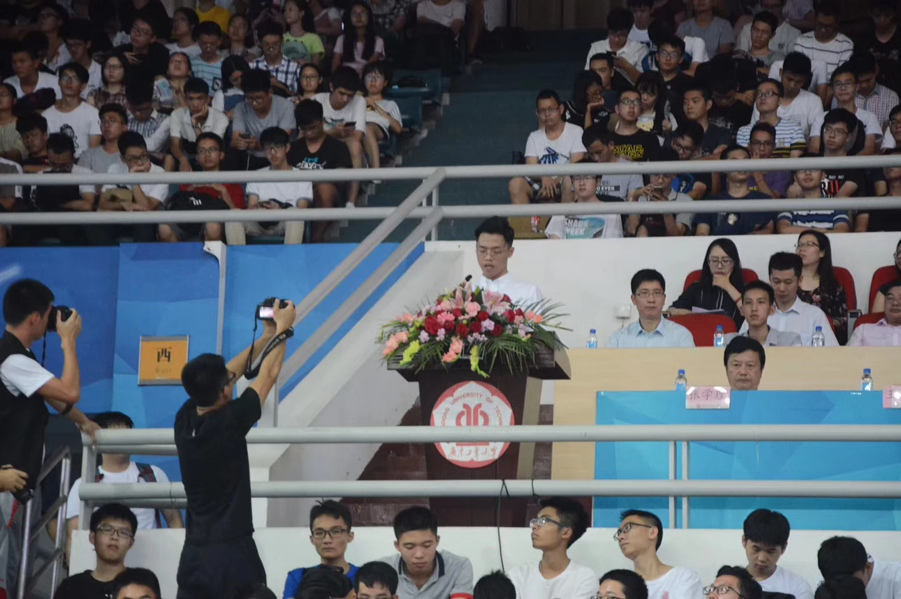

On September 17, 2017, I was invited to speak at the undergraduate opening ceremony of Guangdong University of Technology as an outstanding student representative. The ceremonies welcomed more than **8,000 incoming undergraduate students** across the university’s three campuses.

Sharing my experience with the new students, faculty members, and families was both an honor and a memorable part of my undergraduate experience.

Official coverage: [Guangdong University of Technology’s report on the 2017 undergraduate opening ceremony](https://www.gdut.edu.cn/info/1709/7390.htm).

  

    
    

      Speaking at the university opening ceremony as an outstanding student representative.
    

  

  

    
    

      At the 2017 opening ceremony with incoming undergraduate students.
    

  

