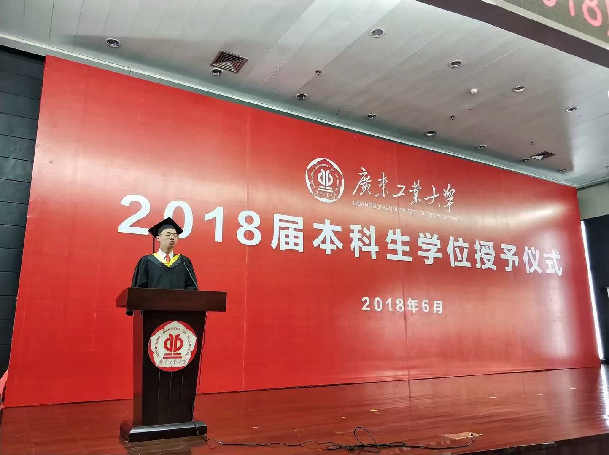
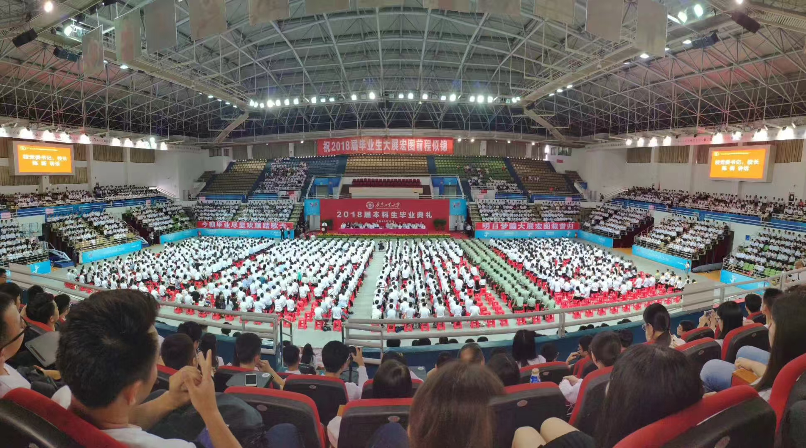

On June 27, 2018, I represented the graduating class and spoke at the undergraduate degree ceremony of the School of Electromechanical Engineering at Guangdong University of Technology.

I completed my Bachelor’s degree and was recognized as one of the **Top 10 Outstanding Graduates of the School of Electromechanical Engineering**. Addressing classmates, faculty members, and families made the ceremony especially meaningful and marked the conclusion of an important chapter in my life.

  

    
    

      Speaking at the 2018 undergraduate degree ceremony as an outstanding graduate.
    

  

  

    
    

      The 2018 undergraduate degree ceremony at Guangdong University of Technology.
    

  

