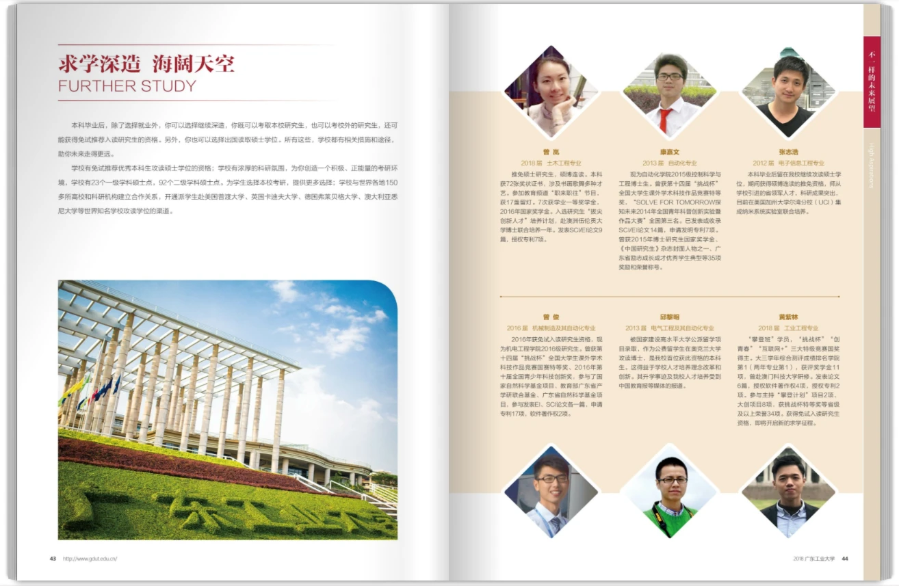

On September 1, 2018, I was selected to be featured in the **2018 Admission Guide of Guangdong University of Technology**.

The profile reflected on my undergraduate research, innovation and entrepreneurship activities, student leadership, and academic development at GDUT. The feature followed my recognition as an Outstanding Graduate of the university, an honor awarded to the top 1% of graduates.

  

    
    

      Featured in the 2018 Admission Guide of Guangdong University of Technology.
    

  

