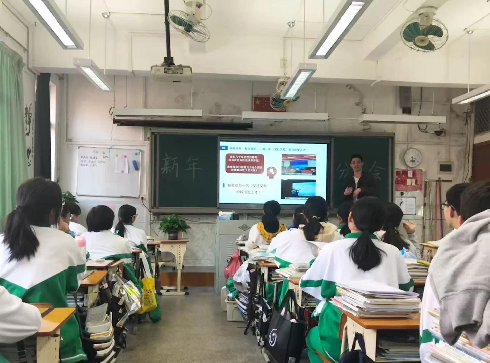
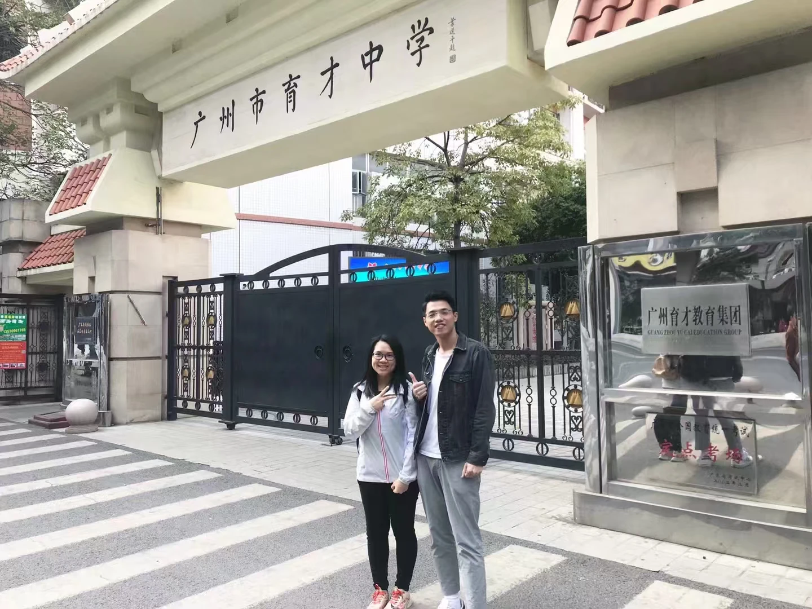

On December 12, 2019, I was delighted to be invited to [Guangzhou Yucai Middle School](https://en.wikipedia.org/wiki/Guangzhou_Yucai_Middle_School) to give a talk to junior high school students. 🎤

I shared stories from my own path in science and technology and encouraged the students to explore the future with curiosity and ambition.

Thank you to the teachers and students at Guangzhou Yucai Middle School for the warm welcome. It was a joy to meet such bright and curious students! 💗

  

    
    

      Sharing my experiences with junior high school students.
    

  

  

    
    

      At the entrance of Guangzhou Yucai Middle School.
    

  

