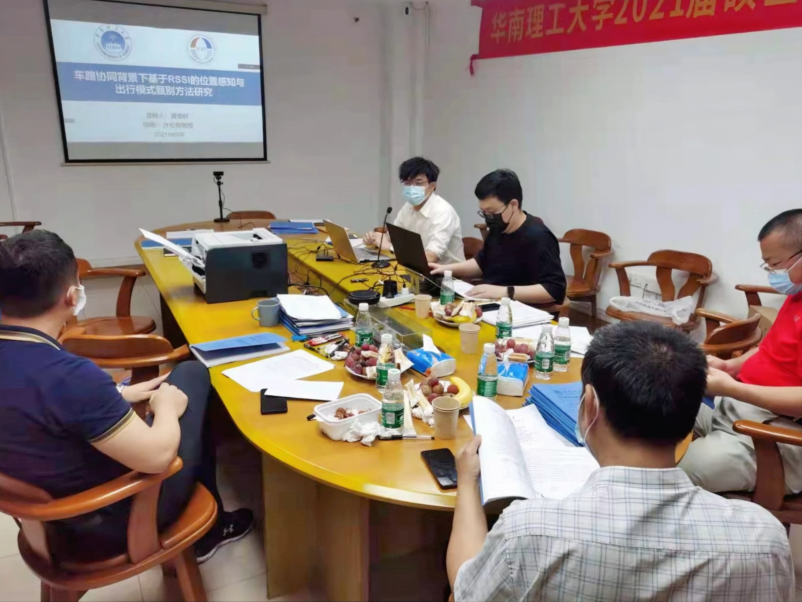
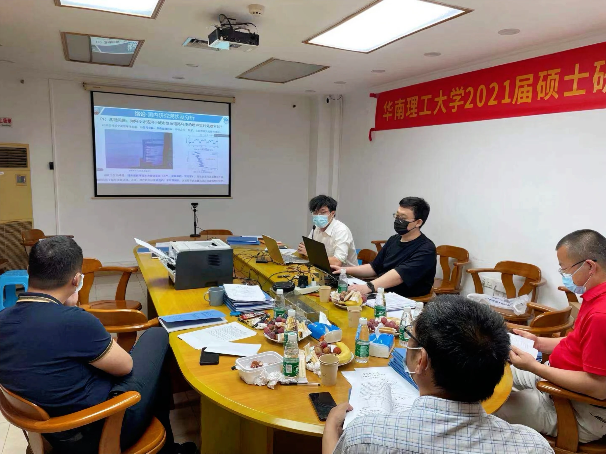
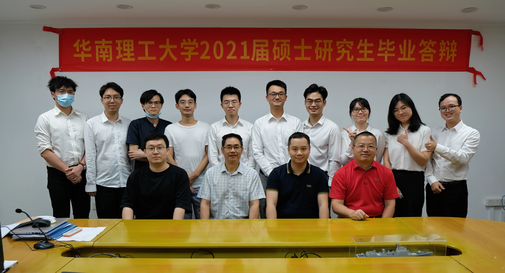
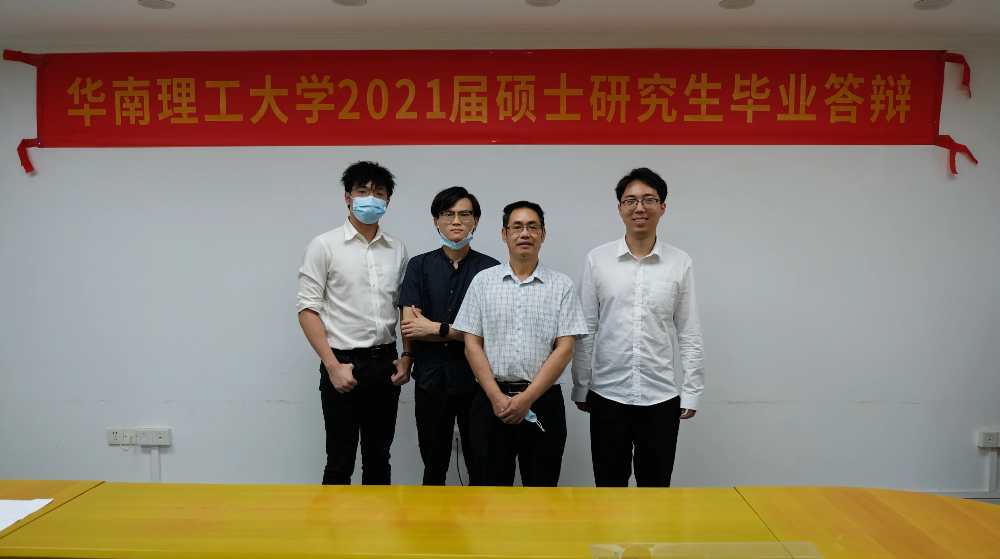

I successfully defended my Master’s thesis, ***Research on Location Awareness and Travel Mode Classification Based on RSSI in Intelligent Vehicle Infrastructure Cooperative System***, on June 6, 2021. The thesis received two peer reviews, both rated **Excellent**.

I am grateful to my advisors, committee members, labmates, friends, and family for their guidance and support throughout this journey.

<strong>Thesis materials:</strong> <a href="/assets/documents/thesis/zilin-huang-masters-thesis.pdf" target="_blank">Master’s thesis</a> · <a href="/assets/documents/thesis/zilin-huang-masters-thesis-defense-slides.pdf" target="_blank">Defense slides</a>

  

    
    

      Presenting my Master’s thesis during the defense.
    

  

  

    
    

      Discussing the research with the defense committee.
    

  

  

    
    

      With faculty members and fellow graduates after the defense.
    

  

  

    
    

      Celebrating the successful defense with faculty and colleagues.
    

  

