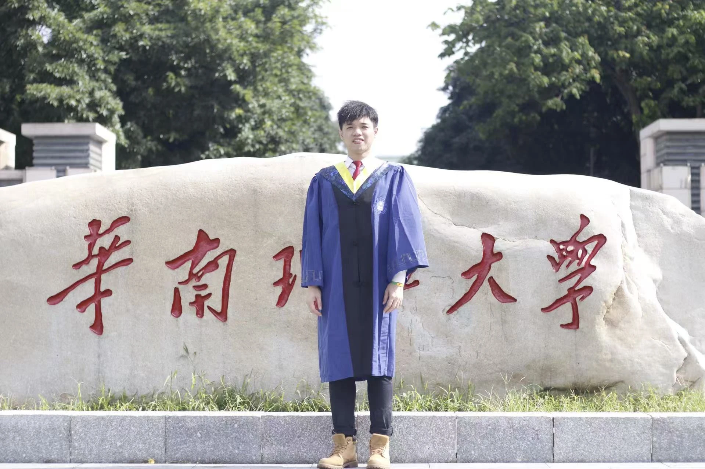
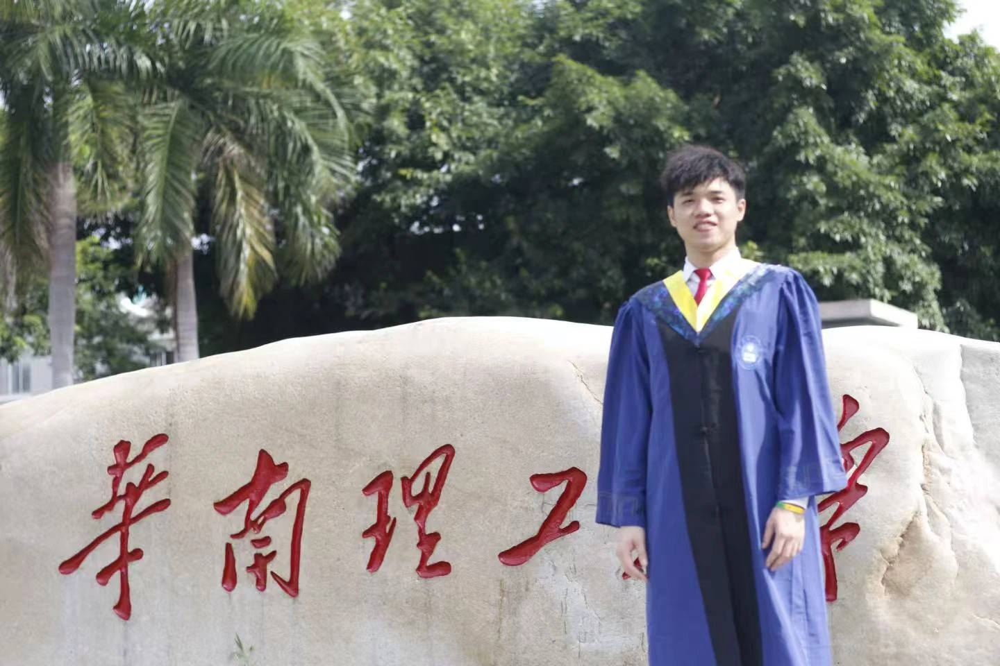
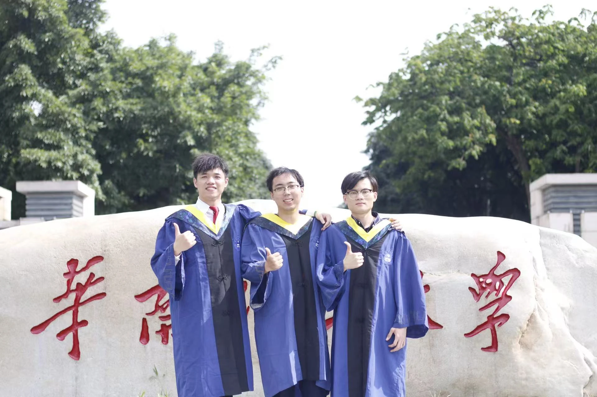
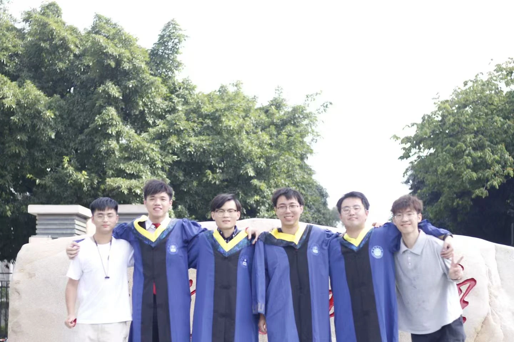

In the summer of 2021, I celebrated completing my Master’s degree at South China University of Technology. I was also honored to be recognized as an **Outstanding Master’s Degree Graduate of Guangdong Province**, an honor awarded to one graduate from our college of approximately 340 students. 🎓

This milestone marked the close of an important chapter filled with research, challenges, growth, and many unforgettable memories. I am deeply grateful to my advisors, teachers, labmates, friends, and family for their guidance and support throughout this journey.

It was especially meaningful to share this moment with the friends and classmates who made these years so memorable. Here’s to the next chapter! 💗

  

    
    

      Celebrating my Master’s graduation at South China University of Technology.
    

  

  

    
    

      Graduation memories on campus.
    

  

  

    
    

      Celebrating with classmates and friends.
    

  

  

    
    

      Sharing the day with friends.
    

  

