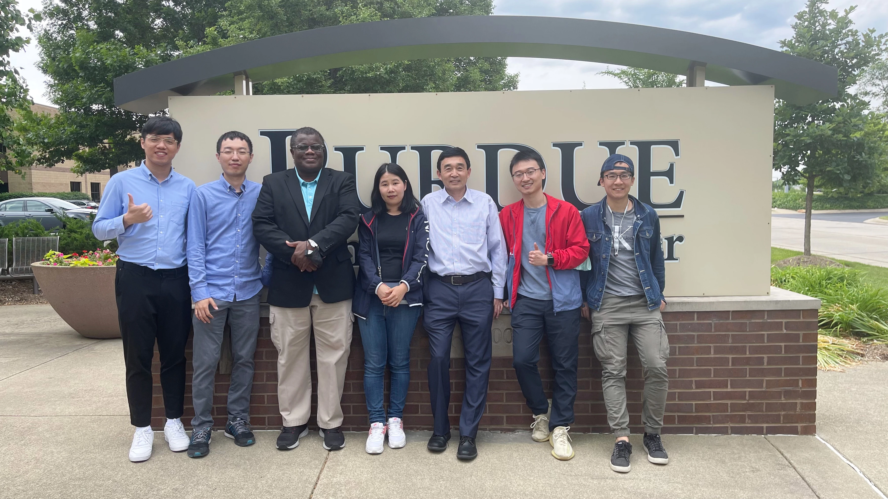
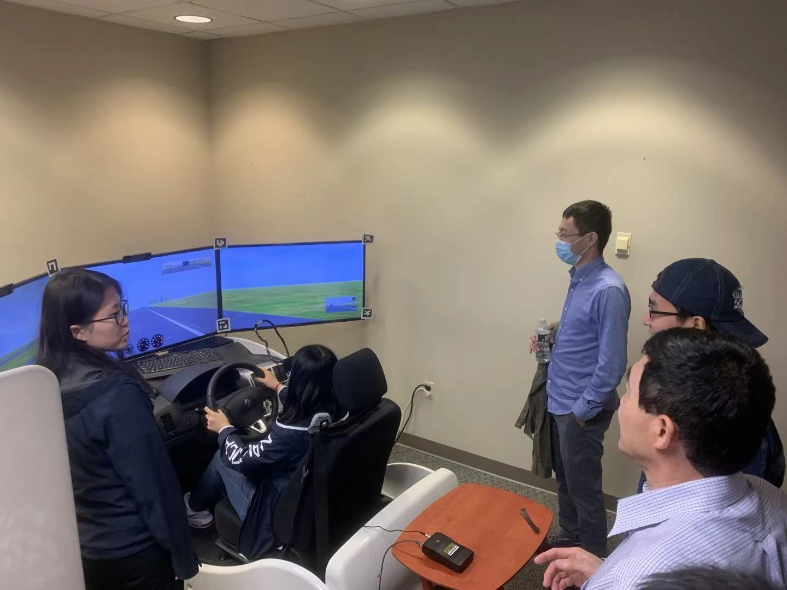

On June 10, 2022, we welcomed Prof. [Heng Wei](https://researchdirectory.uc.edu/p/weihg) from the University of Cincinnati to Purdue University and showcased our autonomous driving research, including a driving simulator demonstration. Thank you, Prof. Wei, for the visit and the insightful discussions! 🚗

  

    
    

      Group photo during Prof. Heng Wei's visit to Purdue.
    

  

  

    
    

      Demonstrating our research on the driving simulator.
    

  

