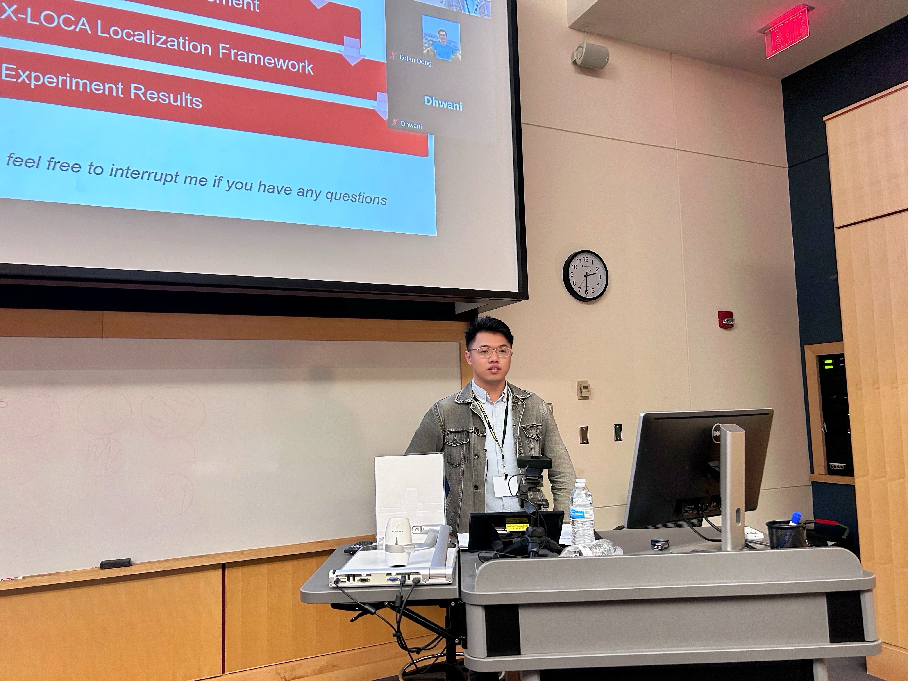
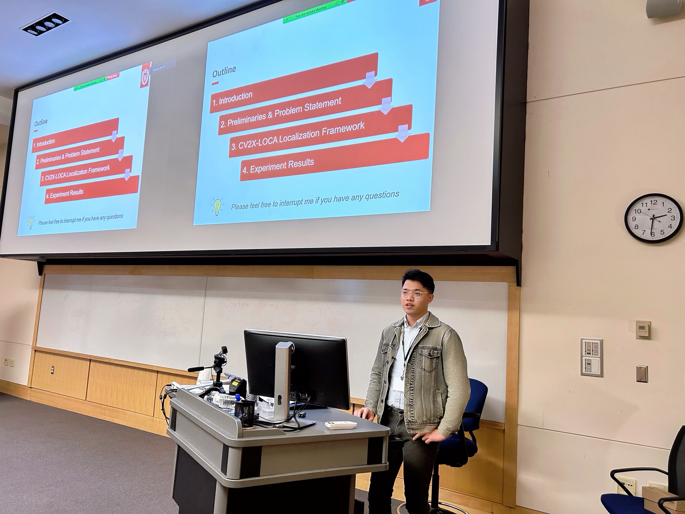
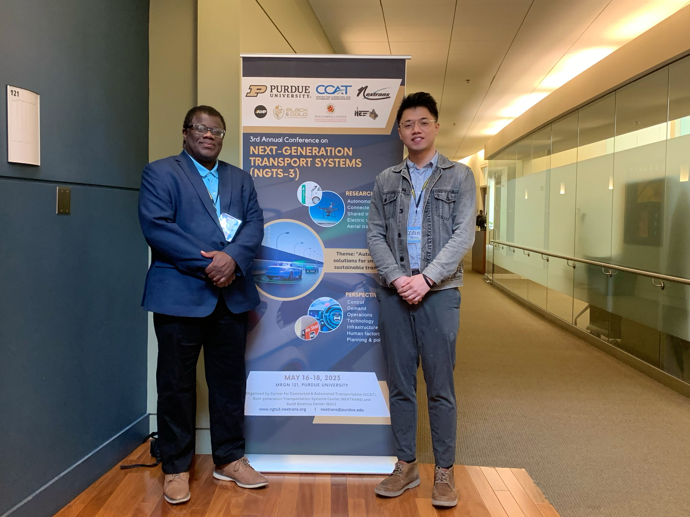
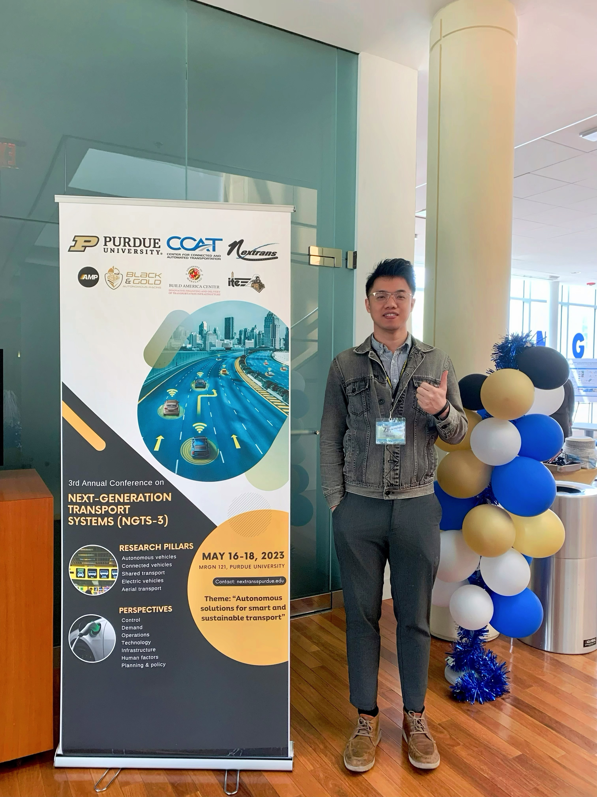

I attended the 3rd Annual Conference on Next-Generation Transport Systems, NGTS-3, held on May 18, 2023, in West Lafayette, Indiana. I presented our research, **“Roadside Unit-Enabled Cooperative Localization Framework for Autonomous Vehicles under GNSS-Denied Environments.”** The conference provided a valuable opportunity to exchange ideas with researchers and industry professionals working in transportation systems and autonomous driving.

  

    
    

      Presenting our cooperative localization research at NGTS-3.
    

  

  

    
    

      Discussing the cooperative localization workflow during the presentation.
    

  

  

    
    

      With a fellow attendee at NGTS-3.
    

  

  

    
    

      At the NGTS-3 conference venue at Purdue University.
    

  

