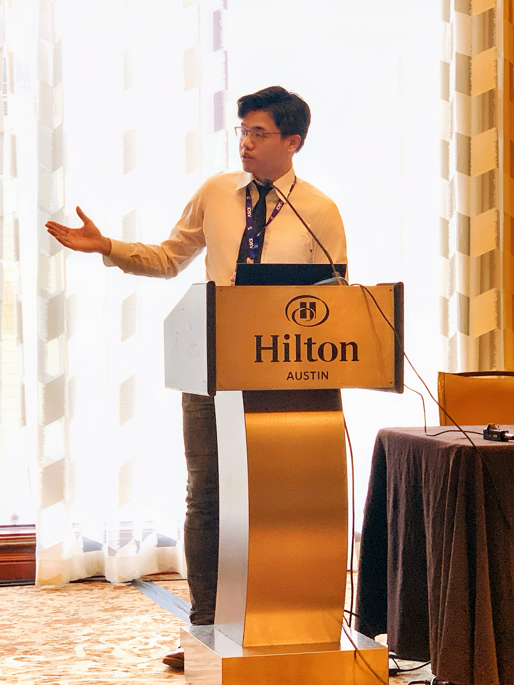
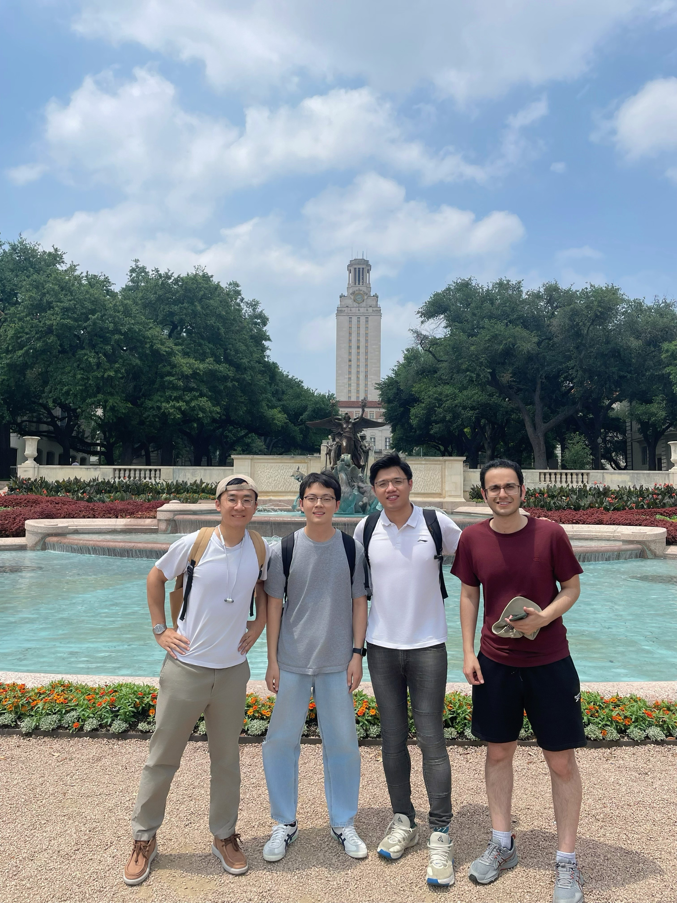
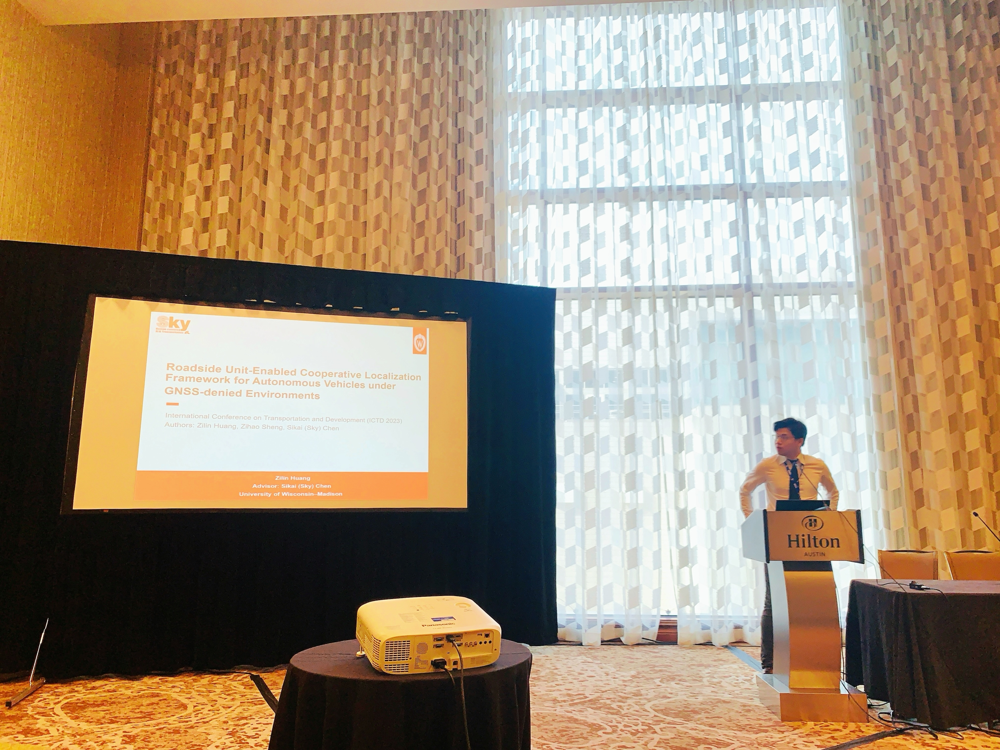
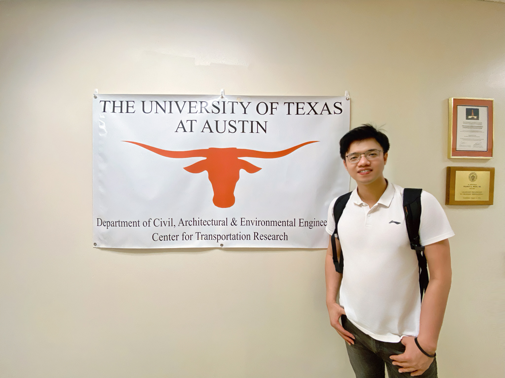
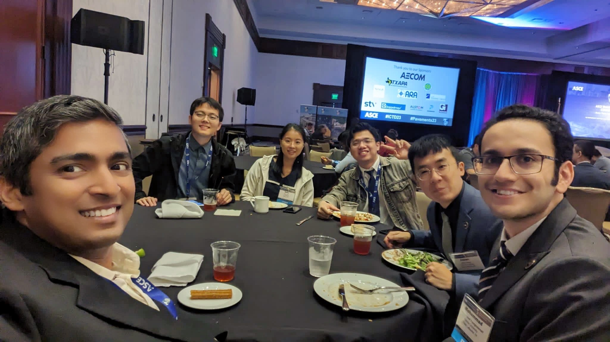
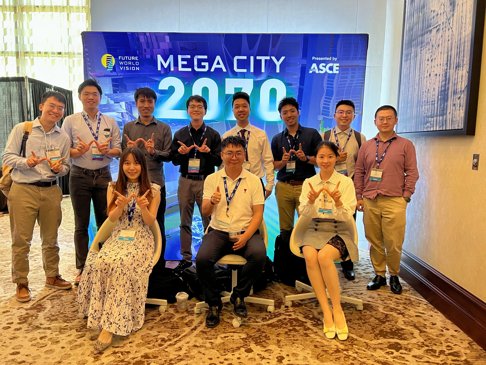
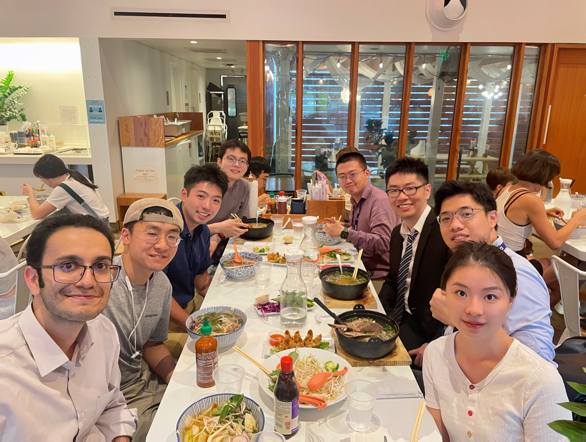

I attended the International Conference on Transportation and Development, ICTD 2023, held June 14 to 17, 2023, in Austin, Texas. I presented our research, **“Roadside Unit-Enabled Cooperative Localization Framework for Autonomous Vehicles under GNSS-Denied Environments.”** The conference provided a valuable forum for discussing emerging transportation challenges with researchers and industry professionals.

<!-- ICTD Conference photos -->

  

    
    

      Presenting our research at ICTD 2023.
    

  

  

    
    

      Visiting the University of Texas at Austin with colleagues.
    

  

  

    
    

      Delivering our research presentation at ICTD 2023.
    

  

  

    
    

      Visiting the Center for Transportation Research at UT Austin.
    

  

  

    
    

      Dining with conference colleagues during ICTD 2023.
    

  

  

    
    

      With colleagues at ICTD 2023.
    

  

  

    
    

      Sharing a meal with colleagues during ICTD 2023.
    

  

