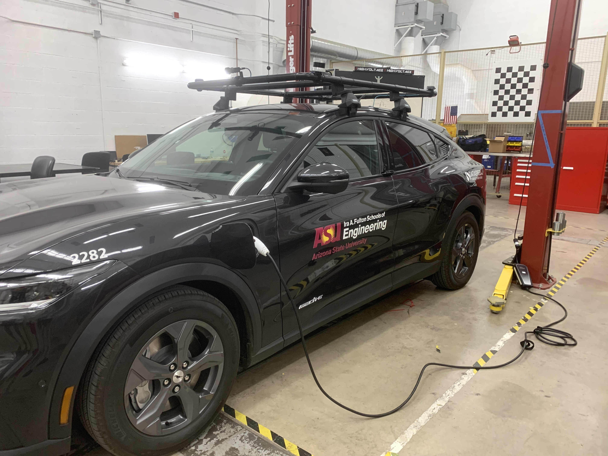
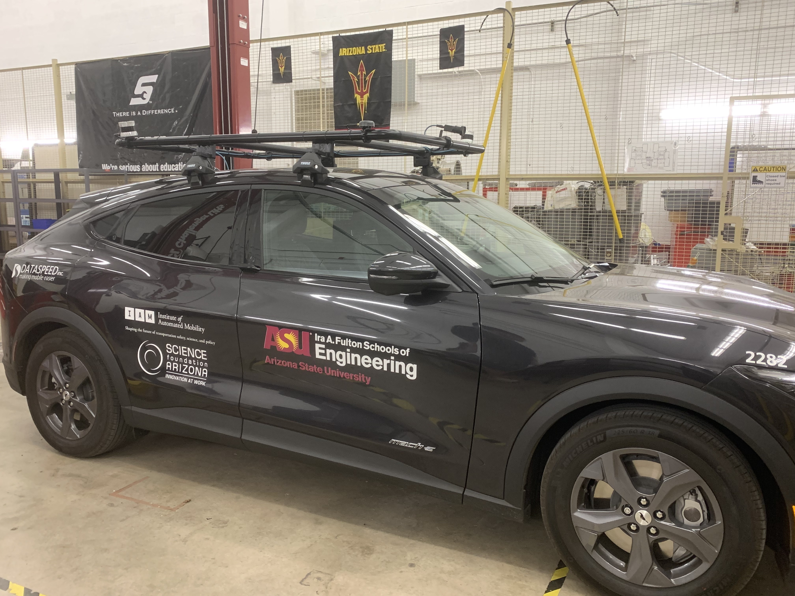
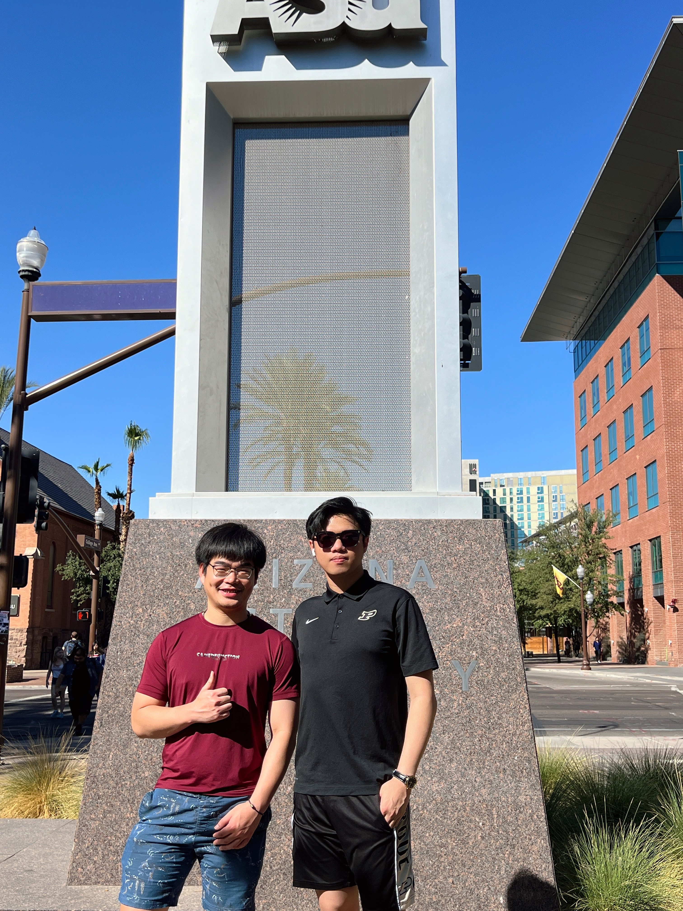

I visited the [Battery Electric & Intelligent Vehicle (BELIV) Lab](https://faculty.engineering.asu.edu/jzhao/) at Arizona State University on October 17, 2023. I explored the lab’s autonomous vehicle platforms and learned about its research in connected and automated vehicles, battery electric vehicles, and smart mobility systems. The BELIV Lab is part of The Polytechnic School within the Ira A. Fulton Schools of Engineering and is led by Prof. Junfeng Zhao.

  

    
    

      A sensor-equipped autonomous vehicle in the BELIV Lab.
    

  

  

    
    

      The BELIV Lab’s autonomous research vehicle.
    

  

  

    
    

      With a colleague during the visit to Arizona State University.
    

  

