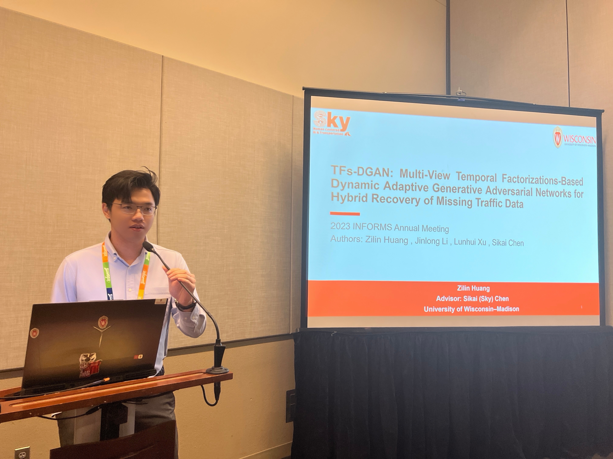
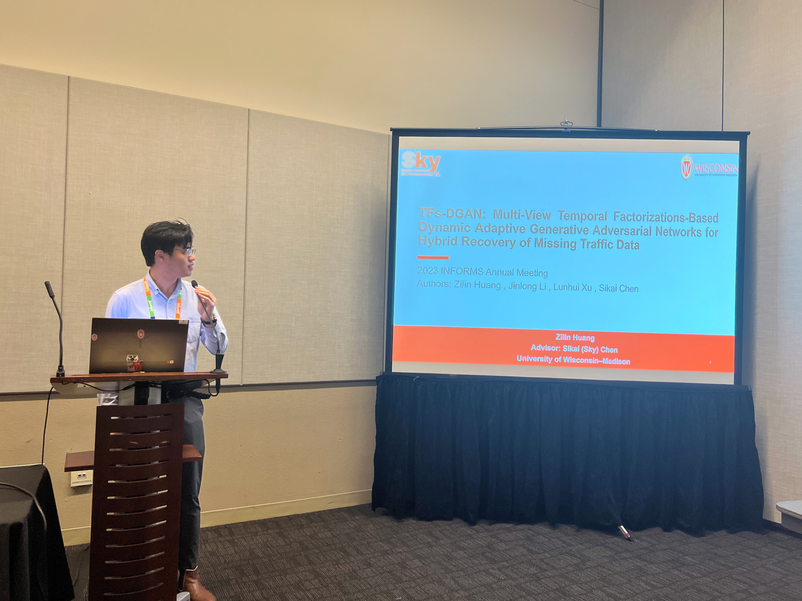
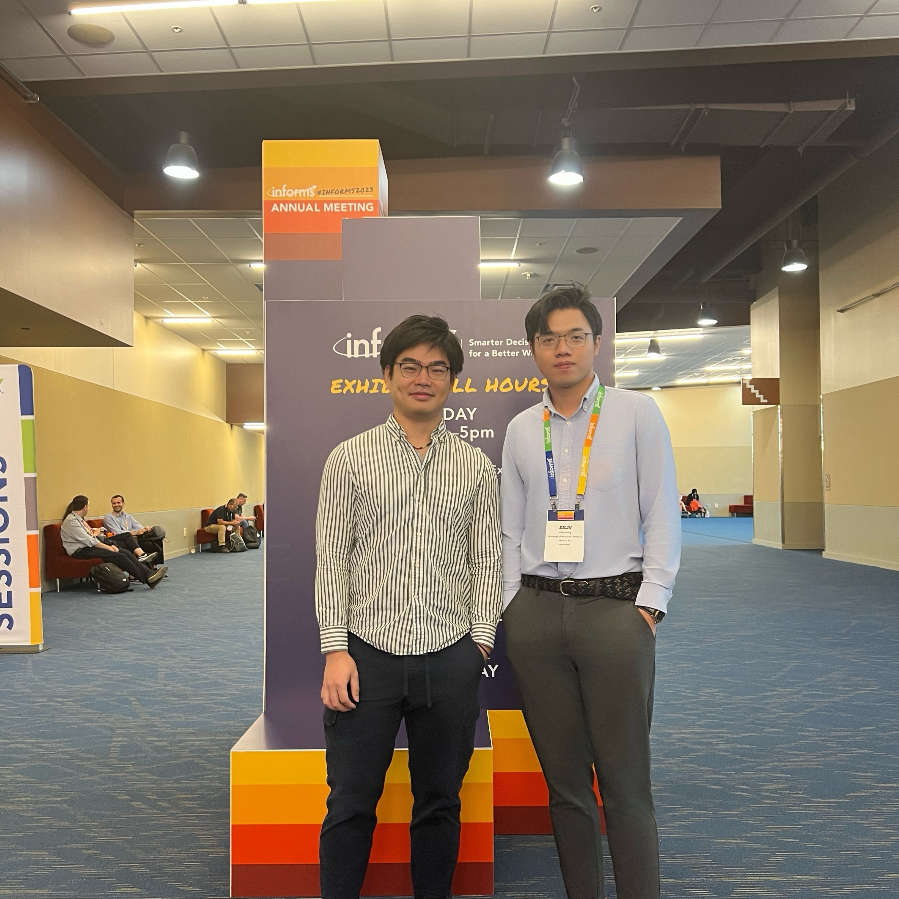

I attended the 2023 INFORMS Annual Meeting, held October 15 to 18, 2023, in Phoenix, Arizona. I presented our research, **“TFs-DGAN: Multi-View Temporal Factorizations-Based Dynamic Adaptive Generative Adversarial Networks for Hybrid Recovery of Missing Traffic Data,”** and discussed the work with researchers and practitioners in operations research and management science.

  

    
    

      Presenting our traffic data recovery research at INFORMS 2023.
    

  

  

    
    

      Explaining our traffic data recovery framework at INFORMS 2023.
    

  

  

    
    

      With a colleague at the 2023 INFORMS Annual Meeting.
    

  

