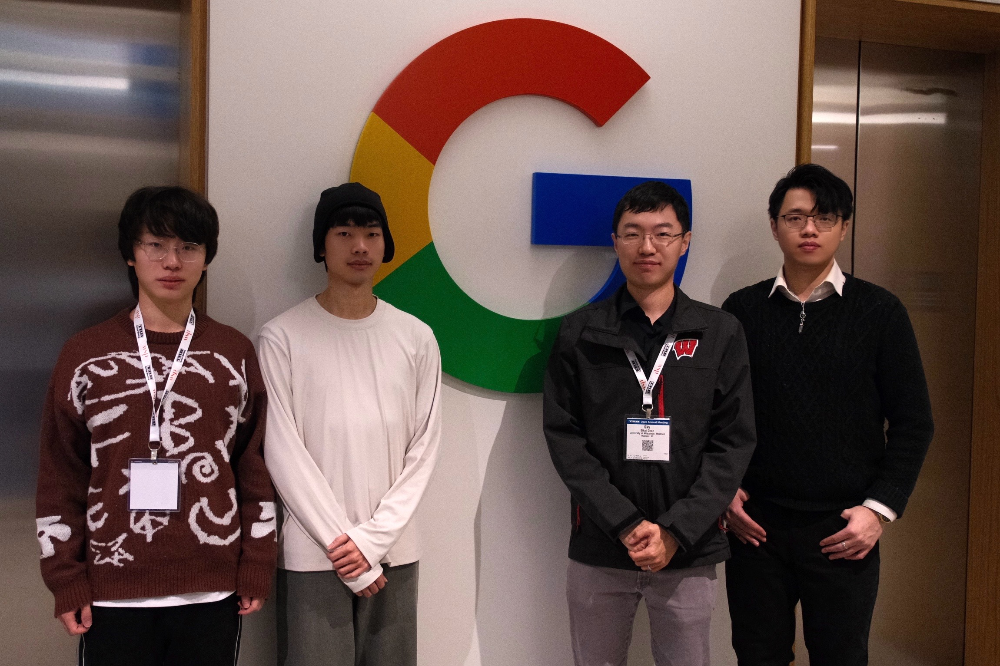
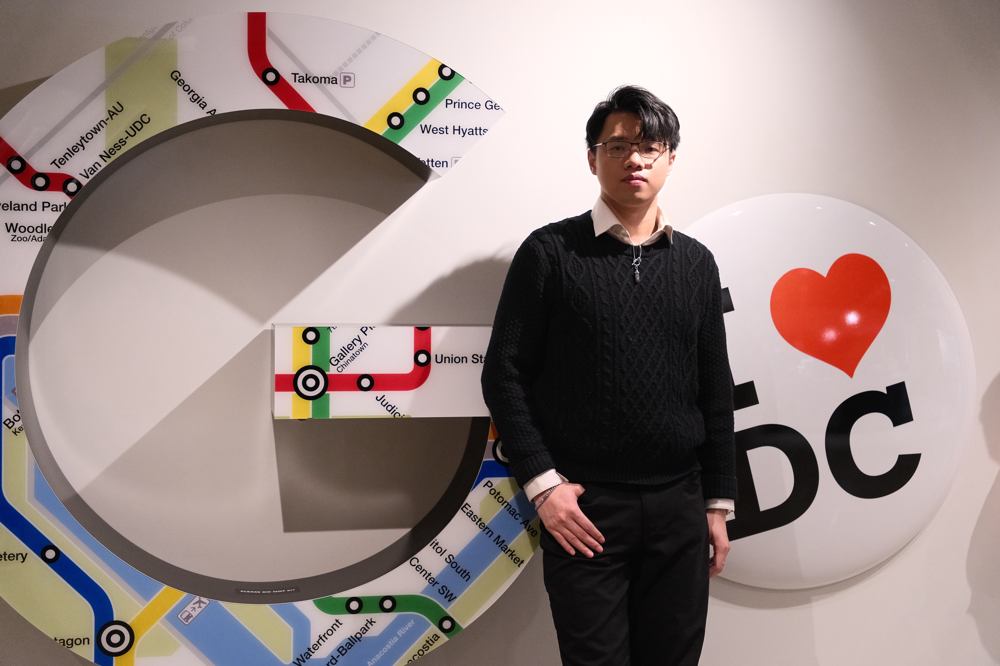
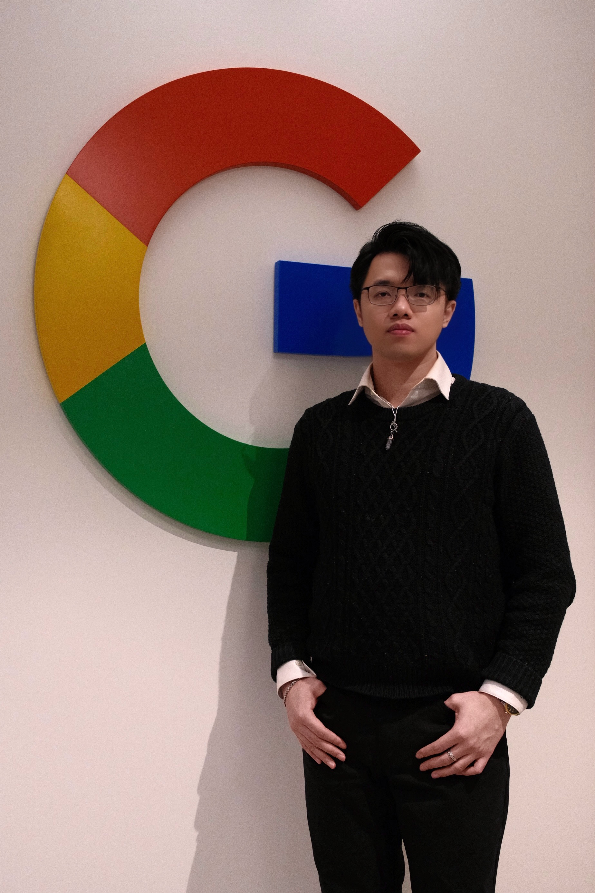

I was invited to visit Google’s office in Washington, D.C., on January 10, 2025. During the visit, I met with members of Google’s research team to discuss potential collaborations and exchange perspectives on emerging research and technology.

  

    
    

      With members of Google’s research team in Washington, D.C.
    

  

  

    
    

      At Google’s Washington, D.C., office.
    

  

  

    
    

      At the Google office in Washington, D.C.
    

  

