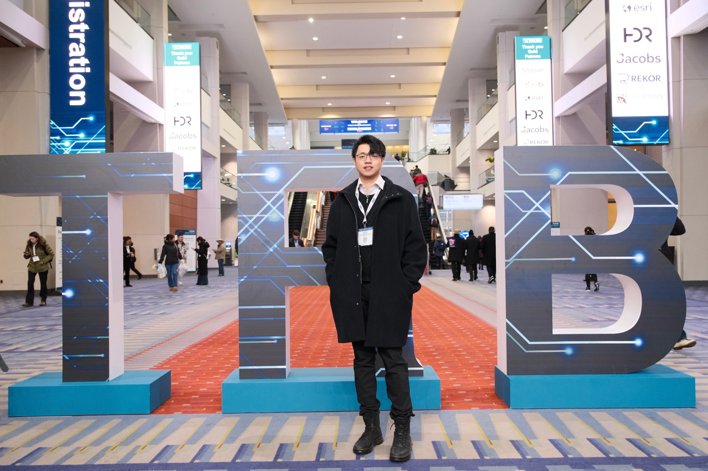
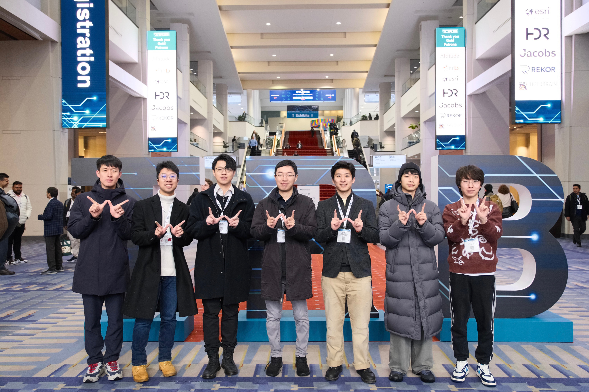
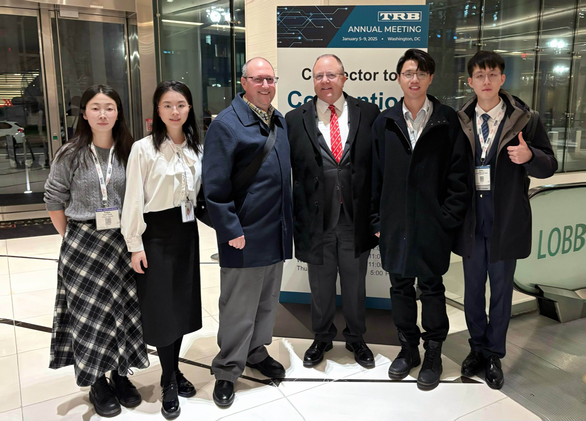
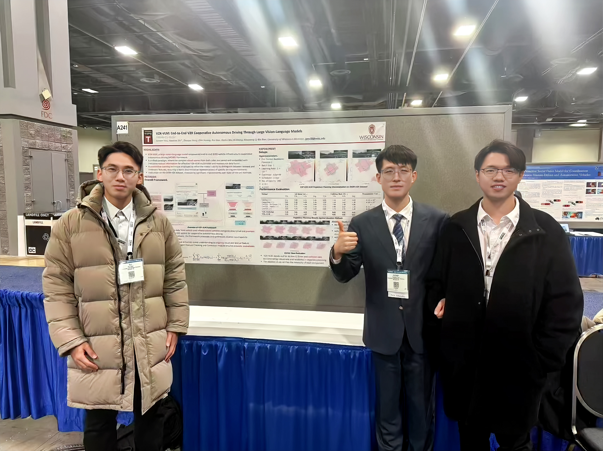
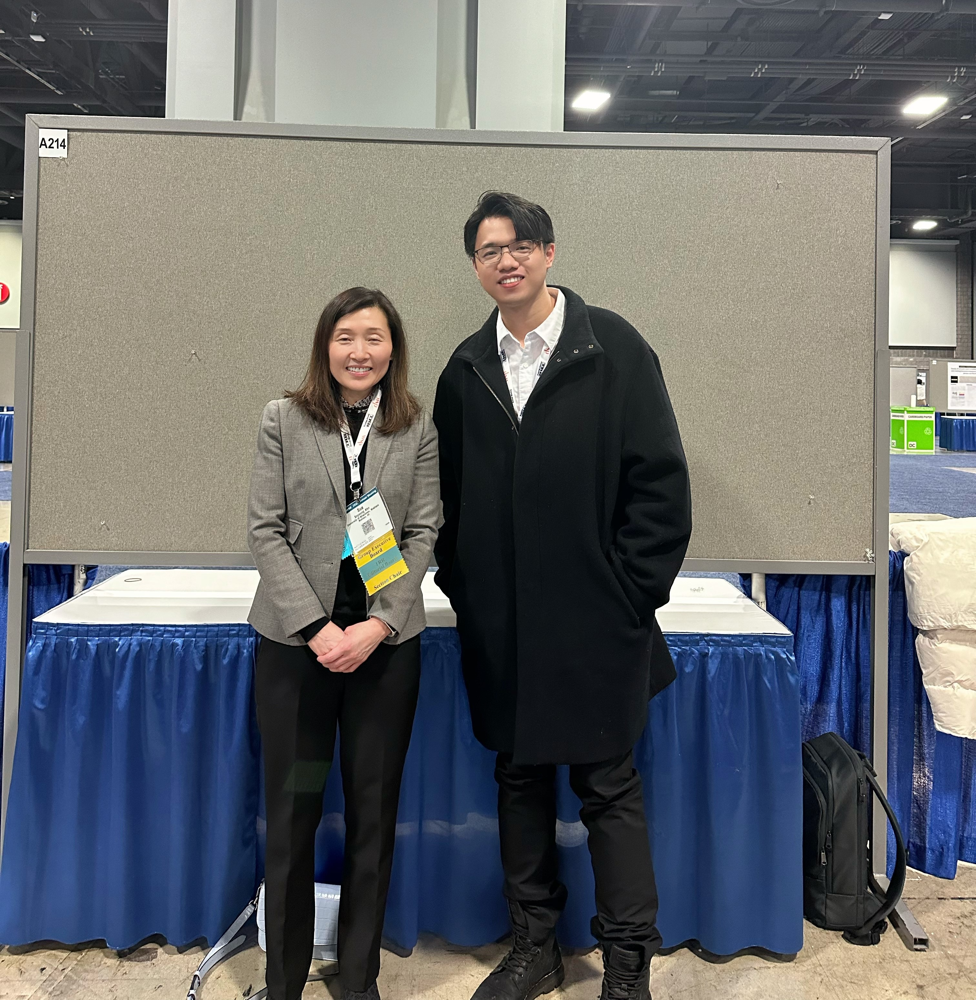

I attended the Transportation Research Board (TRB) 104th Annual Meeting, held January 5 to 9, 2025, in Washington, D.C. Our team presented research in multiple poster and lectern sessions and exchanged ideas with transportation professionals from around the world.

  

    
    

      At the TRB 2025 Annual Meeting.
    

  

  

    
    

      With Sky-Lab members at TRB 2025.
    

  

  

    
    

      With colleagues at the TRB 2025 Annual Meeting.
    

  

  

    
    

      With colleagues in front of our research poster.
    

  

  

    
    

      With a fellow researcher during the poster session.
    

  

