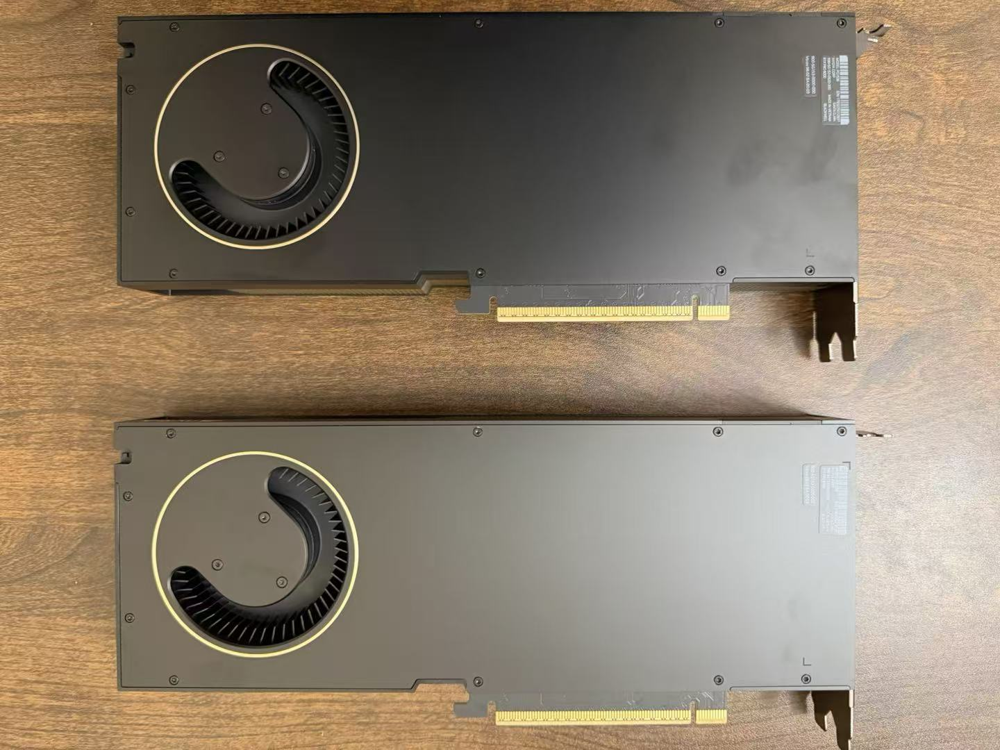
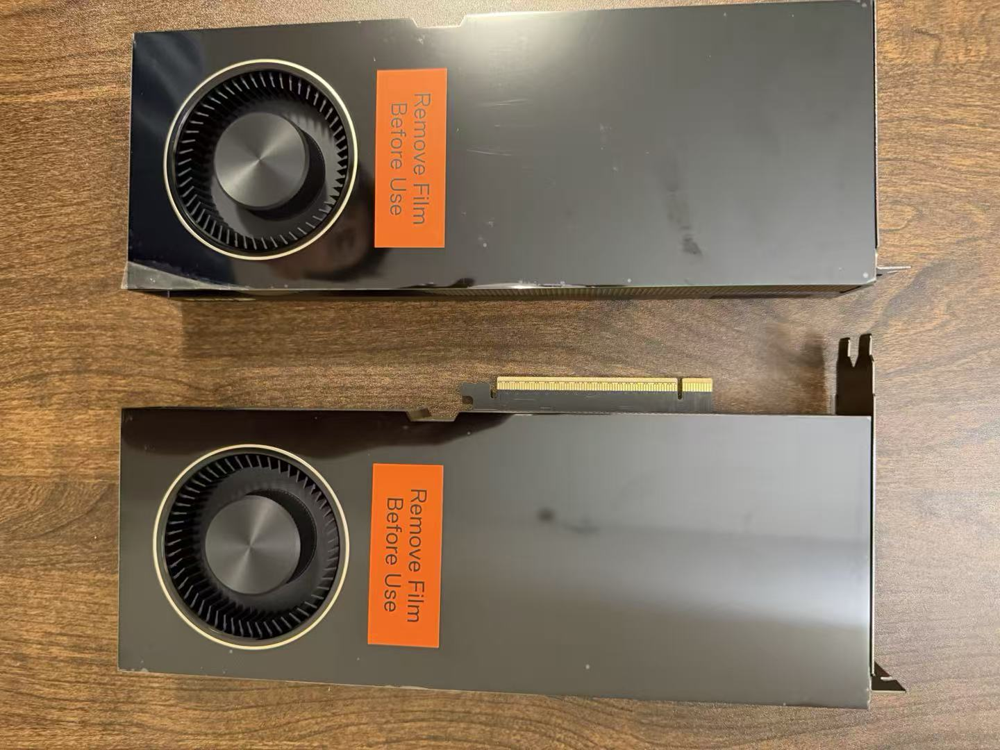
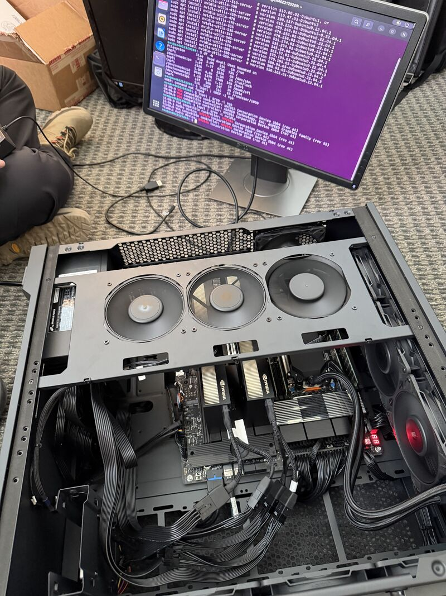
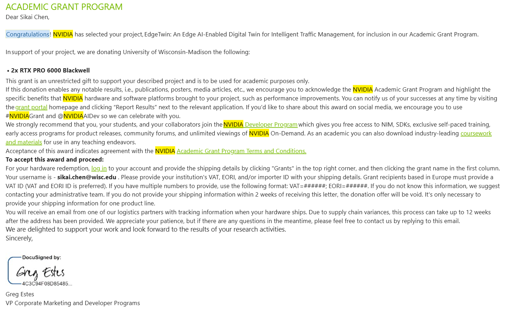
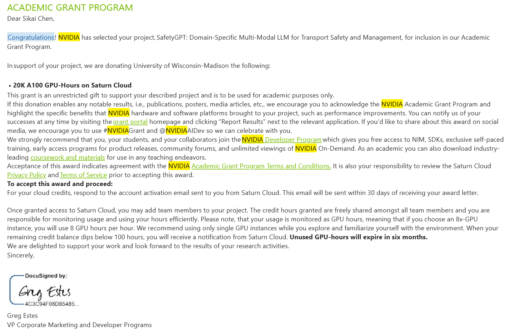

Two of our projects received support from the NVIDIA Academic Grant Program:

NVIDIA generously awarded the University of Wisconsin-Madison the following resources:

1. **20,000 A100 GPU-Hours on Saturn Cloud** (valued at $25,800 USD) for our project **SafetyGPT: Domain-Specific Multi-Modal LLM for Transport Safety and Management**
2. **Two RTX PRO 6000 Blackwell GPUs** (valued at $18,000 USD) for our project **EdgeTwin: An Edge AI-Enabled Digital Twin for Intelligent Traffic Management**

These resources, with a combined value of **$43,800 USD**, will support our ongoing research on specialized AI models for transportation safety and intelligent traffic management.

  

    
    

      The two RTX PRO 6000 Blackwell GPUs received for the EdgeTwin project.
    

  

  

    
    

      The GPUs before installation in our research workstation.
    

  

  

    
    

      Setting up the NVIDIA GPU hardware for our research workstation.
    

  

  

    
    

      NVIDIA Academic Grant Program award notice for the EdgeTwin project.
    

  

  

    
    

      NVIDIA Academic Grant Program award notice for the SafetyGPT project.
    

  

We extend our sincere gratitude to NVIDIA for their generous support and look forward to sharing the research outcomes these grants will help us achieve!
