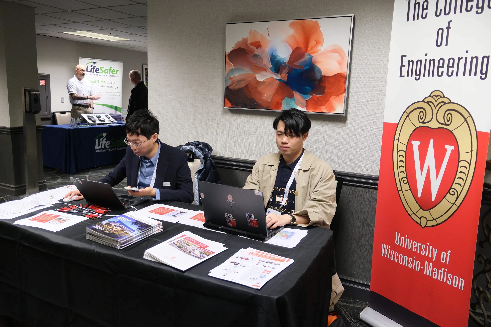
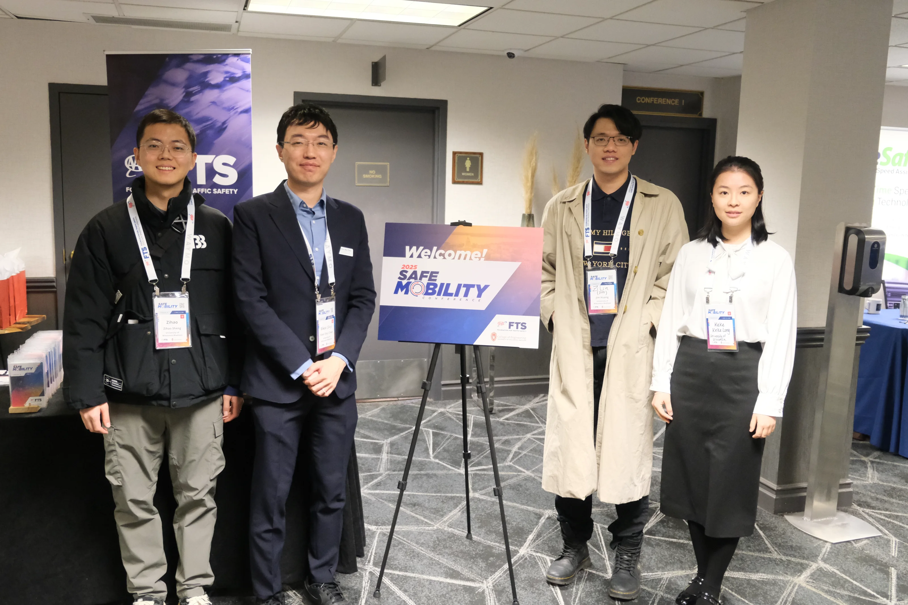
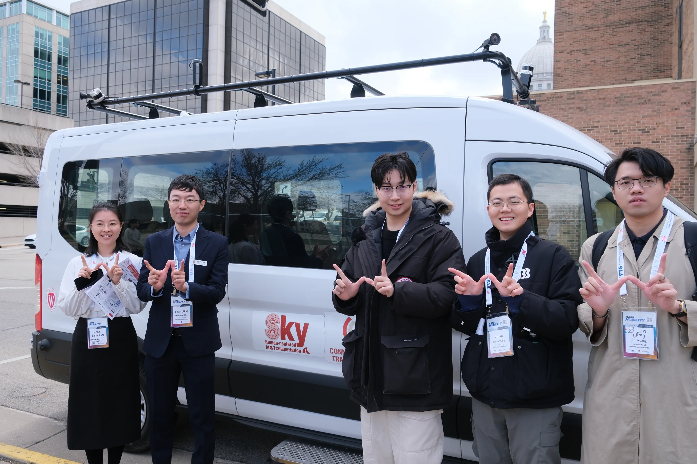
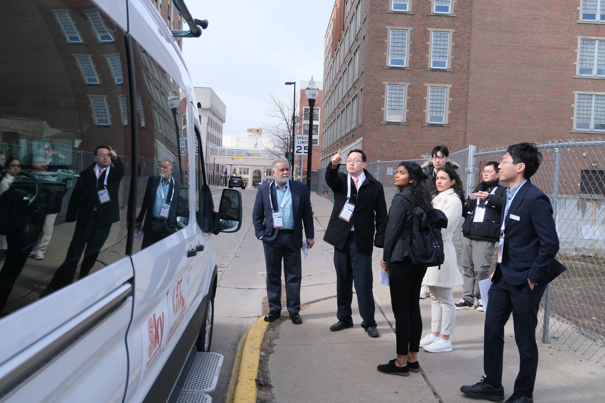
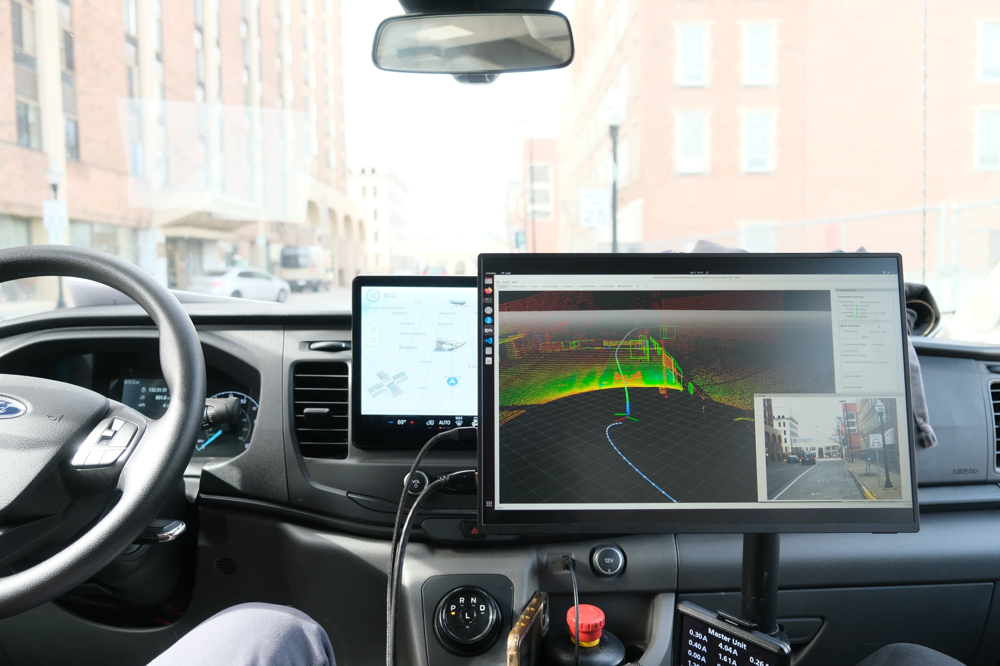
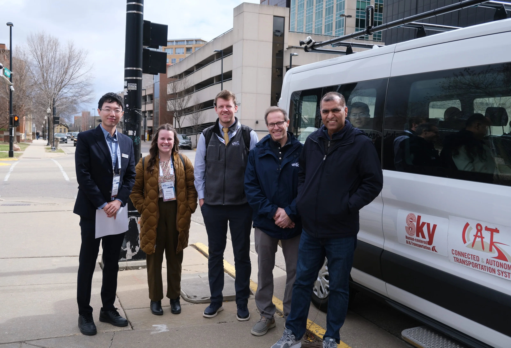
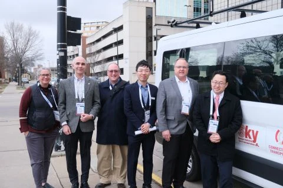
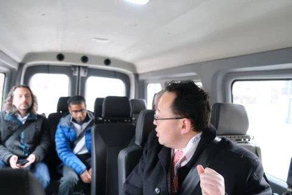
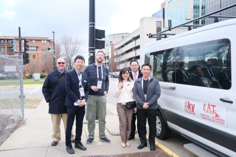
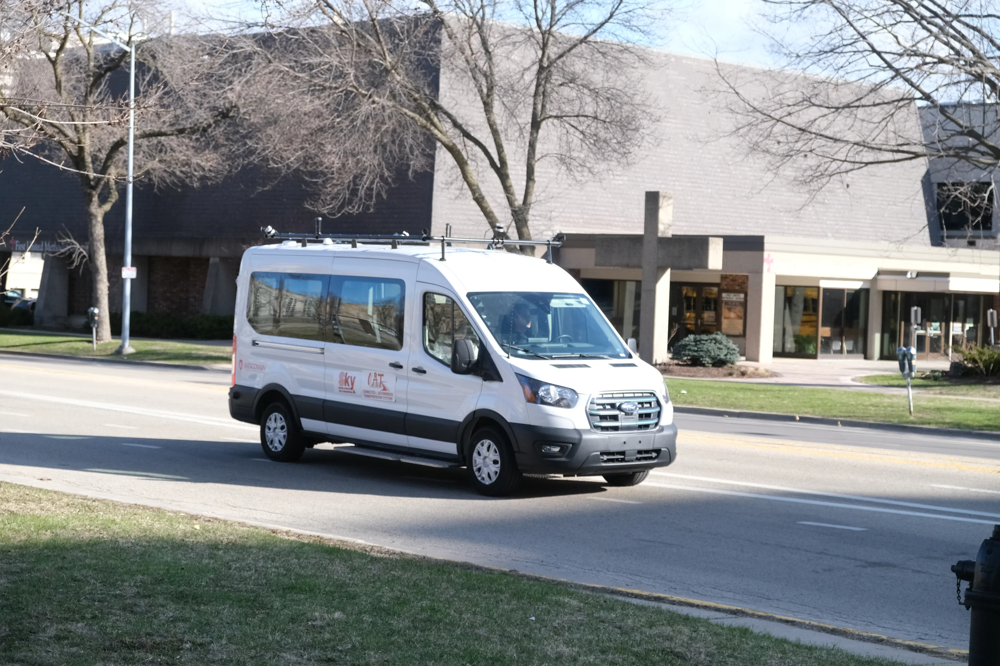

On April 7, 2025, our team at [Sky-Lab](https://sky-lab-uw.github.io/), together with colleagues from the [CATS Lab](https://catslab.engr.wisc.edu/), hosted a live demonstration of our electric autonomous research van for more than 50 attendees at the **2025 AAA Safe Mobility Conference** in Madison, Wisconsin. The audience included transportation professionals from industry, academia, and public agencies.

During the demonstration, we introduced the vehicle’s integrated hardware and software systems and showcased technologies developed by our team, including autonomous driving, path following, collision avoidance, and traffic-signal recognition. Attendees also viewed the onboard sensing and computing setup and experienced the system operating in a real-world environment.

See [Prof. Xiaopeng (Shaw) Li’s LinkedIn post about the demonstration](https://www.linkedin.com/posts/xiaopeng-shaw-li-5997b040_digitaltwin-workzone-cav-activity-7316458671931023361-L8AI).

  

    
    

      At the UW–Madison exhibition table during the conference.
    

  

  

    
    

      With colleagues at the 2025 AAA Safe Mobility Conference.
    

  

  

    
    

      Sky-Lab members with our electric autonomous research van.
    

  

  

    
    

      Prof. Xiaopeng Li introducing the vehicle’s sensing, computing, and control systems to attendees.
    

  

  

    
    

      The onboard perception and visualization interface during the demonstration.
    

  

  

    
    

      Prof. Sikai (Sky) Chen with conference attendees after the live demonstration.
    

  

  

    
    

      Prof. Xiaopeng Li with conference attendees after the live demonstration.
    

  

  

    
    

      Prof. Xiaopeng Li introducing the vehicle’s onboard systems during the demonstration.
    

  

  

    
    

      Prof. Sikai (Sky) Chen and Prof. Xiaopeng Li with conference participants.
    

  

  

    
    

      Our electric autonomous research van during the live demonstration.
    

  

