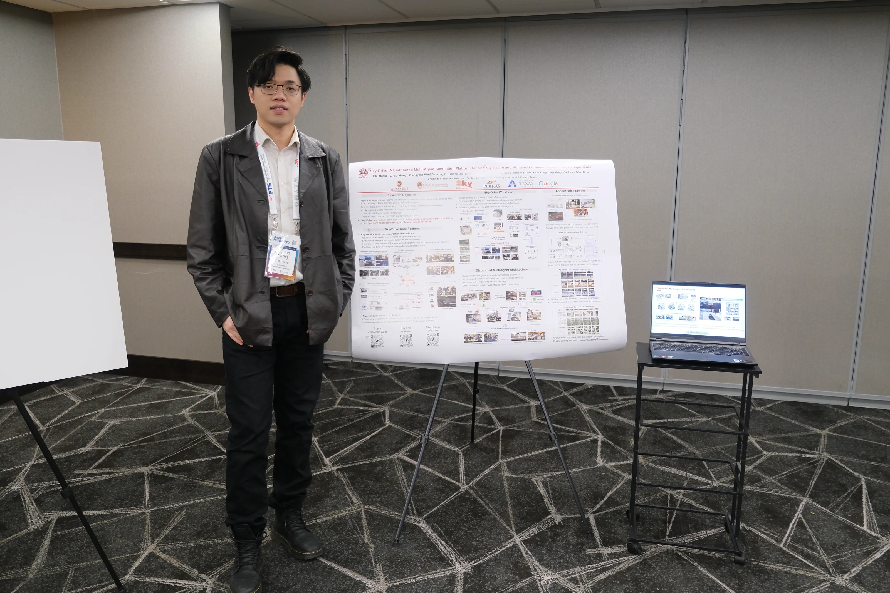
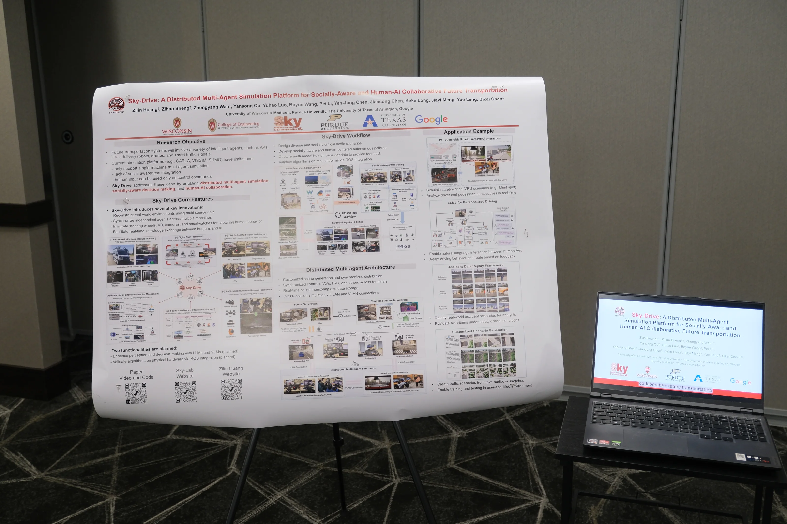
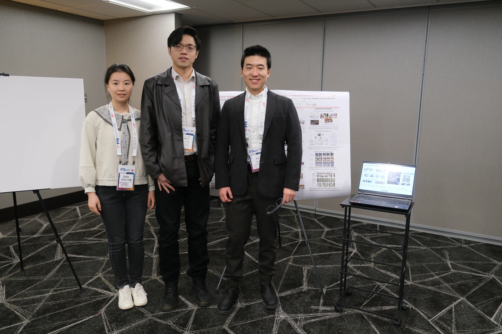
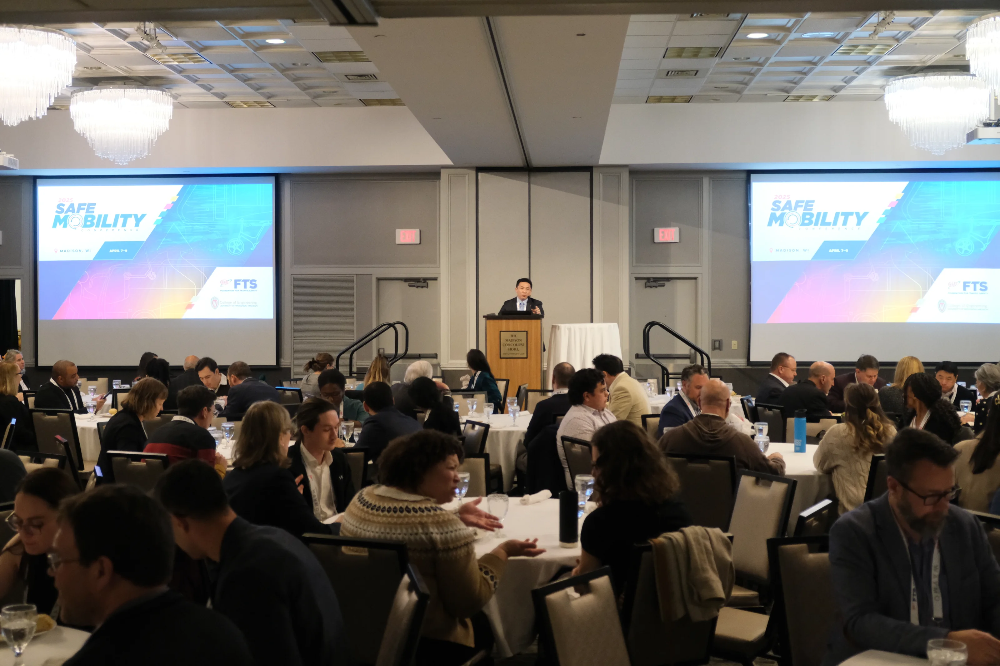
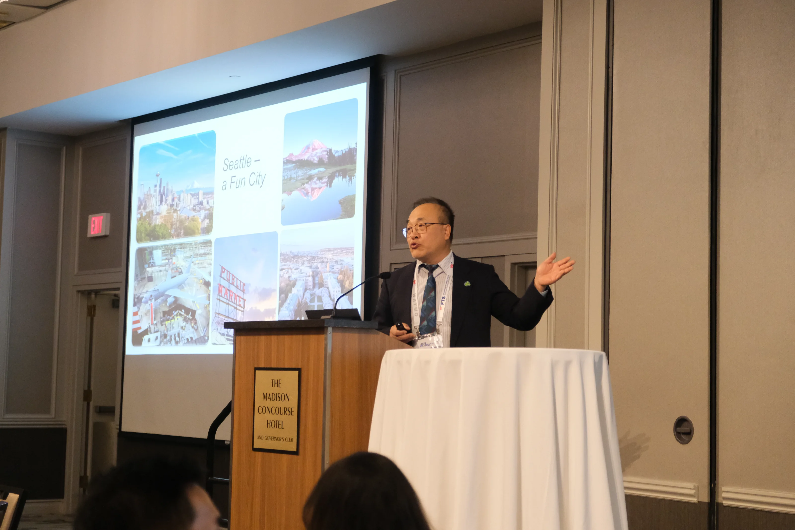
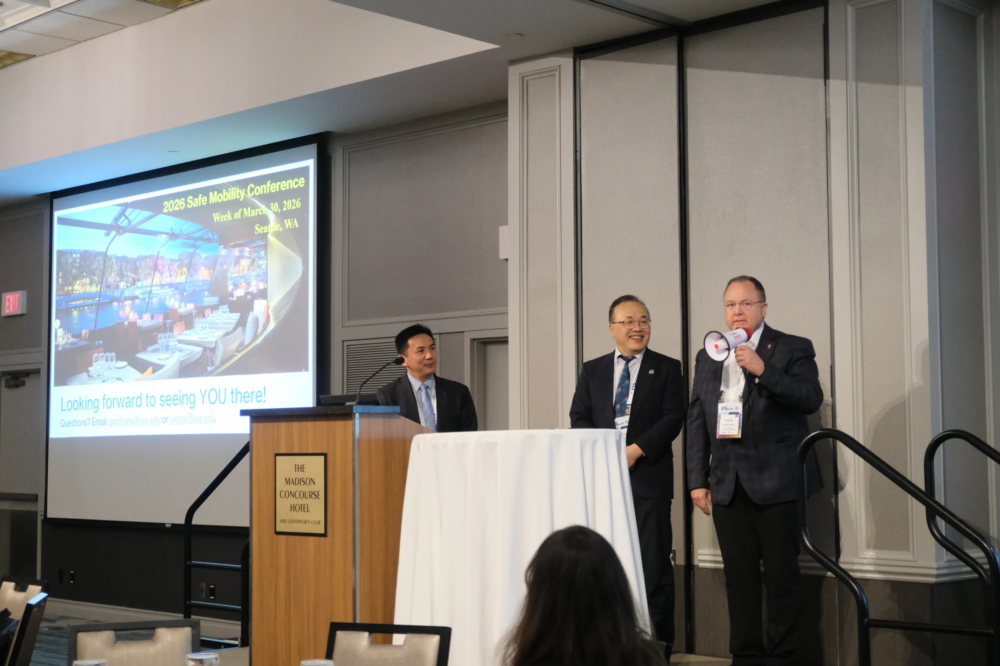

On April 9, 2025, I presented [**Sky-Drive**](https://arxiv.org/abs/2504.18010) during the poster session at the **2025 AAA Safe Mobility Conference** in Madison, Wisconsin. The session provided a valuable opportunity to introduce our work and exchange ideas with transportation professionals from industry, academia, and public agencies.

Sky-Drive is a distributed multi-agent simulation platform designed for human–AI collaborative and socially aware future transportation. The poster highlighted its synchronized simulation of autonomous vehicles, human-driven vehicles, and pedestrians across multiple terminals, as well as its support for human intervention, safety-critical scenario generation, and real-time monitoring.

See the official [2025 Safe Mobility Conference archive](https://safemobilityconference.org/archives/2025/) and [conference proceedings](https://aaafoundation.org/research/2025-safe-mobility-conference-proceedings/).

  

    
    

      Presenting Sky-Drive at the 2025 AAA Safe Mobility Conference.
    

  

  

    
    

      The Sky-Drive poster and interactive demonstration display.
    

  

  

    
    

      With Keke Long and Pei Li at the Sky-Drive poster session.
    

  

  

    
    

      The 2025 AAA Safe Mobility Conference in Madison.
    

  

  

    
    

      A plenary presentation during the conference.
    

  

  

    
    

      Closing remarks at the 2025 AAA Safe Mobility Conference.
    

  

