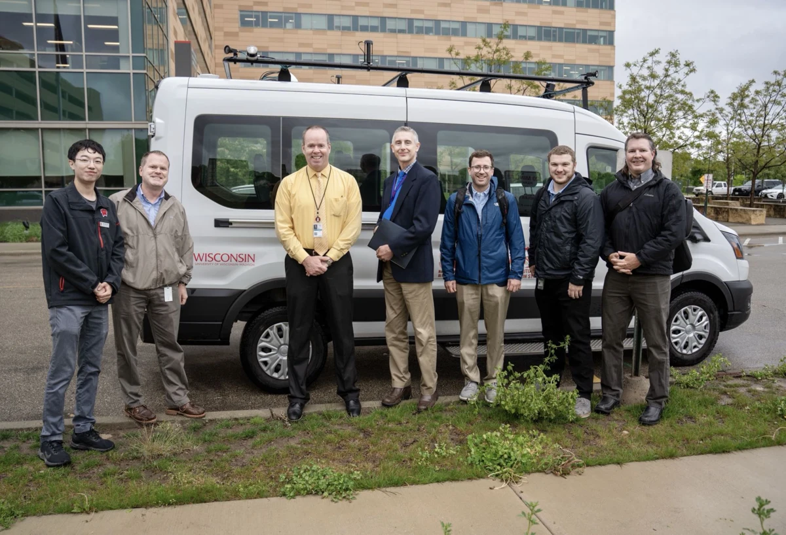
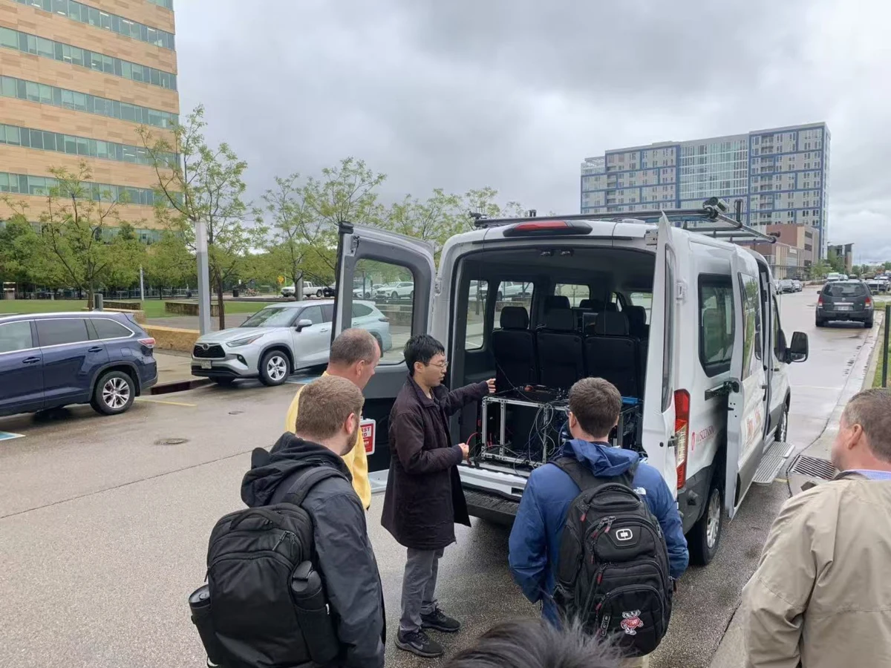
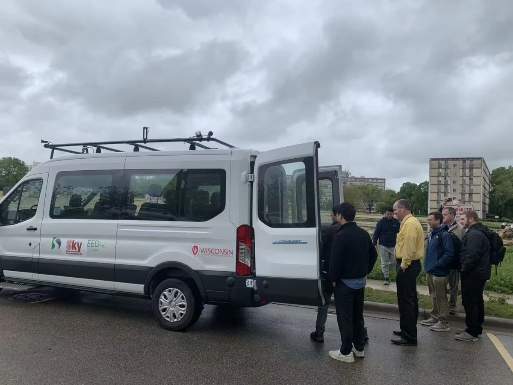
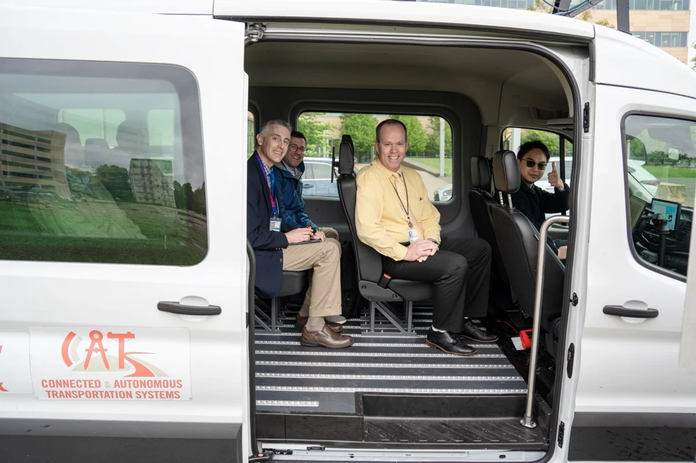
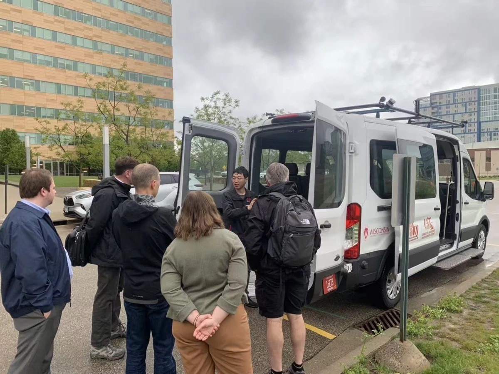

On May 21, 2025, our team at [Sky-Lab](https://sky-lab-uw.github.io/), together with colleagues from the [CATS Lab](https://catslab.engr.wisc.edu/), presented our latest research on connected and automated vehicles (CAVs) at the spring meeting of the **Wisconsin Automated Vehicle External (WAVE) Advisory Committee** in Madison, Wisconsin. The audience included WisDOT Deputy Secretary Scott Lawry, colleagues at WisDOT, and transportation partners from industry and academia.

Following the workshop *CAV Technologies and Applications: A Transportation Stakeholders Resource Guide*, we gave a live demonstration of our autonomous research van. We introduced the vehicle’s integrated sensing, computing, communication, and control systems and discussed how the platform supports autonomous-driving research, data collection, and real-world testing. Participants also toured the vehicle and experienced its onboard systems.

See [WisDOT’s official coverage of the Spring 2025 WAVE meeting](https://wisconsindot.gov/Pages/about-wisdot/newsroom/news-rel/052125-WAVE-meeting.aspx).

  

    
    

      Prof. Sikai (Sky) Chen with WAVE meeting participants beside our autonomous research van.
    

  

  

    
    

      Prof. Sikai (Sky) Chen introducing the vehicle’s onboard sensing and computing systems.
    

  

  

    
    

      Prof. Sikai (Sky) Chen discussing the autonomous research van with meeting participants.
    

  

  

    
    

      WisDOT Deputy Secretary Scott Lawry experiencing the vehicle’s onboard systems.
    

  

  

    
    

      Prof. Sikai (Sky) Chen demonstrating the vehicle and its integrated autonomy systems.
    

  

