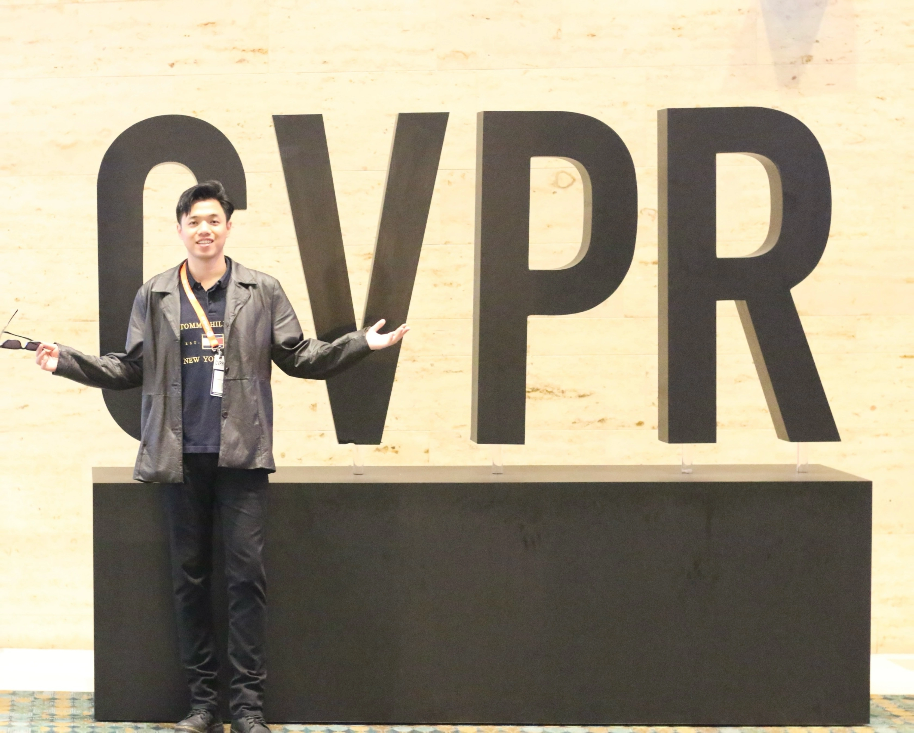
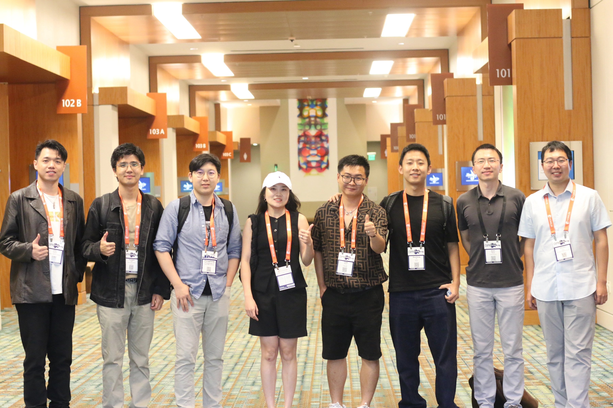
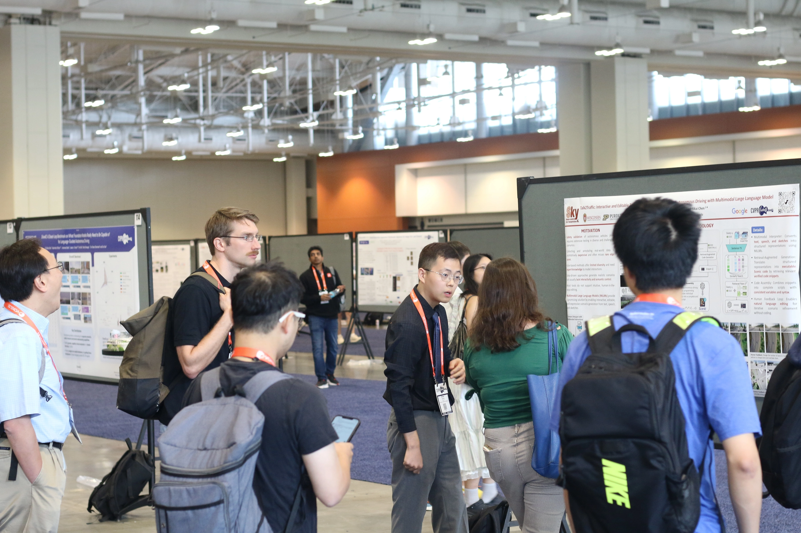
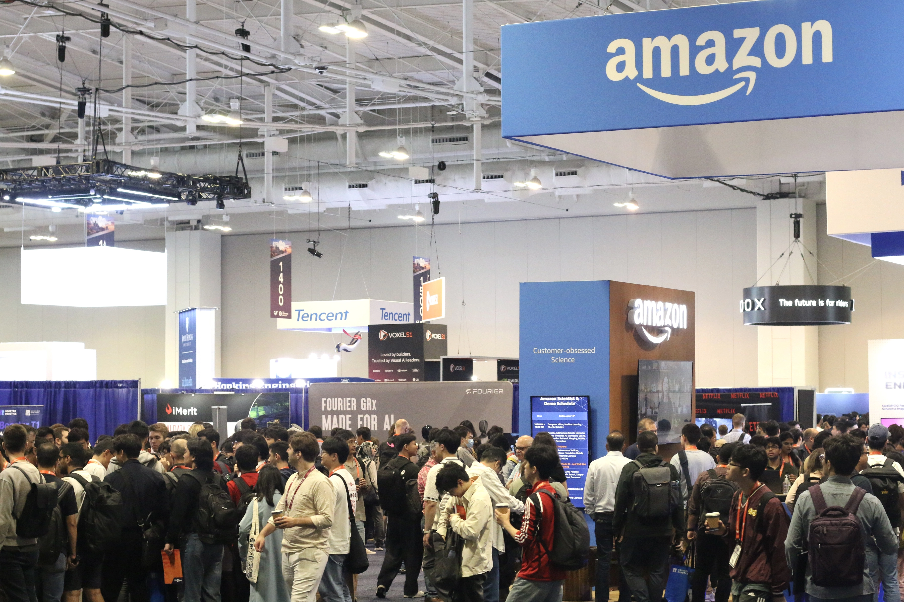
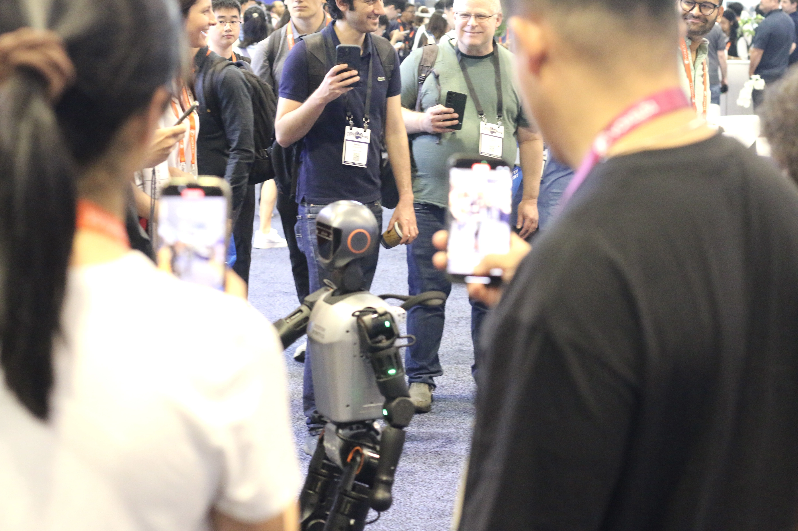
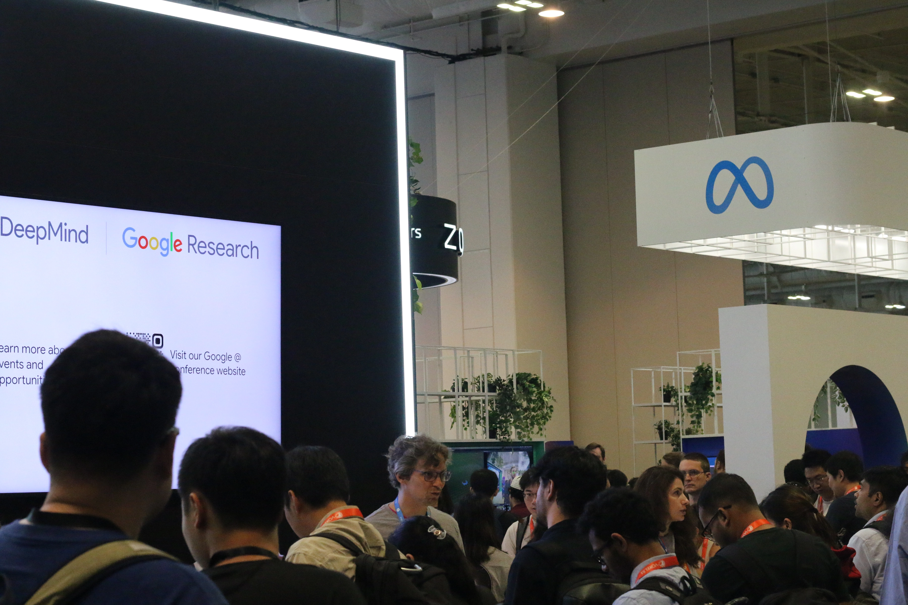
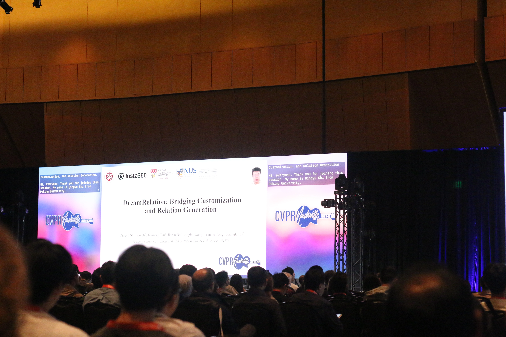
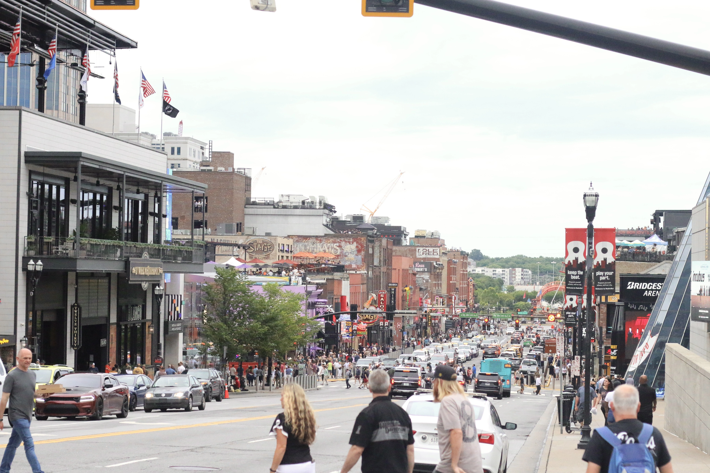
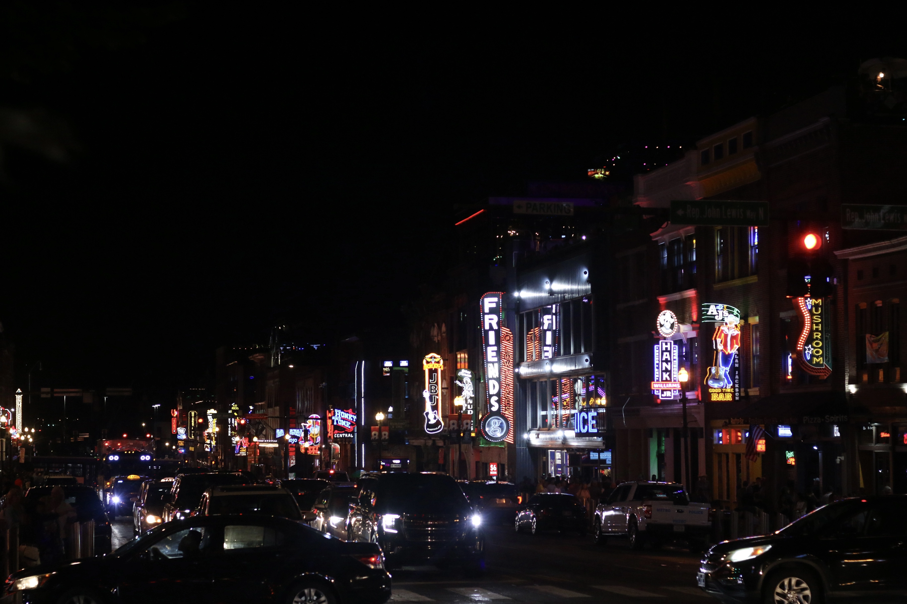

I attended the IEEE/CVF Conference on Computer Vision and Pattern Recognition (CVPR 2025), held June 11 to 15, 2025, at Music City Center in Nashville, Tennessee. It was inspiring to meet researchers and industry leaders, exchange ideas, and see the rapid progress in computer vision, autonomous driving, robotics, and artificial intelligence.

Our team presented **“Talk2Traffic: Interactive and Editable Traffic Scenario Generation for Autonomous Driving with Multimodal Large Language Model”** at the CVPR 2025 Workshops. Talk2Traffic enables users to create and iteratively edit simulation-ready traffic scenarios using text, speech, and sketches.

[Paper](https://openaccess.thecvf.com/content/CVPR2025W/WDFM-AD/papers/Sheng_Talk2Traffic_Interactive_and_Editable_Traffic_Scenario_Generation_for_Autonomous_Driving_CVPRW_2025_paper.pdf) · [Project page](https://zihaosheng.github.io/Talk2Traffic/)

  

    
    

      At CVPR 2025 in Nashville.
    

  

  

    
    

      With fellow researchers in autonomous driving at CVPR 2025.
    

  

  

    
    

      Presenting Talk2Traffic during the CVPR 2025 poster session.
    

  

  

    
    

      Exploring the CVPR 2025 exhibition hall.
    

  

  

    
    

      A robotics demonstration at CVPR 2025.
    

  

  

    
    

      Visiting industry exhibits at CVPR 2025.
    

  

  

    
    

      Attending a technical session at CVPR 2025.
    

  

  

    
    

      Exploring downtown Nashville between conference sessions.
    

  

  

    
    

      Nashville’s Broadway at night.
    

  

