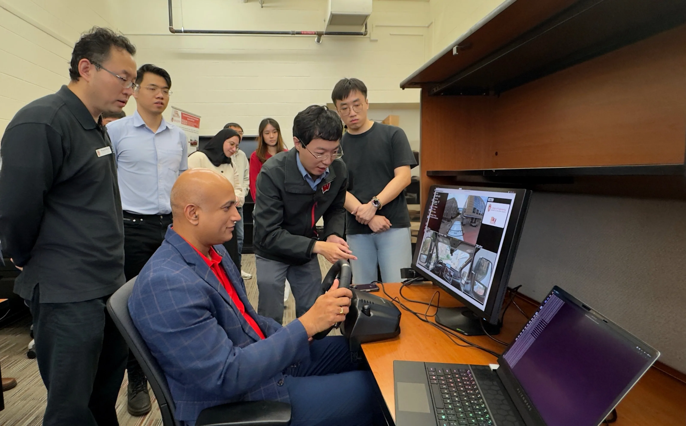
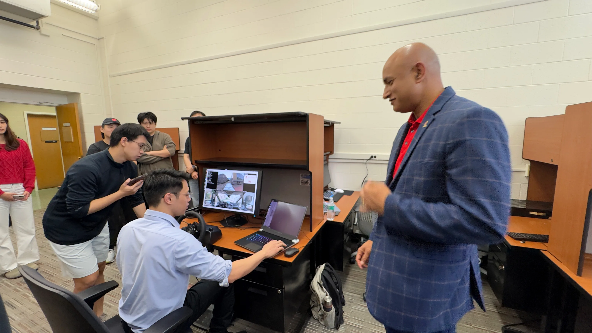
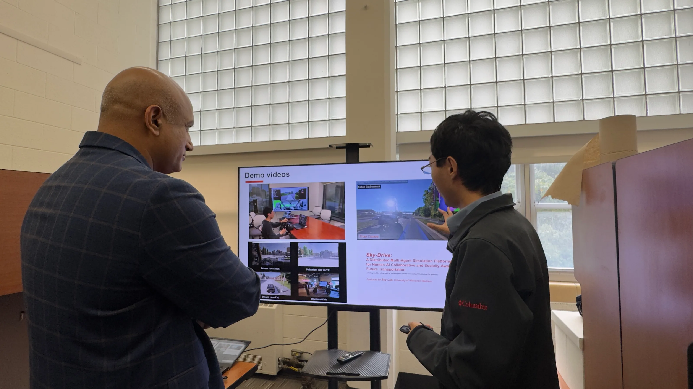
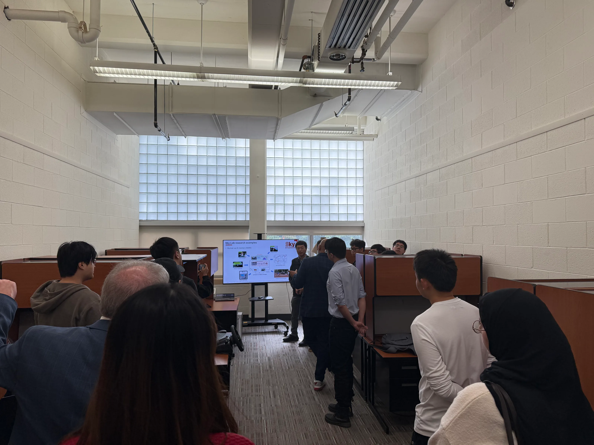
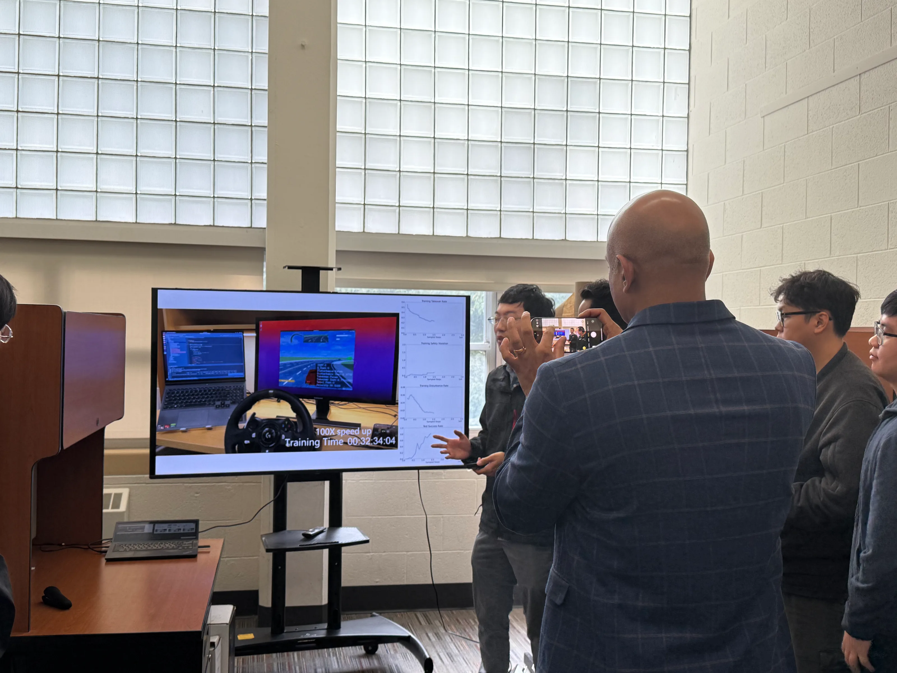
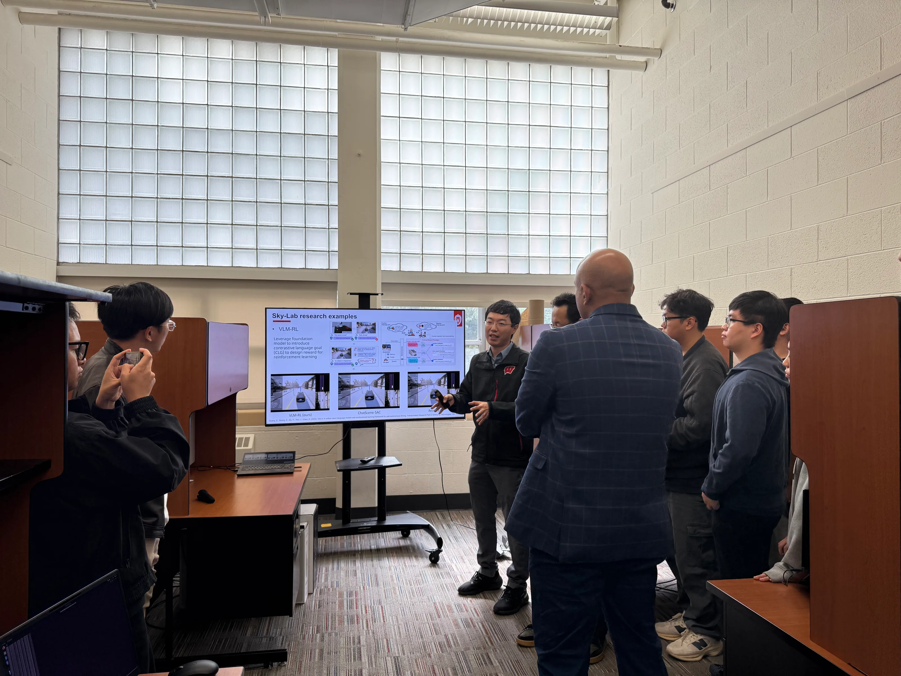
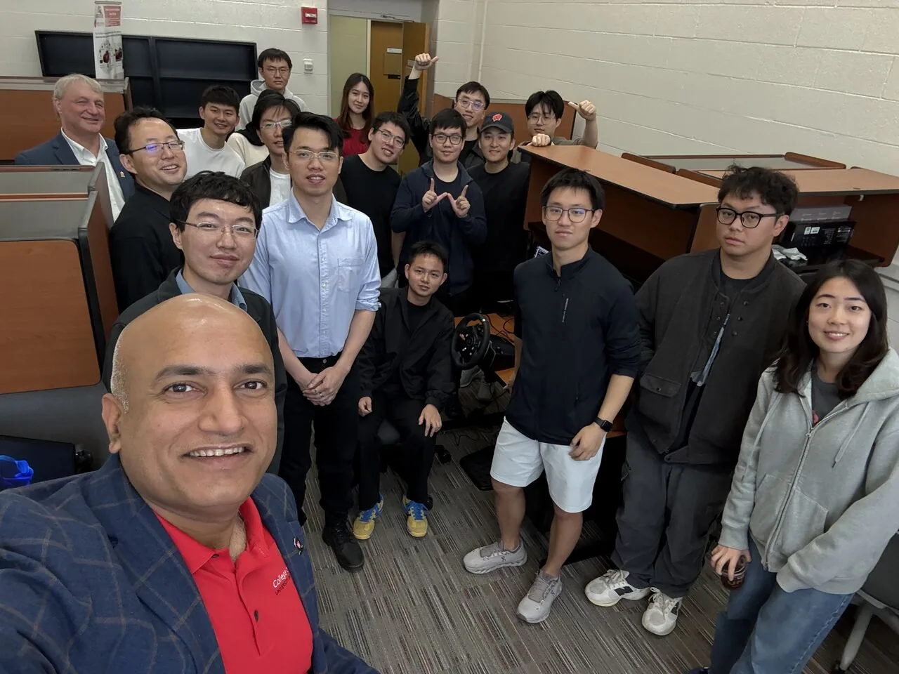
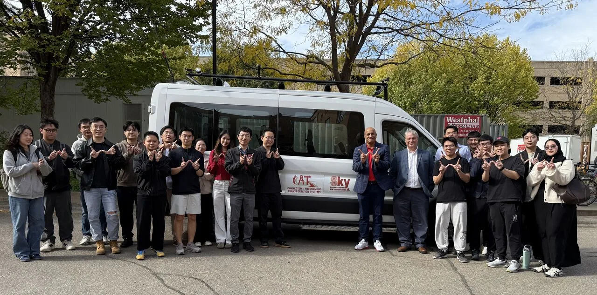

On October 17, 2025, our team at [Sky-Lab](https://sky-lab-uw.github.io/) welcomed Prof. [**Devesh Ranjan**](https://engineering.wisc.edu/directory/profile/devesh-ranjan/), Grainger Dean of the UW–Madison College of Engineering, during his visit to the Department of Civil and Environmental Engineering. We demonstrated a newly developed **5G-enabled remote takeover and real-time control system** for autonomous vehicles.

Using a steering-wheel control station and live video interface, Dean Ranjan remotely operated our research vehicle over the cellular connection. We also presented the system architecture and shared our ongoing research in connected and autonomous transportation. The demonstration represented one of the outcomes of our team's development and integration work over the summer.

More about the visit is available in [Dean Devesh Ranjan's LinkedIn post](https://www.linkedin.com/posts/devesh-ranjan-63755b8_water-sustainability-resilentinfrastructure-activity-7386161217905721344-U6E8).

  

    
    

      Dean Devesh Ranjan operating Sky-Lab's remote-driving system.
    

  

  

    
    

      Introducing the remote-driving system to Dean Ranjan.
    

  

  

    
    

      Presenting our connected and autonomous vehicle research.
    

  

  

    
    

      Explaining the remote-driving system architecture.
    

  

  

    
    

      Demonstrating live vehicle control through the remote interface.
    

  

  

    
    

      Sharing our remote-driving and autonomous vehicle research.
    

  

  

    
    

      Dean Ranjan with Sky-Lab members.
    

  

  

    
    

      With Dean Ranjan and our autonomous research vehicle.
    

  

