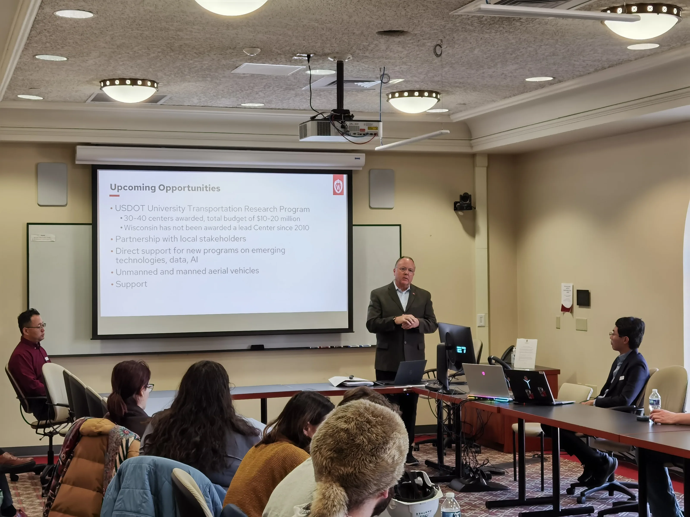
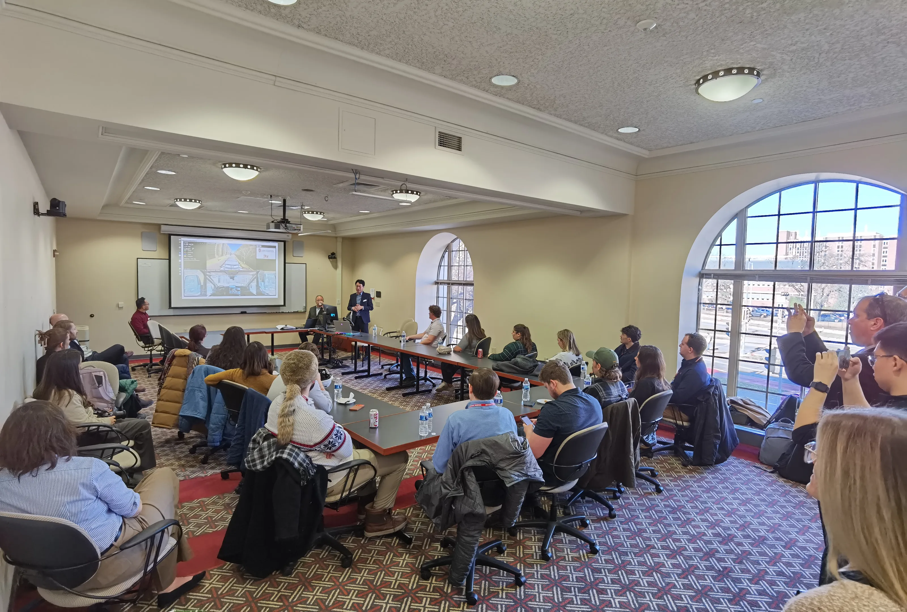
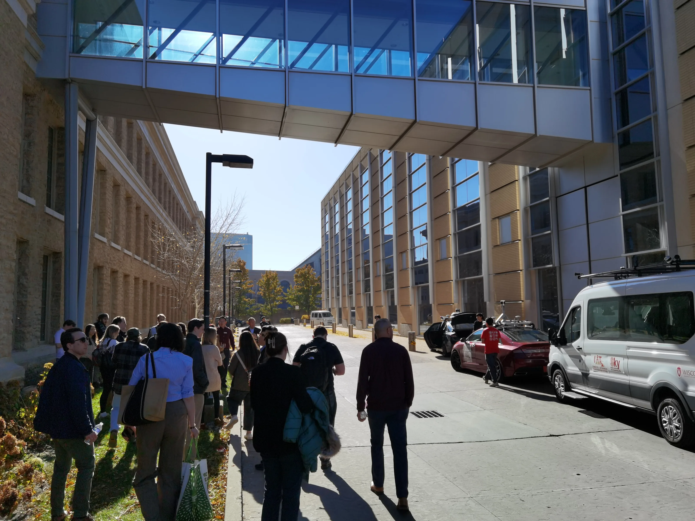
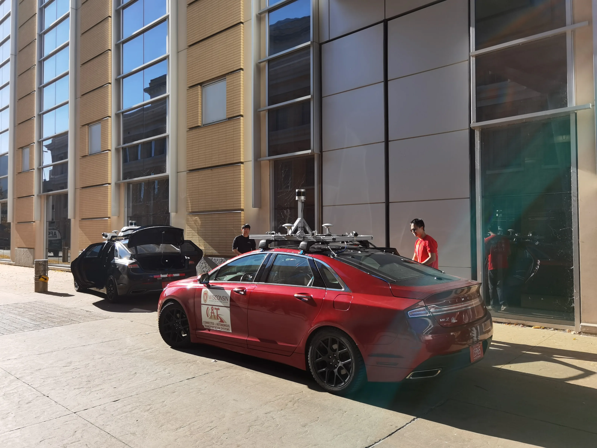
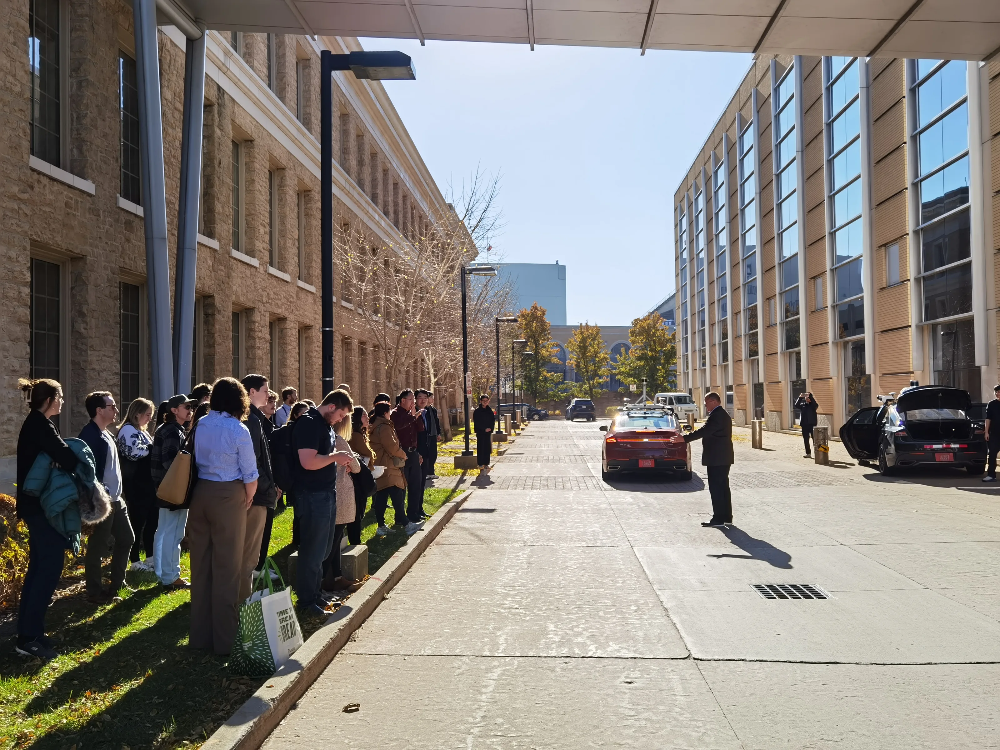
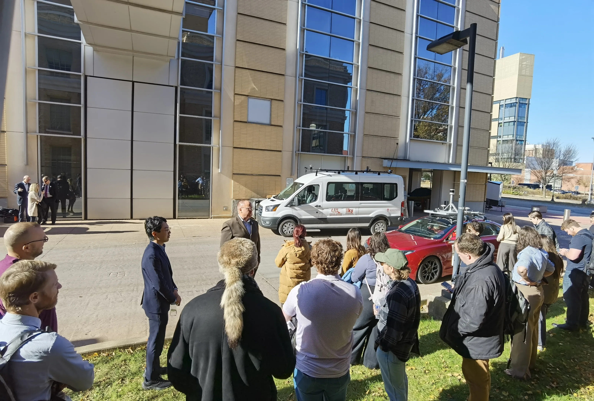
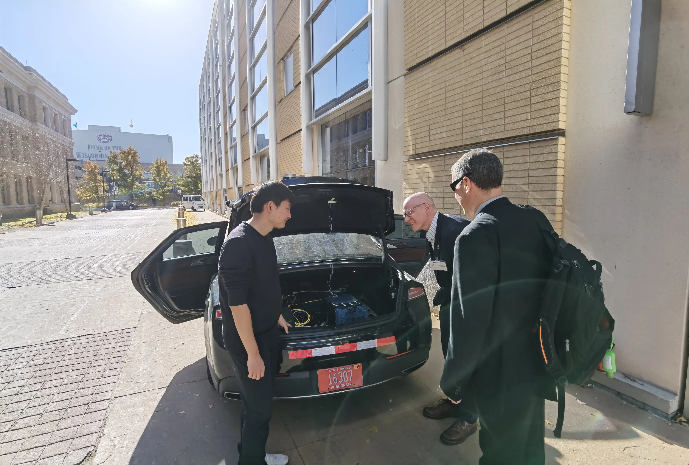

On November 14, 2025, we welcomed members of **Wisconsin's congressional delegation staff** to UW–Madison during a campus visit organized by the university's Office of Federal Relations.

During the engineering portion of the visit, our team at [Sky-Lab](https://sky-lab-uw.github.io/), together with colleagues from the [CATS Lab](https://catslab.engr.wisc.edu/), introduced our autonomous research vehicle and its onboard sensing, computing, and control systems. We shared how connected and autonomous vehicle research can support safer, more efficient, and more accessible transportation.

More about the broader campus visit is available in [UW–Madison Federal Relations' report](https://federalrelations.wisc.edu/2025/11/25/congressional-staff-see-uw-madison-research-up-close-and-the-federal-investments-powering-wisconsin-innovation/).

  

    
    

      A briefing on federally supported research at UW–Madison.
    

  

  

    
    

      Presenting connected and autonomous transportation research.
    

  

  

    
    

      Arriving at the outdoor autonomous vehicle demonstration.
    

  

  

    
    

      Connected and autonomous research vehicles outside Union South.
    

  

  

    
    

      Watching an autonomous research vehicle demonstration.
    

  

  

    
    

      An overview of the outdoor research demonstration.
    

  

  

    
    

      Discussing onboard sensing and computing systems.
    

  

  

    
    

      Introducing our autonomous research vehicle to Wisconsin congressional staff.
    

  

