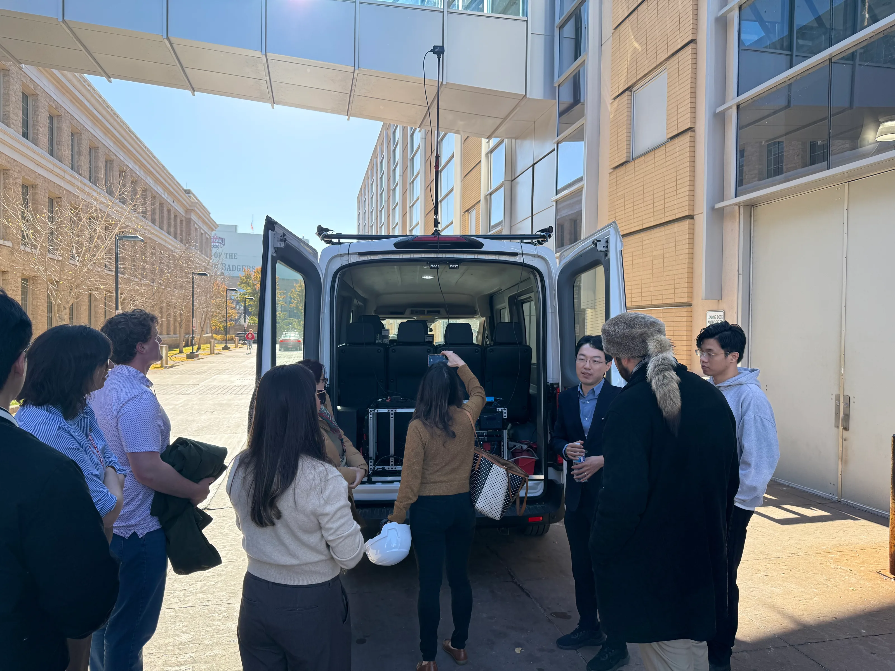

On November 14, 2025, we welcomed members of **Wisconsin's congressional delegation staff** to UW–Madison during a campus visit organized by the university's Office of Federal Relations.

During the engineering portion of the visit, our team at [Sky-Lab](https://sky-lab-uw.github.io/), together with colleagues from the [CATS Lab](https://catslab.engr.wisc.edu/), introduced our autonomous research vehicle and its onboard sensing, computing, and control systems. We shared how connected and autonomous vehicle research can support safer, more efficient, and more accessible transportation.

More about the broader campus visit is available in [UW–Madison Federal Relations' report](https://federalrelations.wisc.edu/2025/11/25/congressional-staff-see-uw-madison-research-up-close-and-the-federal-investments-powering-wisconsin-innovation/).

  

    
    

      Introducing our autonomous research vehicle to Wisconsin congressional staff.
    

  

