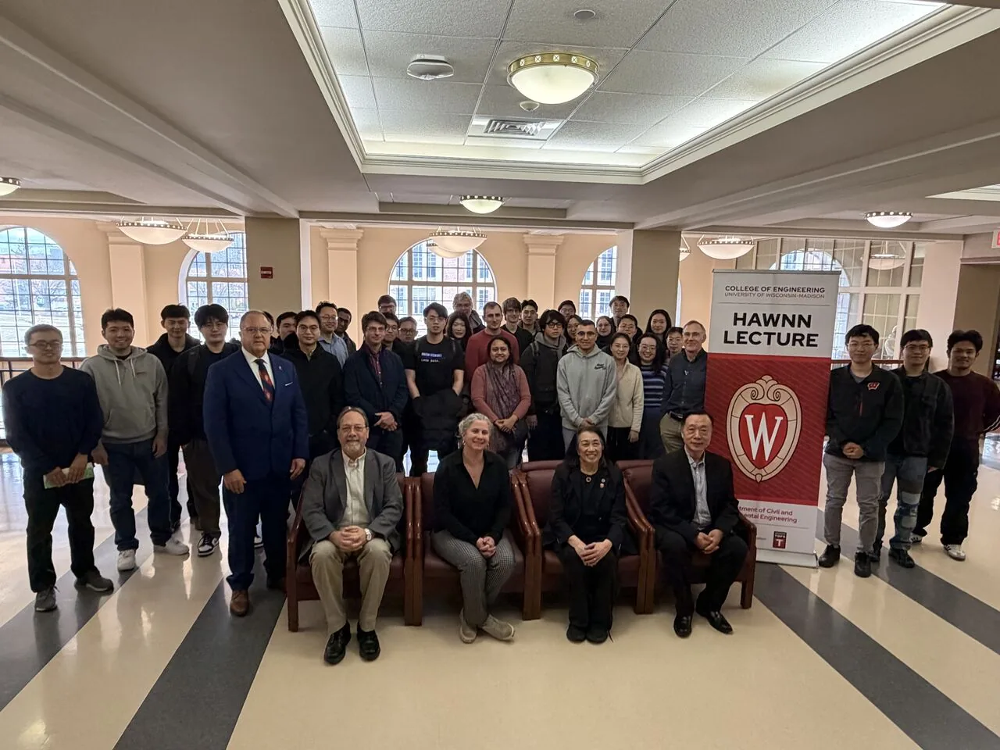
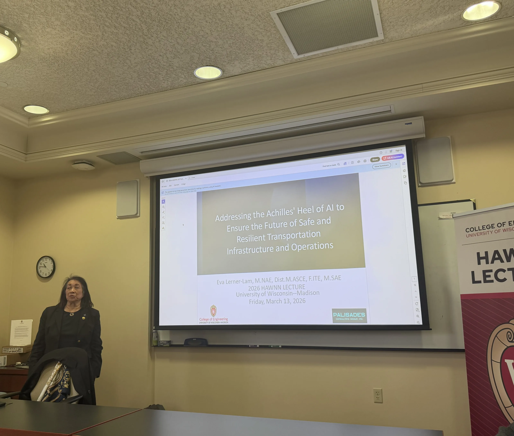
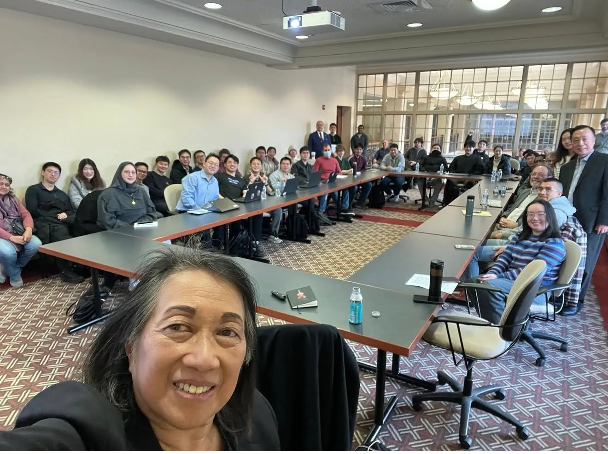
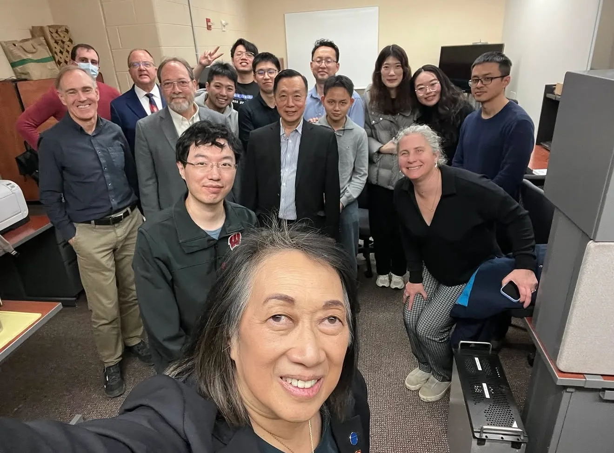
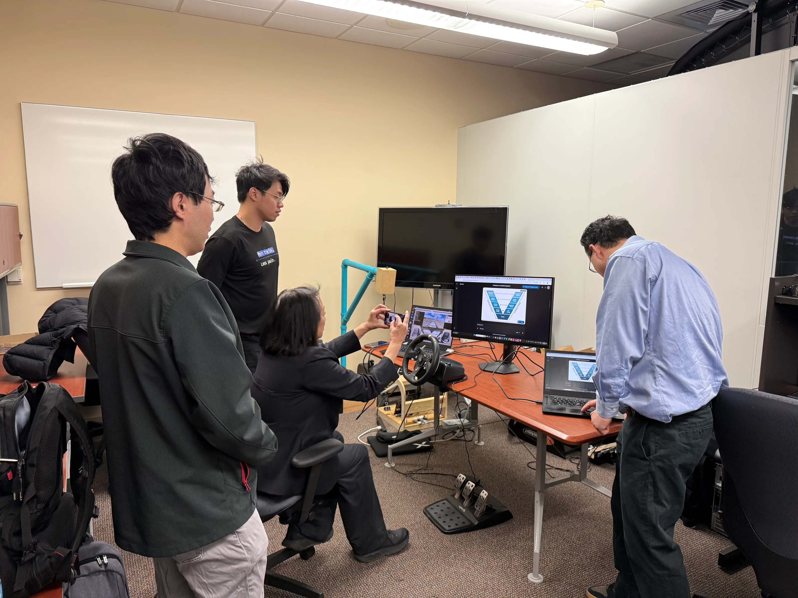
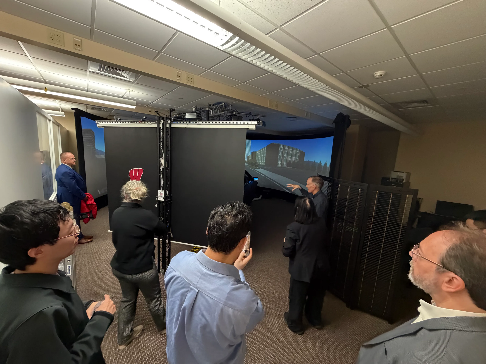
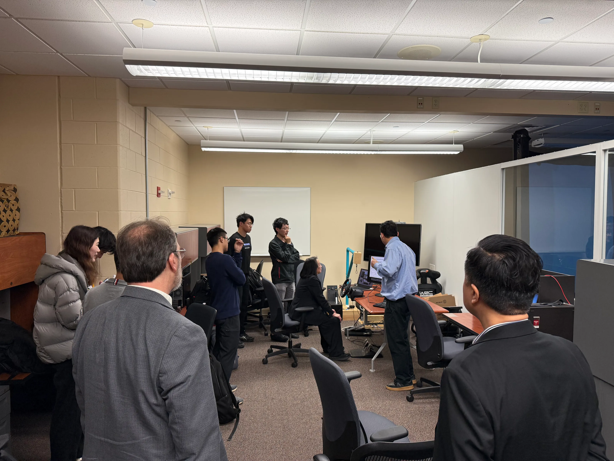

On March 13, 2026, our team at [Sky-Lab](https://sky-lab-uw.github.io/) demonstrated our remote-driving research to **Eva Lerner-Lam**, a member of the National Academy of Engineering and founder and president of Palisades Consulting Group, during her visit to UW–Madison.

Eva explored how a driver can interact with a research vehicle through a steering-wheel control station and live computer interface, and experienced the remote-driving system firsthand. We also introduced the autonomous-driving simulator and discussed the technologies supporting remotely operated and autonomous vehicles.

More about the visit is available in [Prof. David Noyce’s post](https://www.linkedin.com/posts/david-noyce-174a42b9_we-were-fortunate-to-have-my-colleague-and-activity-7439064475090980864-rAab).

  

    
    

      With Eva Lerner-Lam during her visit to UW–Madison.
    

  

  

    
    

      Eva Lerner-Lam speaking during her visit.
    

  

  

    
    

      Meeting faculty, students, and other visitors at UW–Madison.
    

  

  

    
    

      With researchers following the remote-driving demonstration.
    

  

  

    
    

      Exploring the remote-driving control station.
    

  

  

    
    

      Introducing the autonomous-driving simulator.
    

  

  

    
    

      Discussing the remote-driving system with visitors.
    

  

