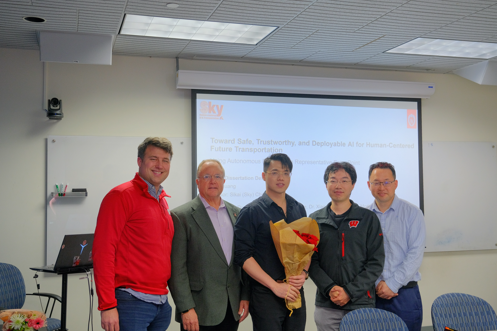
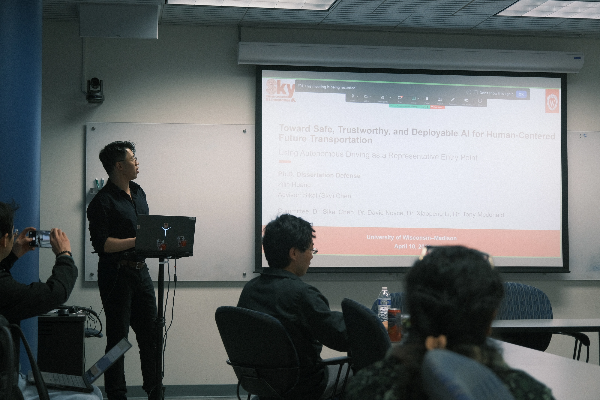
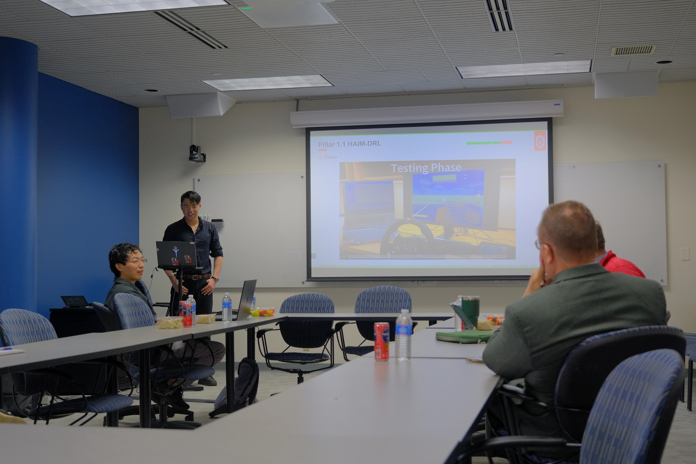
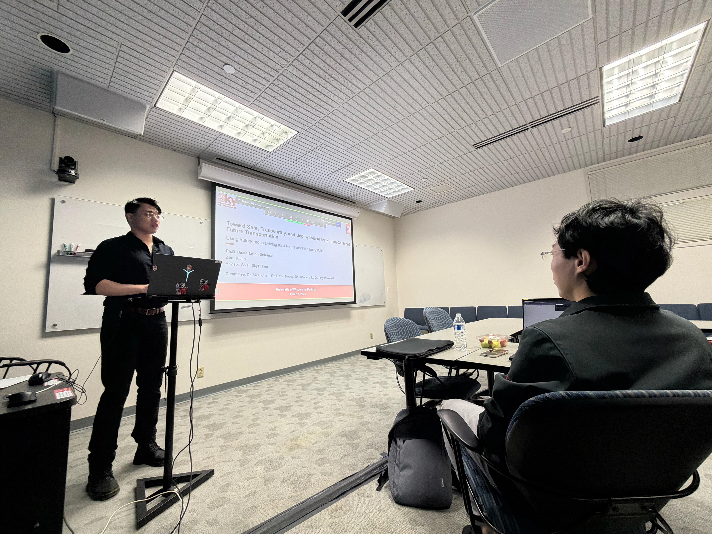
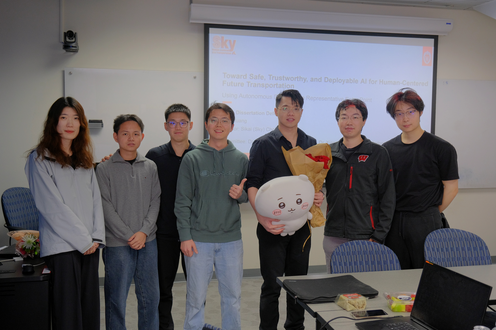
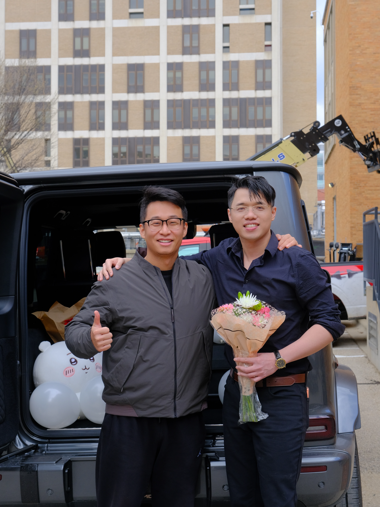
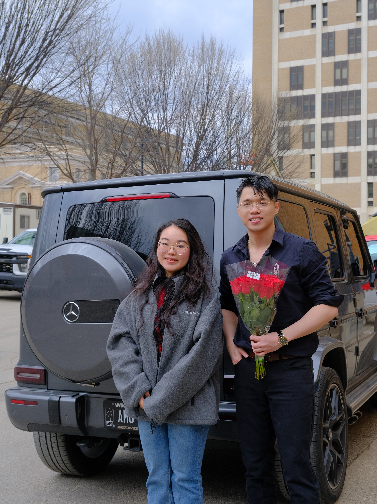
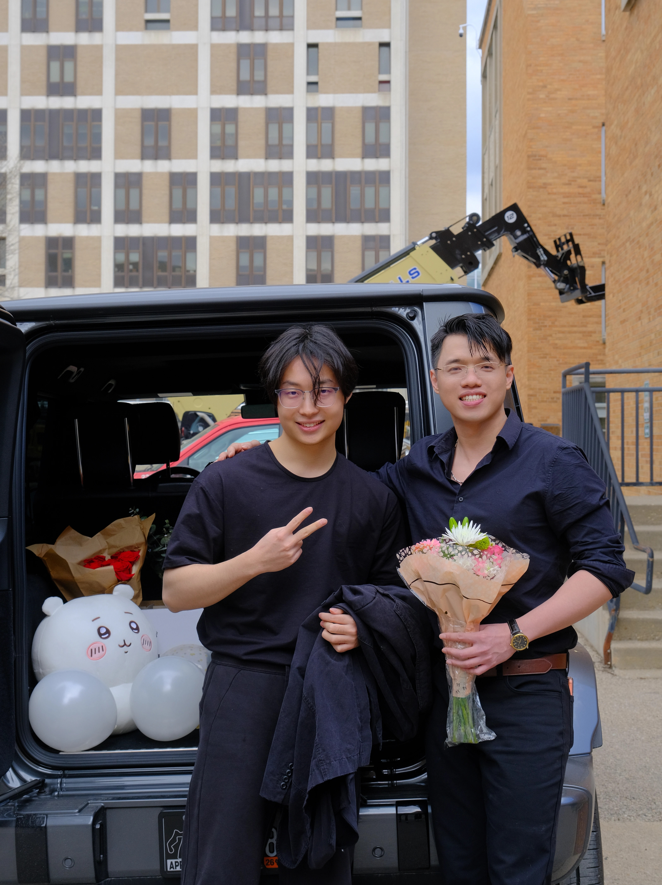

I am excited to share that I successfully defended my Ph.D. dissertation at the [University of Wisconsin–Madison](https://www.wisc.edu/) on April 10, 2026. 🎓

Coming to a new country on my own was not easy, and everything felt unfamiliar at first. Over time, with the support of many people around me, I found my direction in research, which eventually led to my dissertation, ***Toward Safe, Trustworthy, and Deployable AI for Human-Centered Future Transportation***.

I am deeply grateful to my advisor, Prof. [Sikai (Sky) Chen](https://directory.engr.wisc.edu/cee/Faculty/Chen_Sikai/), for his mentorship, trust, and continuous support throughout these years. I would also like to sincerely thank my dissertation committee members, Prof. David Noyce, Prof. Xiaopeng (Shaw) Li, and Prof. Tony McDonald, for their time, guidance, and valuable feedback. I am especially thankful to Prof. Bin Ran and Prof. Soyoung Ahn for their guidance and encouragement during my Ph.D. journey.

Beyond that, I feel very fortunate to have had the support of my collaborators, labmates, friends, and family. This milestone would not have been possible without all of you. 🙏

Chapter closed. Next adventure begins. 🚀

  

    
    

      With my advisor and dissertation committee after a successful defense.
    

  

  

    
    

      Presenting my dissertation research.
    

  

  

    
    

      Discussing autonomous driving system evaluation during the defense.
    

  

  

    
    

      Discussing the dissertation with the committee and audience.
    

  

  

    
    

      Celebrating with Sky-Lab members.
    

  

  

    
  

  

    
  

  

    
  

  

    
  

  

    
  

  

    
  

  

    
  

  

    
  

  

    

      Celebrating this milestone with friends and labmates. Grateful for everyone who made this journey possible.
    

  

