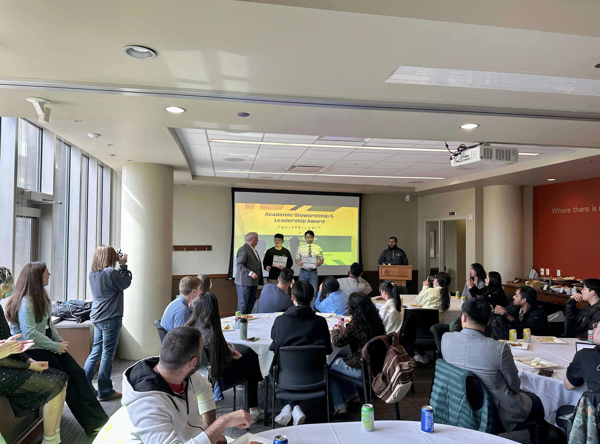
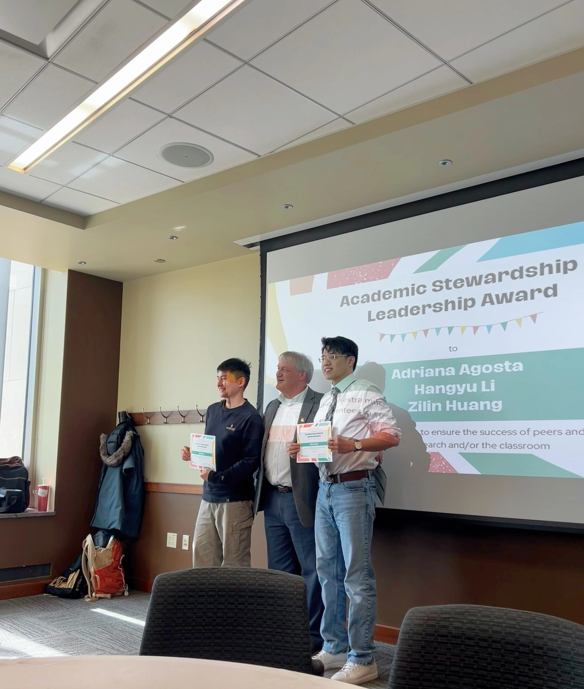

I was honored to receive the 2026 **Academic Stewardship & Leadership Award** from the UW-Madison Department of Civil and Environmental Engineering. Mentoring has been one of the most rewarding parts of my Ph.D. journey, and this award means even more because it comes from the people I have had the privilege to work alongside.

My sincere thanks to my advisor, Prof. [Sikai (Sky) Chen](https://directory.engr.wisc.edu/cee/Faculty/Chen_Sikai/), for his continuous guidance, trust, and support throughout my Ph.D. journey. I am also grateful to our department chair, Prof. Greg Harrington, whose support made this recognition possible, and to Amanda Thuss and the CEE Graduate Student Council for their thoughtful work behind the scenes.

Most importantly, thank you to every mentee who has trusted me along the way. Your collaboration, curiosity, and growth continually inspire me to become a better mentor and researcher.

Onward, together. ✨

More details about the inaugural awards, recipients, and achievements recognized by the department are available in the [UW-Madison College of Engineering's full report](https://engineering.wisc.edu/blog/cee-launches-new-graduate-student-awards-to-honor-achievements-and-celebrate-excellence/).

  

    
    

      Receiving the Academic Stewardship & Leadership Award at the CEE graduate student awards celebration.
    

  

  

    
    

      With fellow recipient Hangyu Li and CEE Department Chair Greg Harrington.
    

  

