This spring, I had the honor of attending both the [University of Wisconsin–Madison](https://www.wisc.edu/) doctoral hooding ceremony and the [College of Engineering](https://engineering.wisc.edu/) and [Department of Civil and Environmental Engineering](https://engineering.wisc.edu/departments/civil-environmental-engineering/) commencement, a milestone I will carry with me for a long time. 🎓

To my advisor, Prof. [Sikai (Sky) Chen](https://directory.engr.wisc.edu/cee/Faculty/Chen_Sikai/), the faculty and staff at UW–Madison, every member of [Sky-Lab](https://sky-lab-uw.github.io/), and every friend who has been part of this journey: **thank you**. It has been a privilege to learn, struggle, and grow alongside all of you. I am incredibly proud of what we built together and deeply excited for what comes next.

Here’s to the next chapter. 💗

Videos from the ceremonies are available here: [UW–Madison Spring 2026 Commencement — May 8 full ceremony](https://www.youtube.com/watch?v=3xZWItAZdmg) and [2026 College of Engineering Graduate Recognition Event](https://www.youtube.com/watch?v=tInTAratpw4).

  

    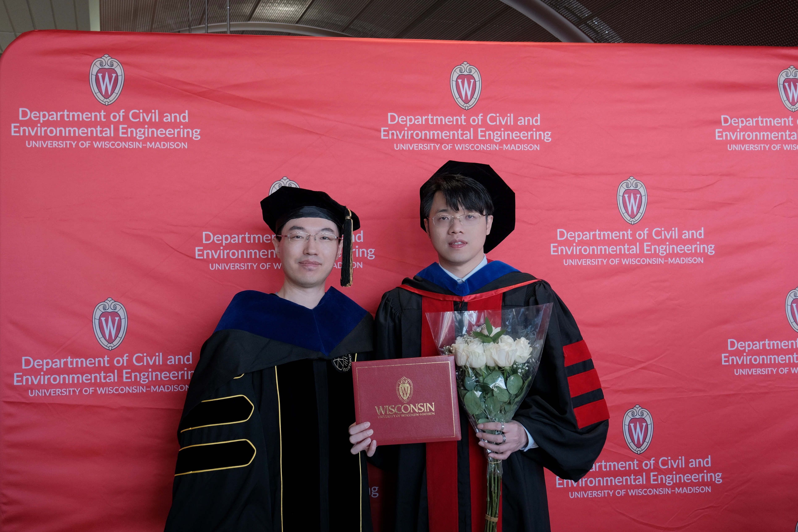
    

      With my advisor, Prof. Sikai (Sky) Chen, at the CEE commencement.
    

  

  

    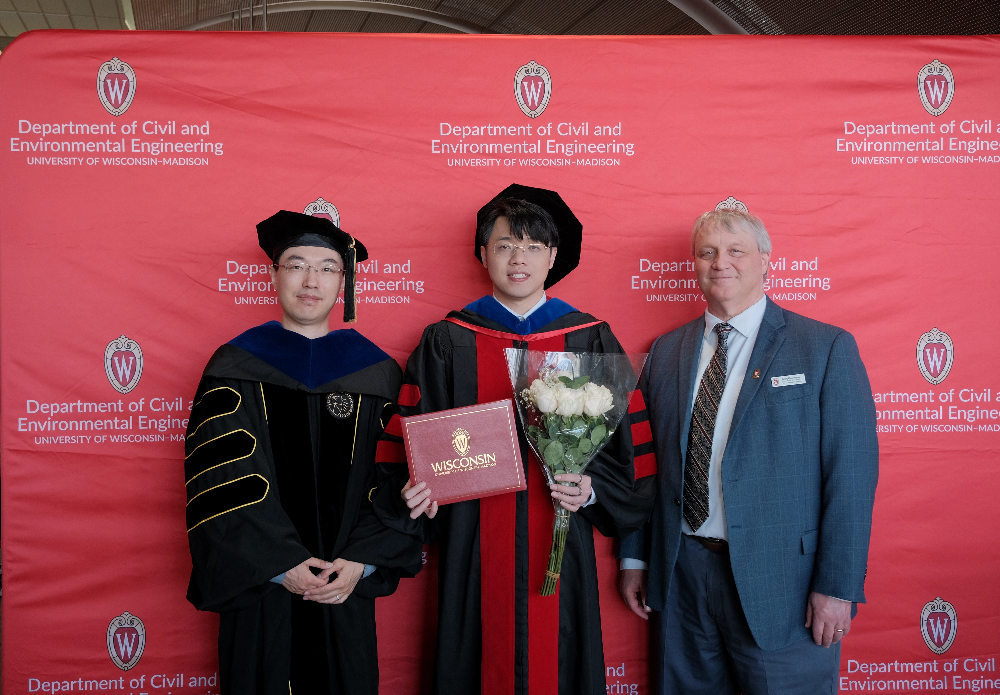
    

      Celebrating with CEE faculty members.
    

  

  

    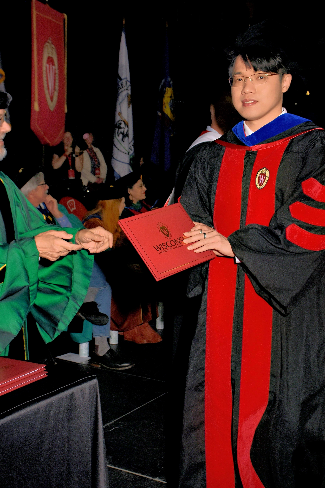
    

      Receiving my doctoral diploma during the hooding ceremony.
    

  

  

    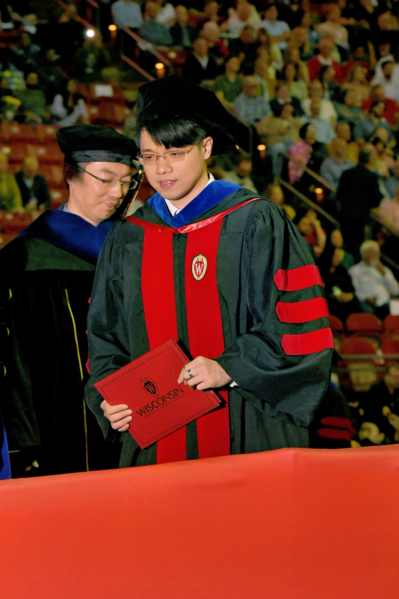
    

      Doctoral hooding ceremony at the Kohl Center.
    

  

  

    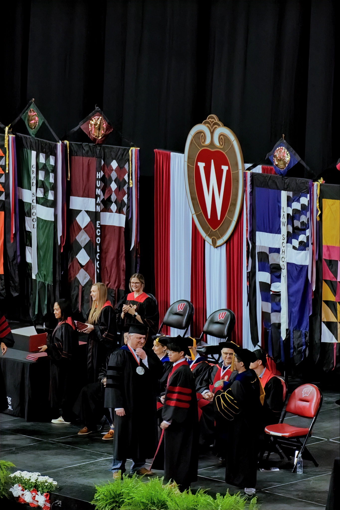
    

      Being hooded during the doctoral hooding ceremony.
    

  

  

    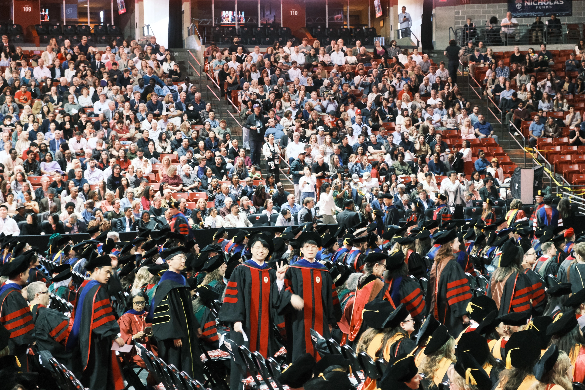
    

      Doctoral graduates at the Kohl Center.
    

  

  

    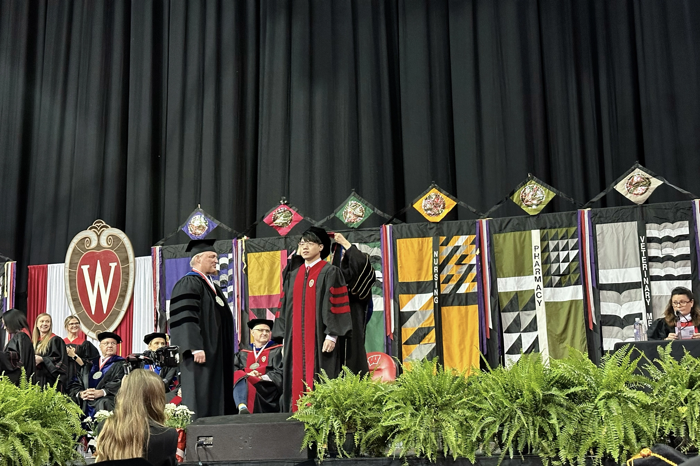
    

      Crossing the commencement stage.
    

  

  

    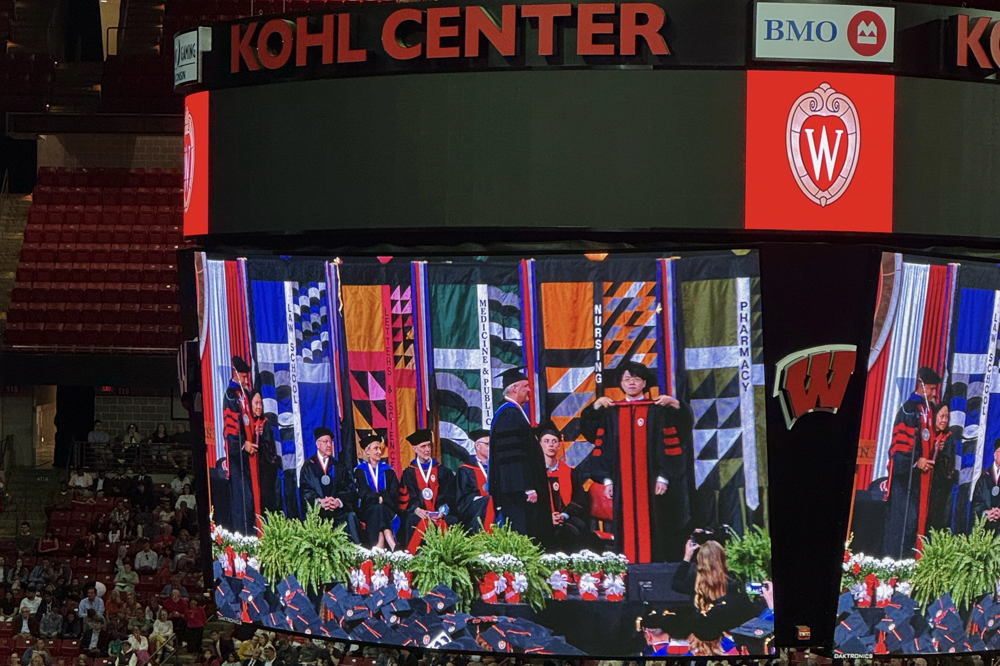
    

      Appearing on the Kohl Center video board during commencement.
    

  

  

    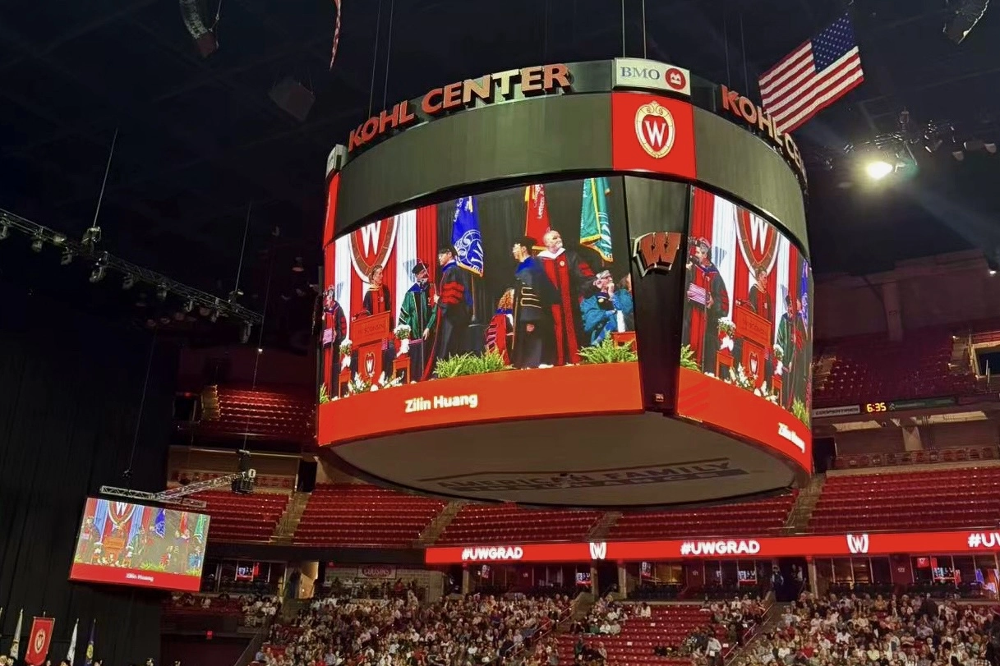
    

      The Kohl Center video board during commencement.
    

  

  

    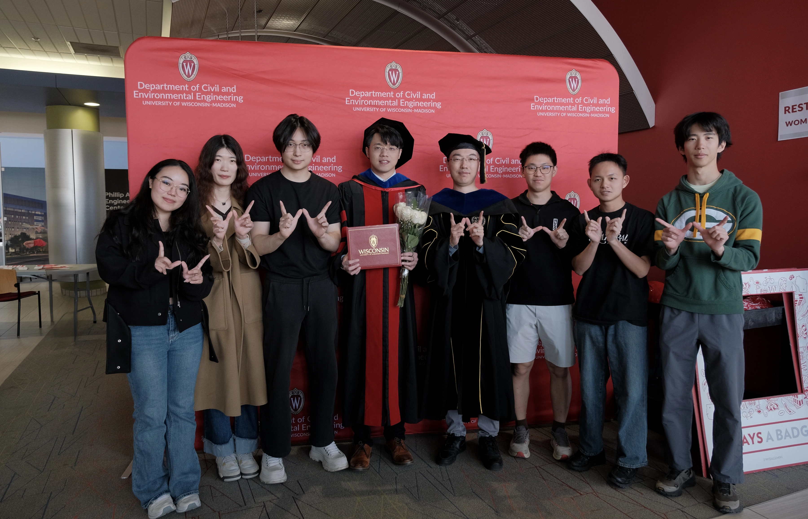
    

      Celebrating with Sky-Lab members and friends.
    

  

  

    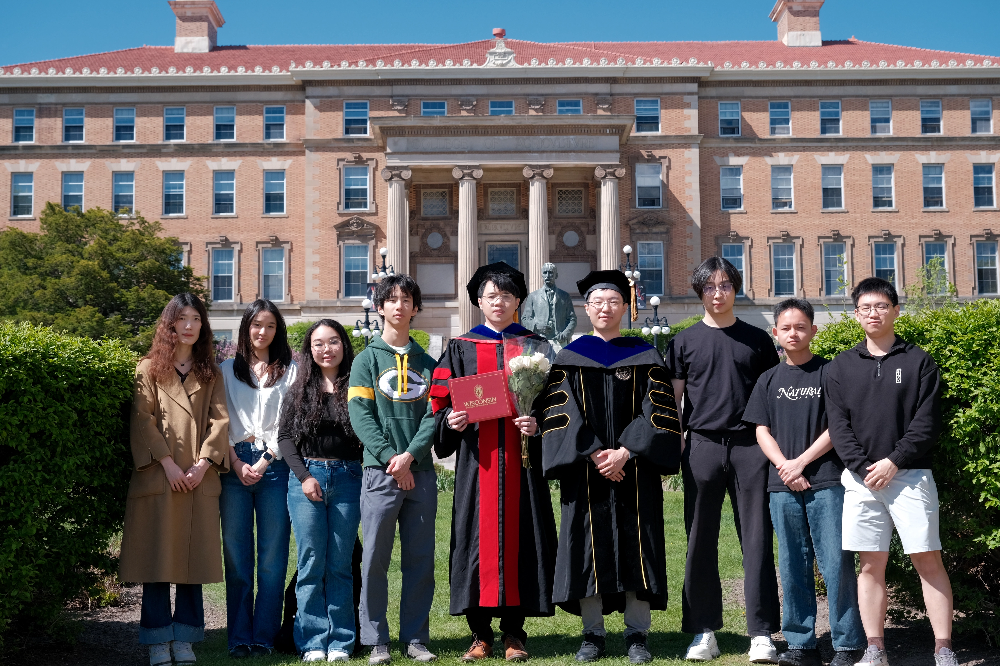
    

      With friends outside Engineering Hall.
    

  

  

    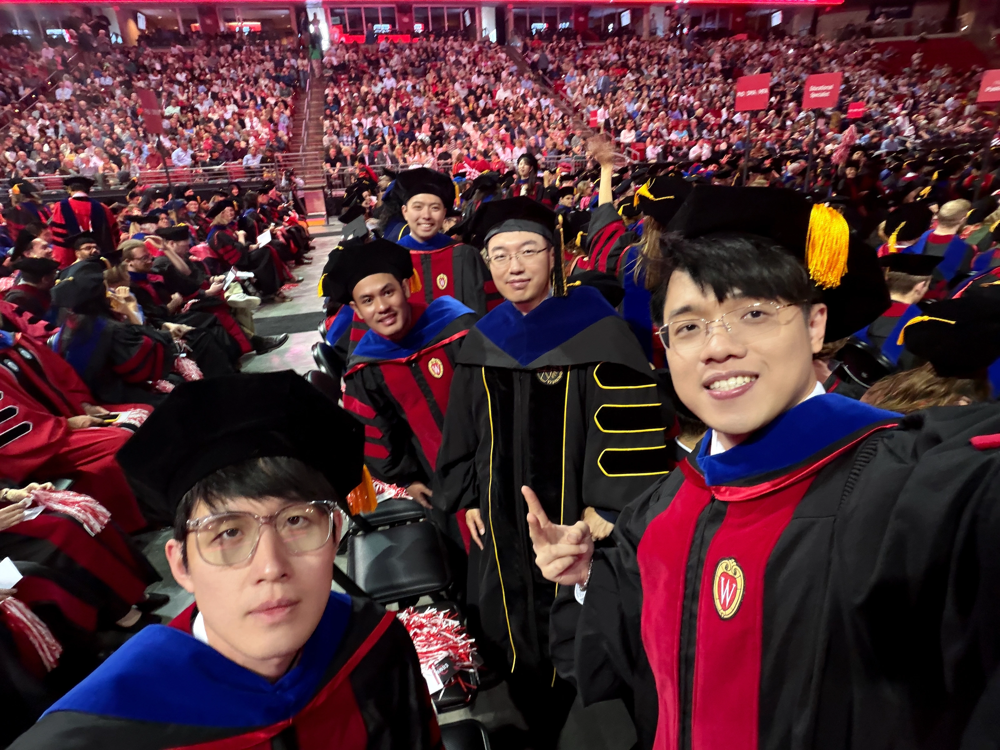
    

      Sharing the day with friends.
    

  

  

    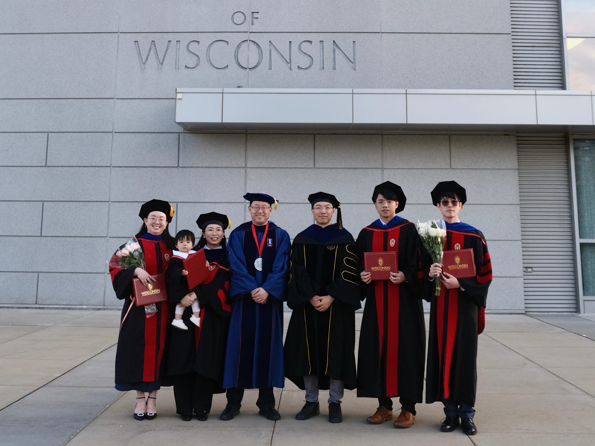
    

      CEE faculty and graduates celebrating together.
    

  

