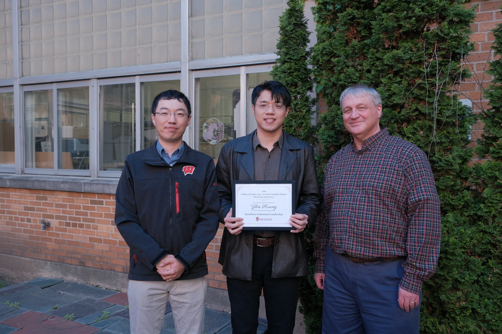
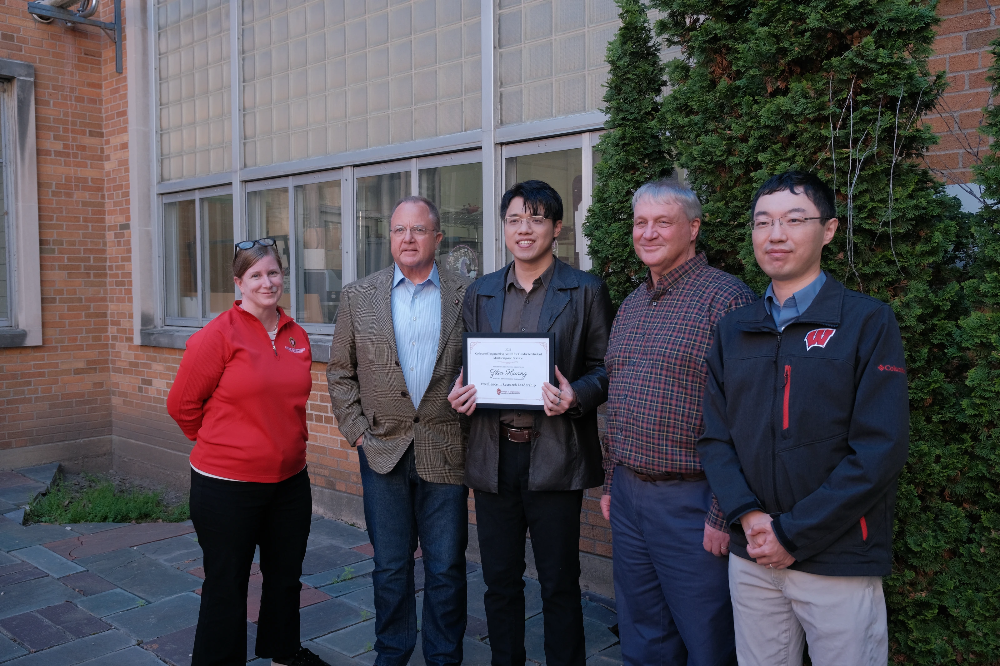
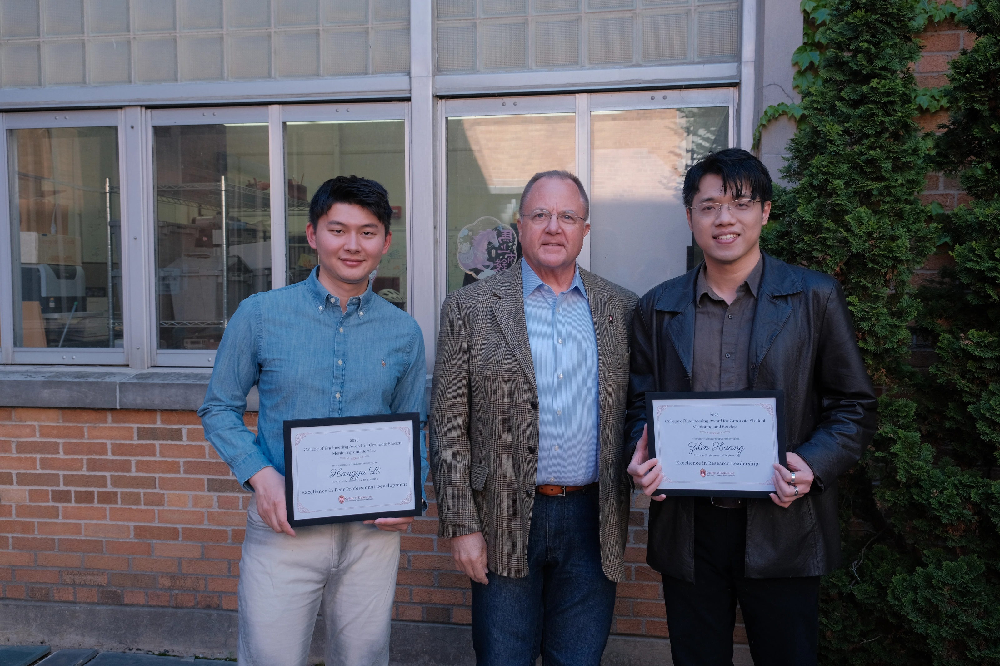
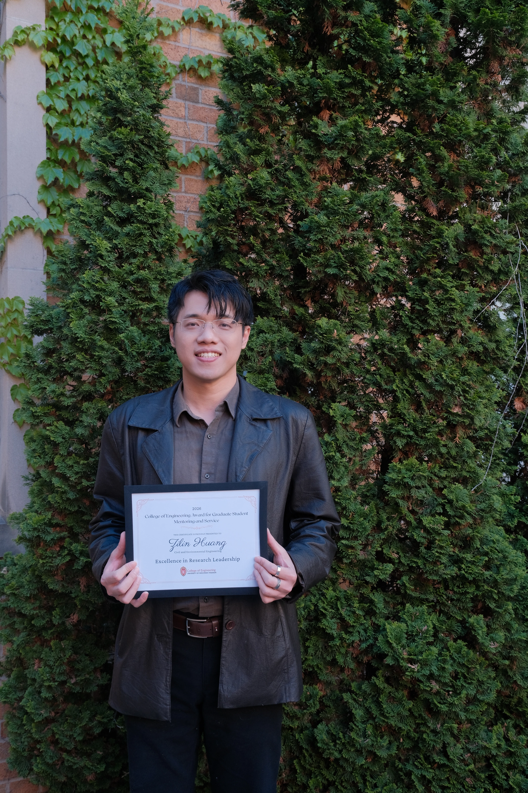
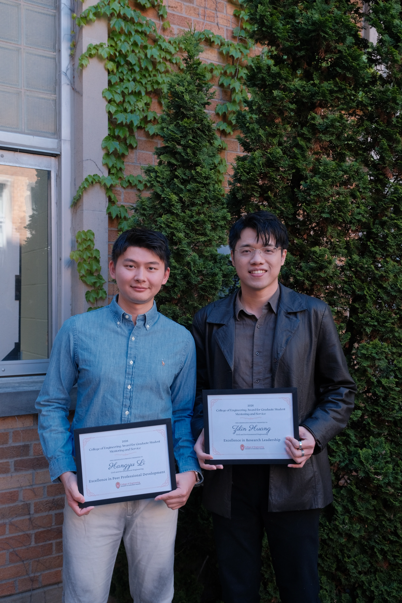
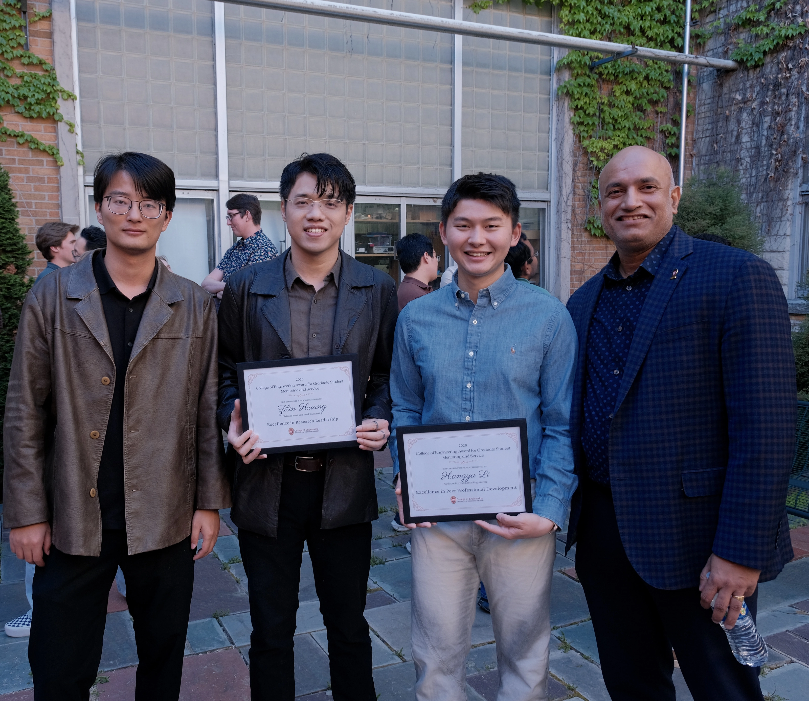
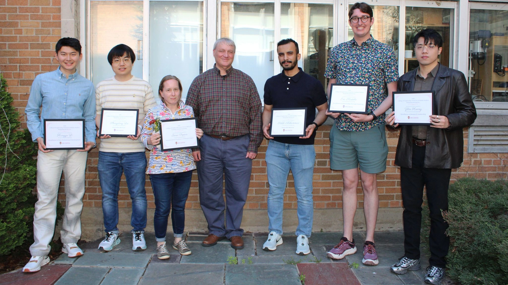

I was honored to receive the **College of Engineering Award for Graduate Student Mentorship and Service: Excellence in Research Leadership**, presented by the Graduate Student Advisory Council. This recognition comes from the students and colleagues I have had the privilege to work alongside, and it means a great deal to me. 💗

My sincere thanks to my advisor, Prof. [Sikai (Sky) Chen](https://directory.engr.wisc.edu/cee/Faculty/Chen_Sikai/), for his continuous trust and nomination. I am also deeply grateful to Prof. Devesh Ranjan, Prof. David Noyce, and Kathy Prem for their leadership in supporting graduate student mentoring across the UW-Madison College of Engineering, and to Joanna Gurstelle for coordinating this recognition and the ceremony.

My thanks also extend to my home department, the UW-Madison Department of Civil and Environmental Engineering, including Prof. Greg Harrington, Prof. Daniel Wright, and Amanda Thuss. Their continued support made my Ph.D. journey at the University of Wisconsin-Madison especially meaningful.

To every mentee whose curiosity and growth continue to shape me as a researcher and mentor, thank you.

Onward, together. ✨

More details about the awards, recipients, and their contributions to graduate student mentoring are available in the [UW-Madison College of Engineering's full report](https://engineering.wisc.edu/blog/college-recognizes-graduate-mentoring-excellence/).

  

    
    

      Celebrating the mentoring award with colleagues from Civil and Environmental Engineering.
    

  

  

    
    

      Celebrating with College of Engineering and Civil and Environmental Engineering leadership.
    

  

  

    
    

      Celebrating with colleagues from Civil and Environmental Engineering.
    

  

  

    
    

      Receiving the award for Excellence in Research Leadership.
    

  

  

    
    

      Celebrating this recognition with a fellow award recipient.
    

  

  

    
    

      With College of Engineering leaders and fellow award recipients.
    

  

  

    
    

      Graduate student mentoring award recipients from Civil and Environmental Engineering.
    

  

