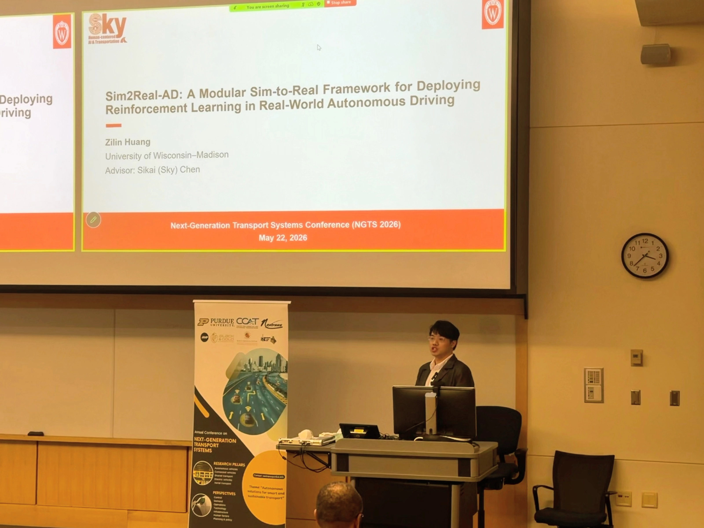
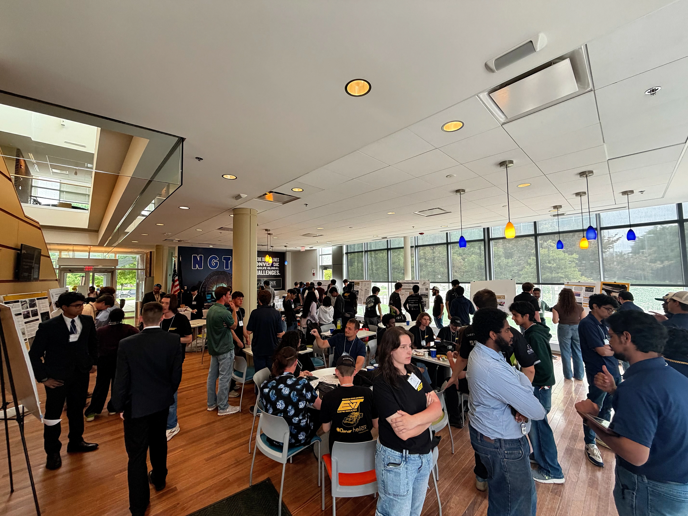
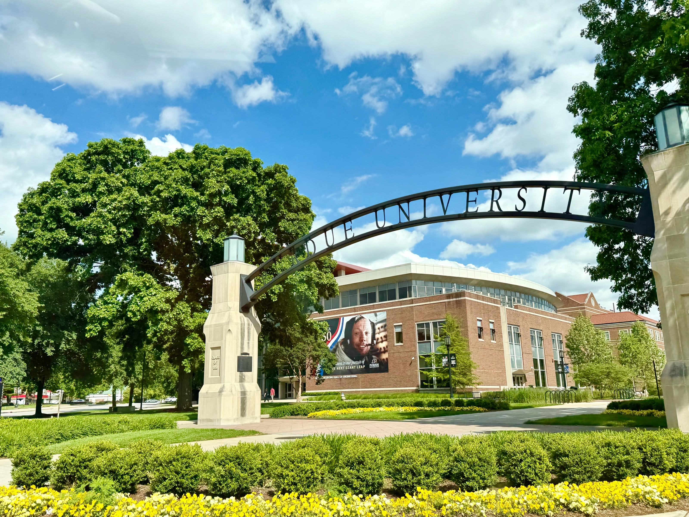
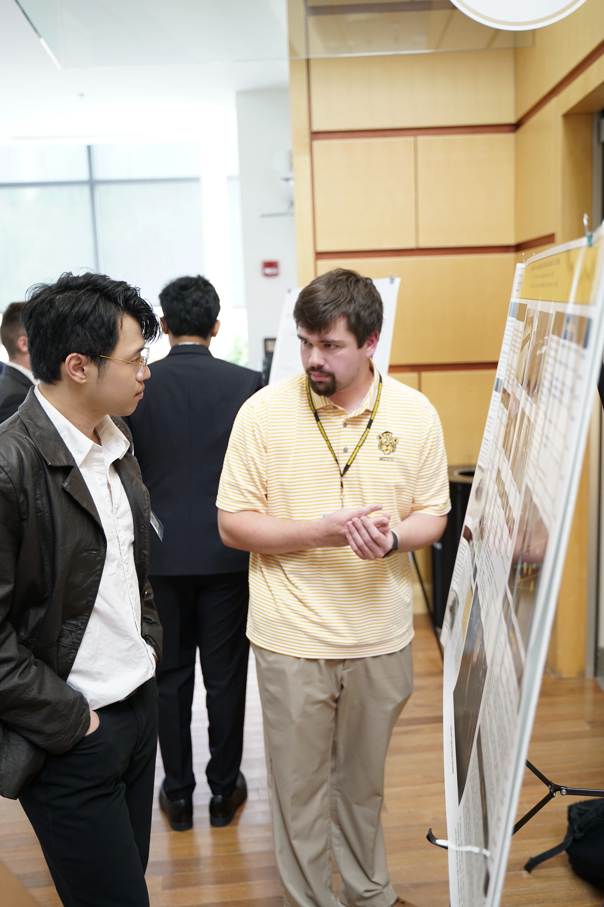
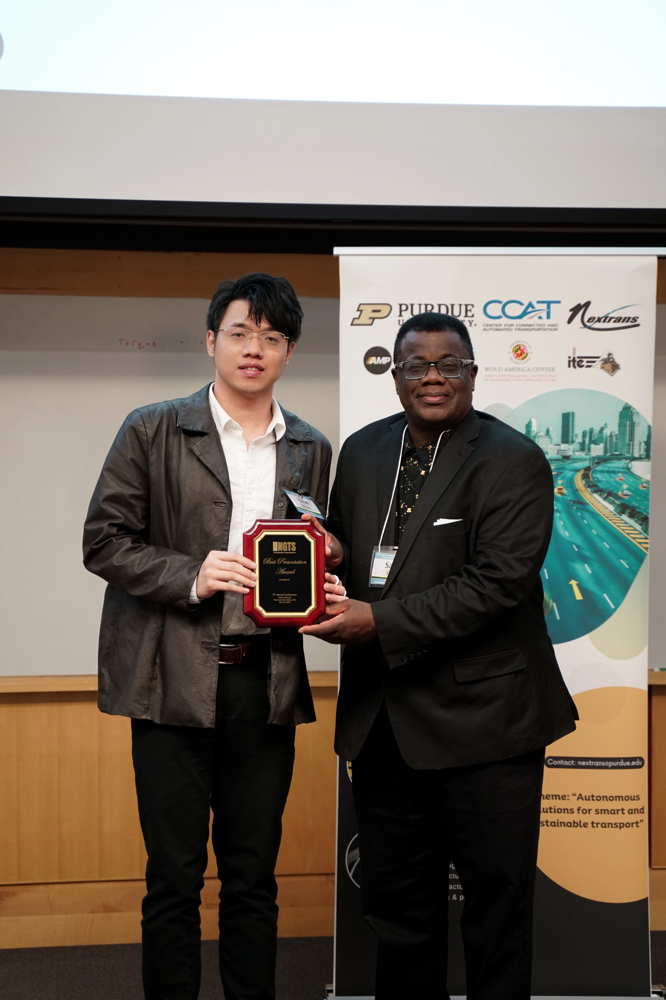

I was delighted to return to Purdue University for the 5th Next-Generation Transport Systems Annual Conference, NGTS 2026, organized with the support of the Lyles School of Civil and Construction Engineering and the Center for Connected and Automated Transportation.

It was wonderful to see so many familiar faces again. The conversations, energy, and shared commitment to advancing transportation research made this visit especially meaningful.

I presented our research, **“Sim2Real-AD: A Modular Sim-to-Real Framework for Deploying Reinforcement Learning in Real-World Autonomous Driving,”** and was deeply honored to receive the **Best Presentation Award**. My sincere thanks to Prof. Sam Labi for his outstanding leadership in organizing the conference and to my advisor, Prof. [Sikai (Sky) Chen](https://directory.engr.wisc.edu/cee/Faculty/Chen_Sikai/), for his continuous guidance and support. I am also grateful to all members and volunteers of the organizing committee, especially Jiancong Chen, Yansong Qu, and Shiwei Fu, whose efforts made this conference possible. 🙏

More details about the conference, presentations, and award recipients are available in the [Purdue University Lyles School of Civil and Construction Engineering's full report](https://purduece.exposure.co/lscce-hosts-5th-annual-next-generation-transport-systems-conference).

  

    
    

      Presenting Sim2Real-AD at NGTS 2026.
    

  

  

    
    

      Connecting with researchers and friends at the conference.
    

  

  

    
    

      Back at Purdue University for NGTS 2026.
    

  

  

    
    

      Discussing research during the NGTS 2026 poster session.
    

  

  

    
    

      Receiving the Best Presentation Award at NGTS 2026.
    

  

