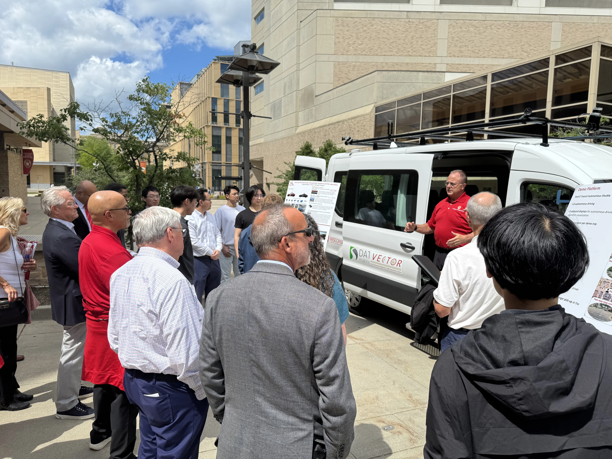
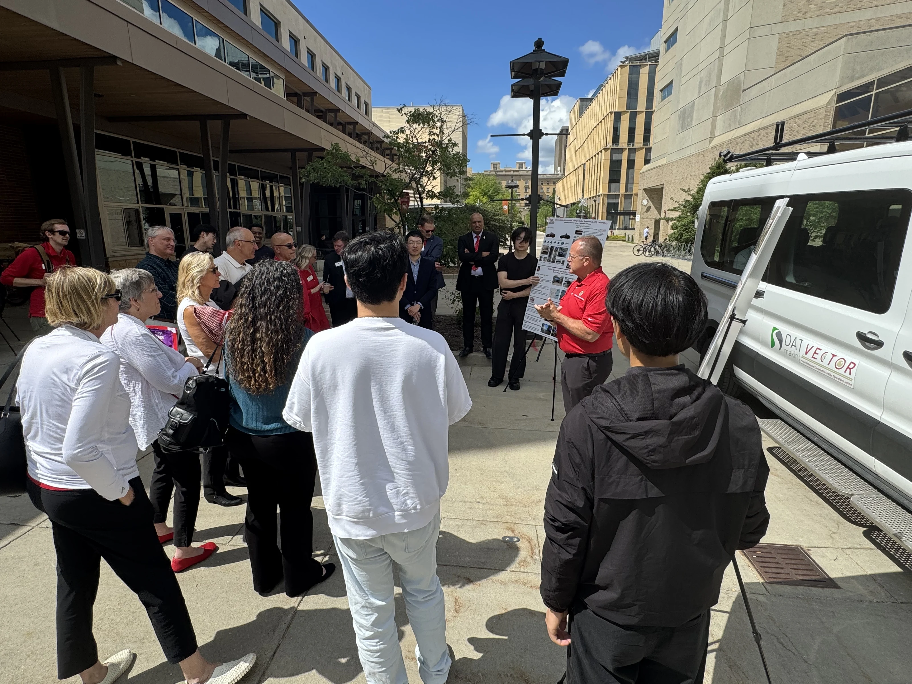
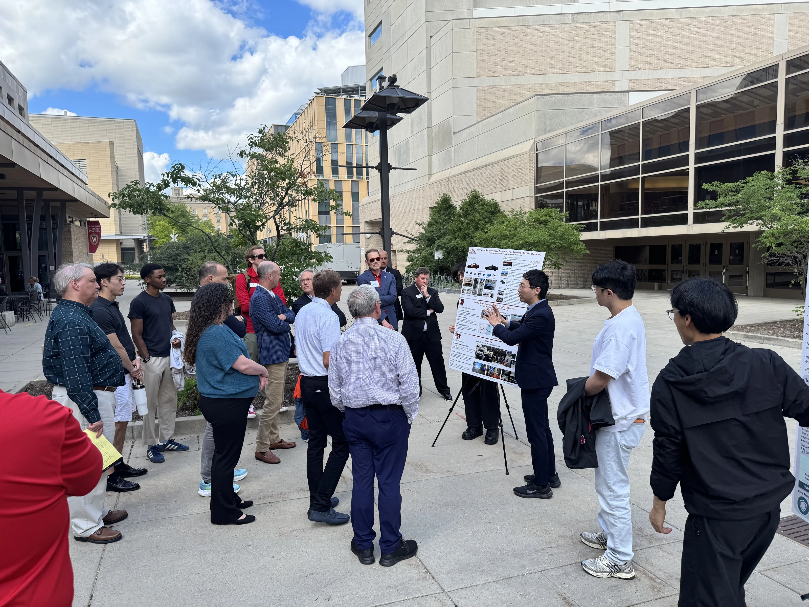
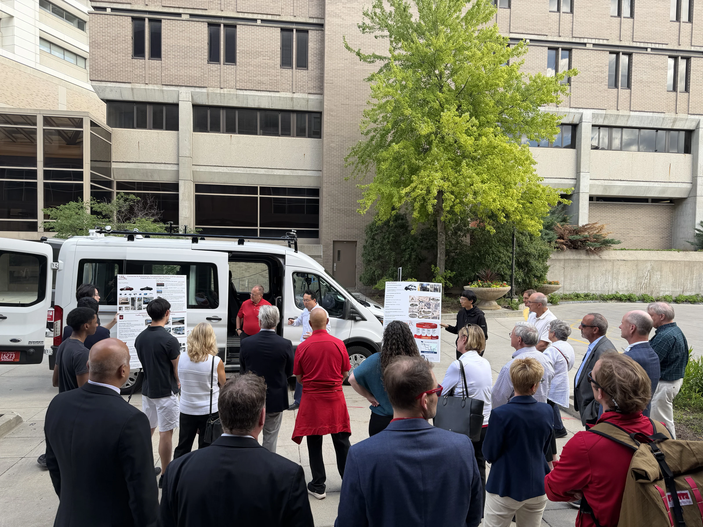
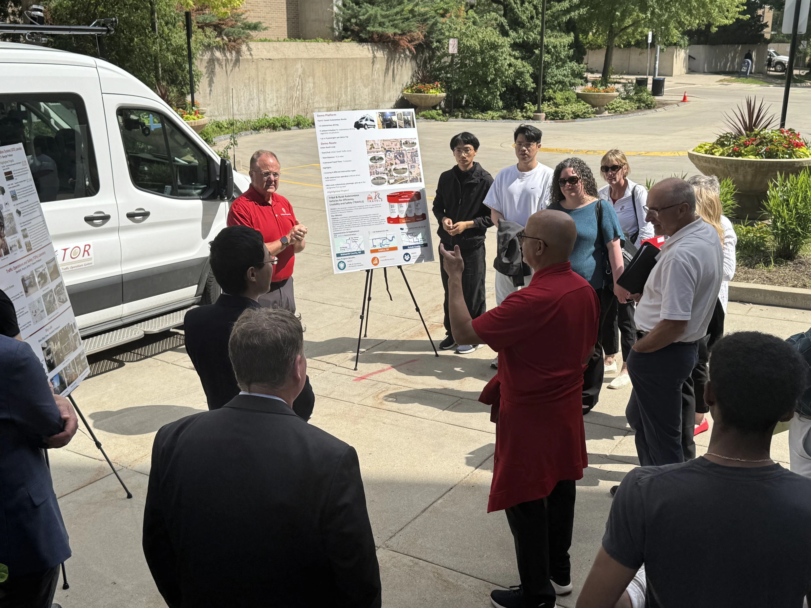
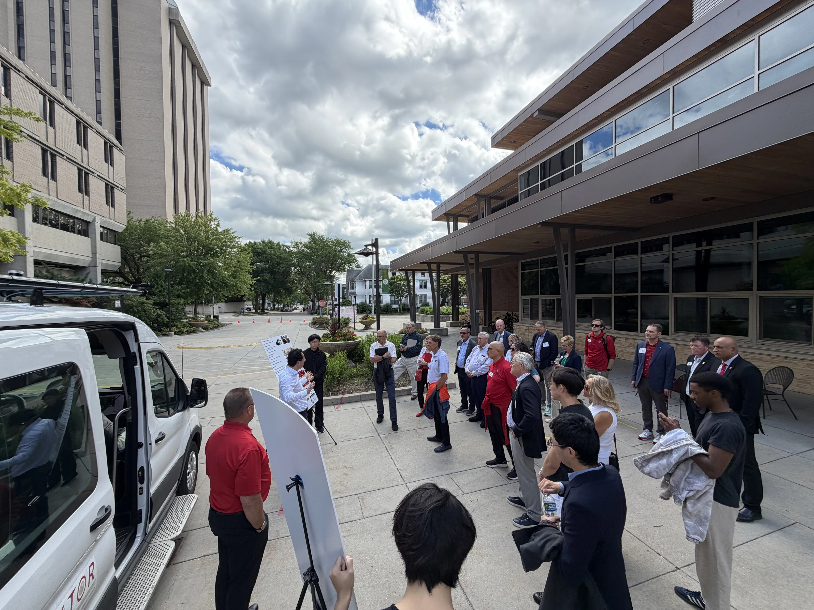
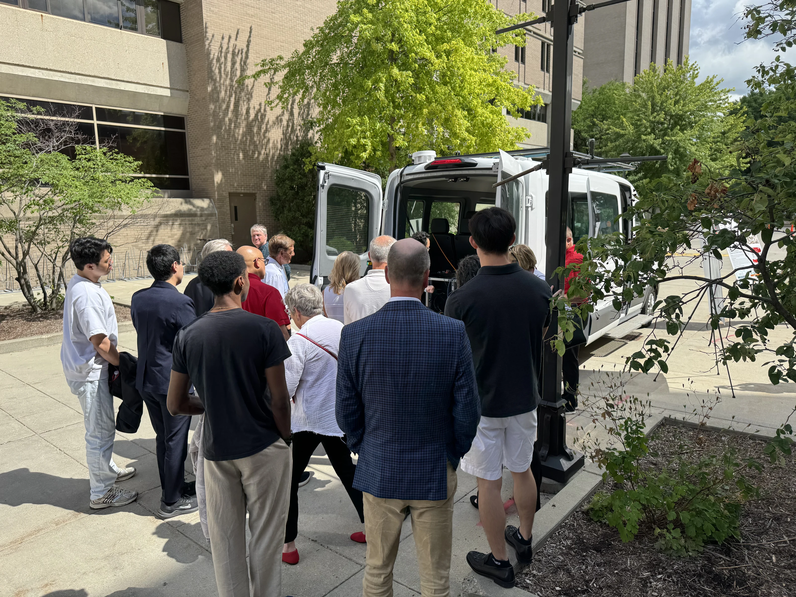
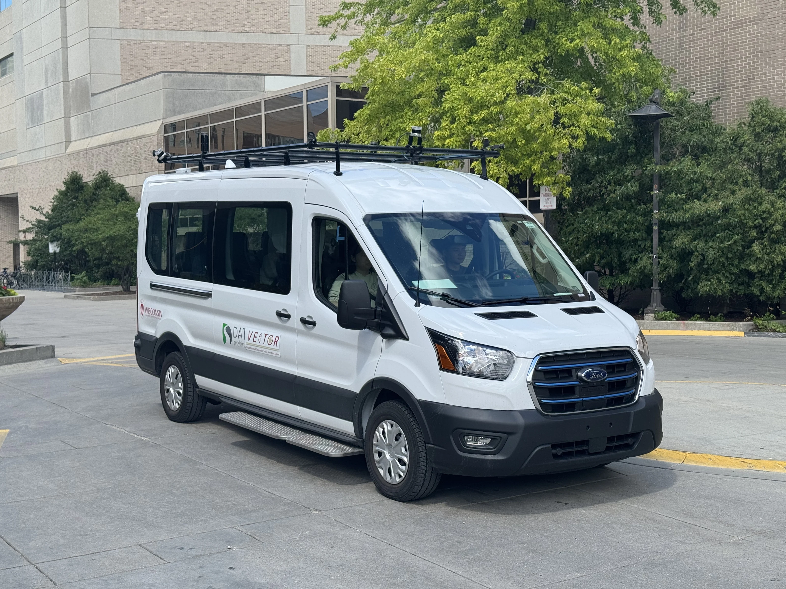

We were delighted to present autonomous vehicle research from [Sky-Lab](https://sky-lab-uw.github.io/) and the [CATS Lab](https://catslab.engr.wisc.edu/) to members of the **Wisconsin Foundation and Alumni Association (WFAA) Board of Directors and Alumni Council** at Union South on June 18, 2026.

The session, **“Transportation of the Future: College of Engineering's Autonomous Vehicle Fleet,”** offered guests a hands-on look at how our team is advancing autonomous transportation. We introduced the College of Engineering's autonomous vehicle fleet, shared our research activities and the mission of the [TRAVELS Center](https://engineering.wisc.edu/news/with-uw-madison-leadership-autonomous-vehicles-could-bridge-transportation-gaps-for-people-living-in-rural-areas/), and demonstrated the autonomous shuttle's passenger-request and pick-up process. Guests also had the opportunity to take short rides in the research vehicle and experience the system firsthand.

  

    
    

      Introducing Sky-Lab and CATS Lab autonomous vehicle research.
    

  

  

    
    

      Welcoming guests beside the autonomous shuttle at Union South.
    

  

  

    
    

      Sharing the technologies and research behind the demonstration.
    

  

  

    
    

      Engaging with WFAA Board and Alumni Council members.
    

  

  

    
    

      Discussing autonomous transportation research with university and alumni leaders.
    

  

  

    
    

      The live demonstration setup outside Union South.
    

  

  

    
    

      A closer look at the autonomous vehicle platform.
    

  

  

    
    

      The autonomous research shuttle used for the live ride demonstration.
    

  

