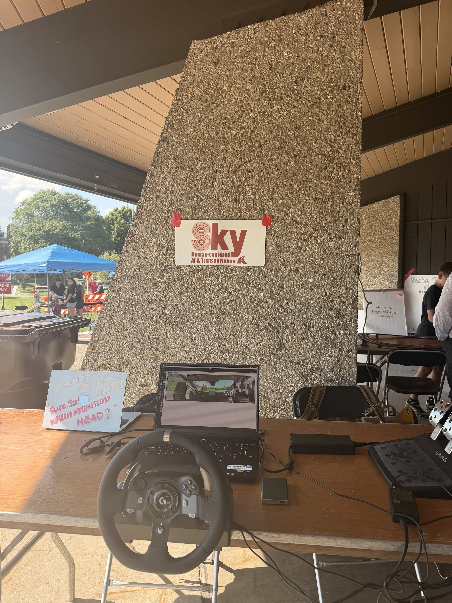
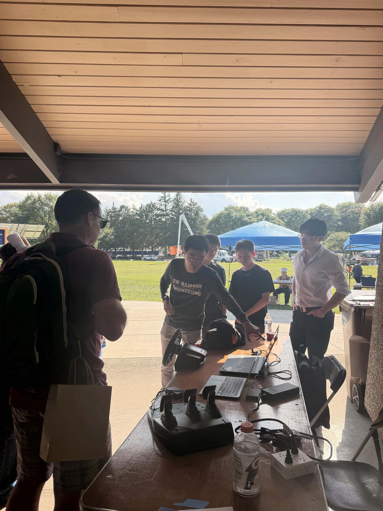
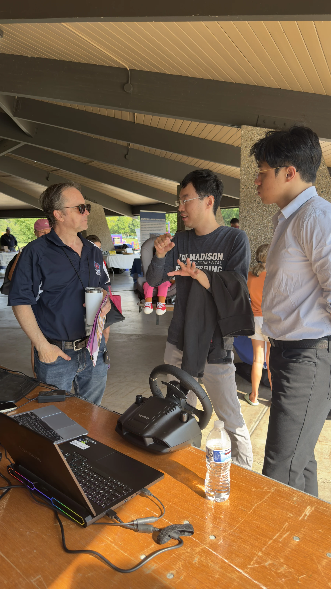
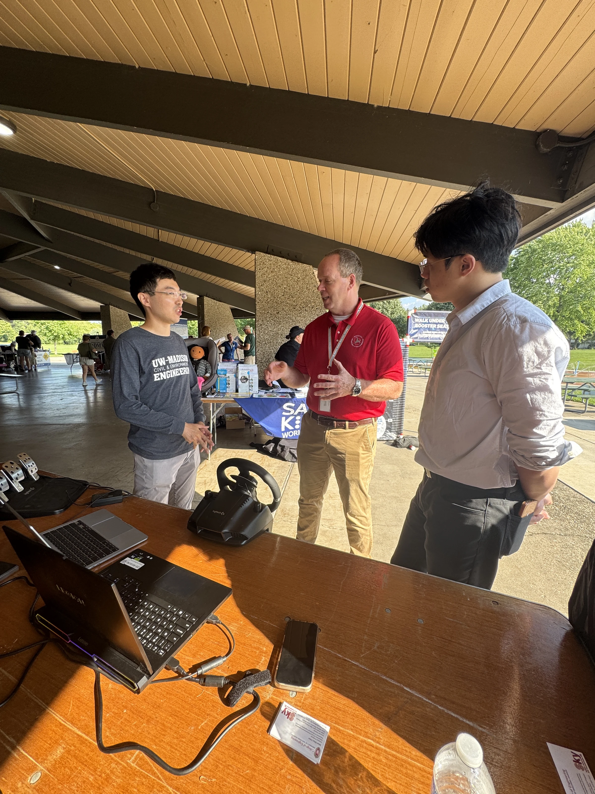
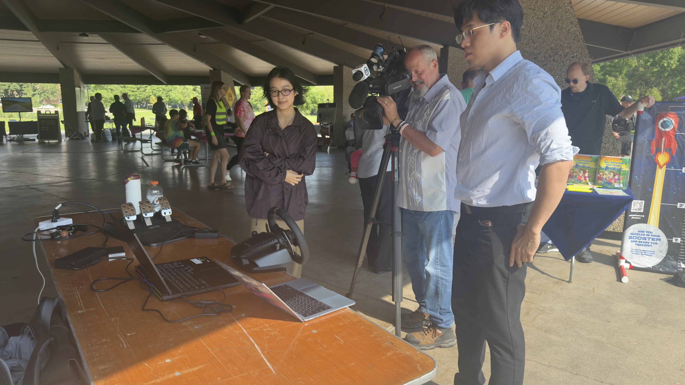
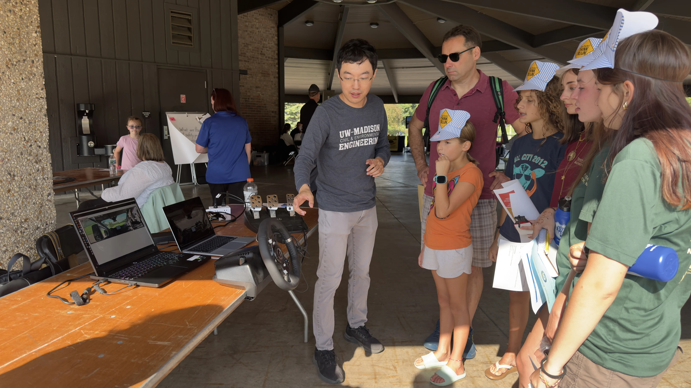
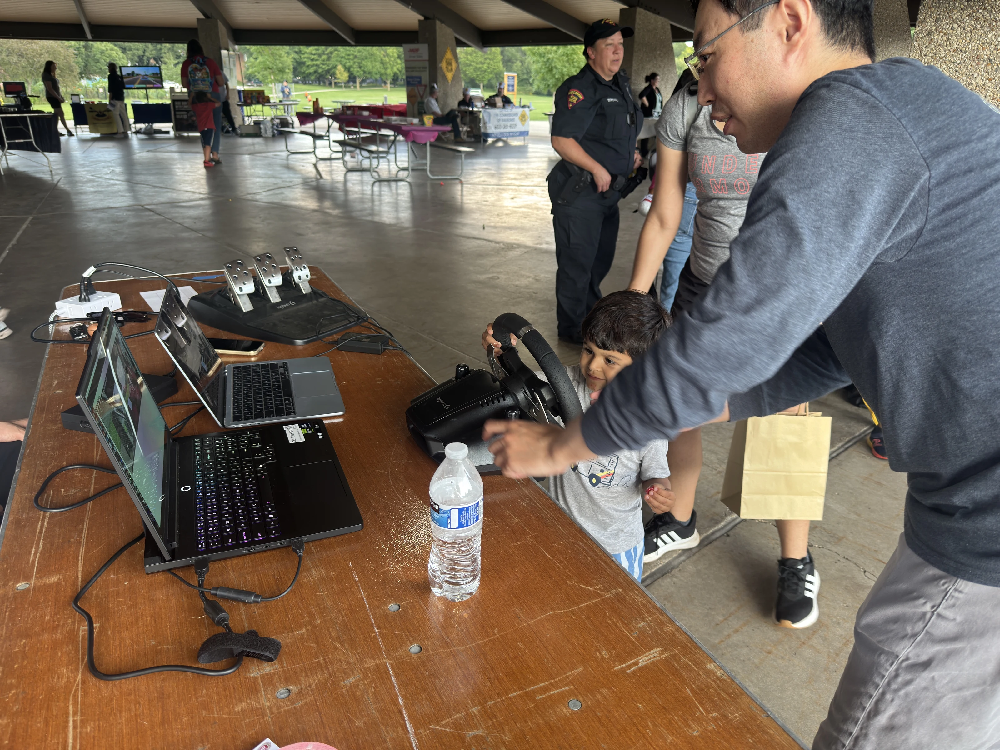
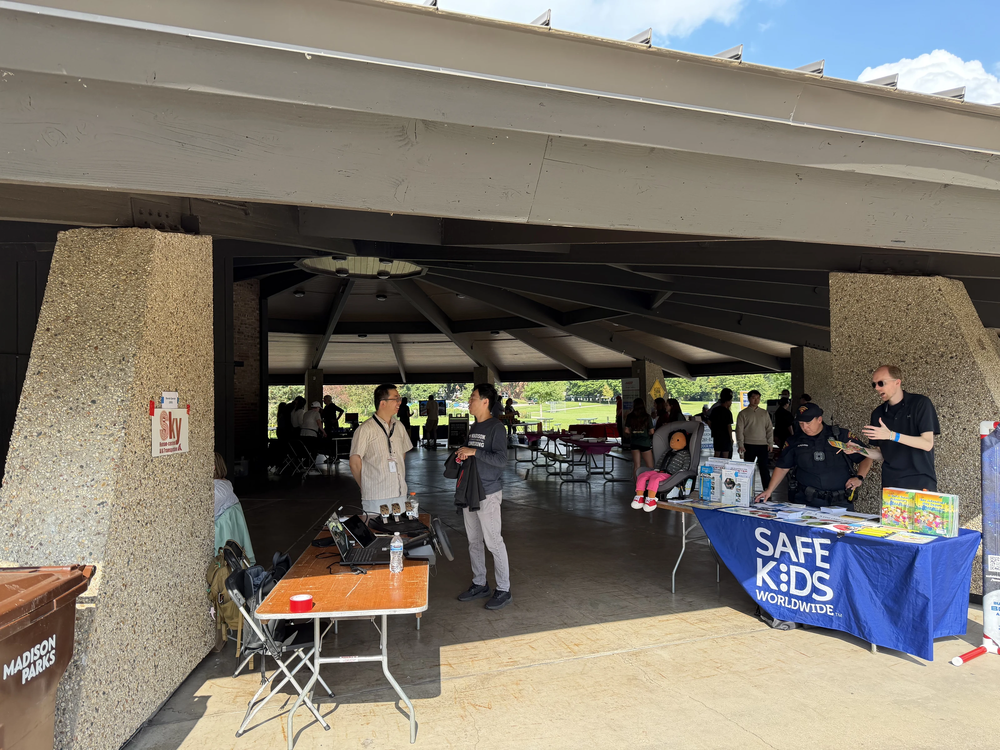
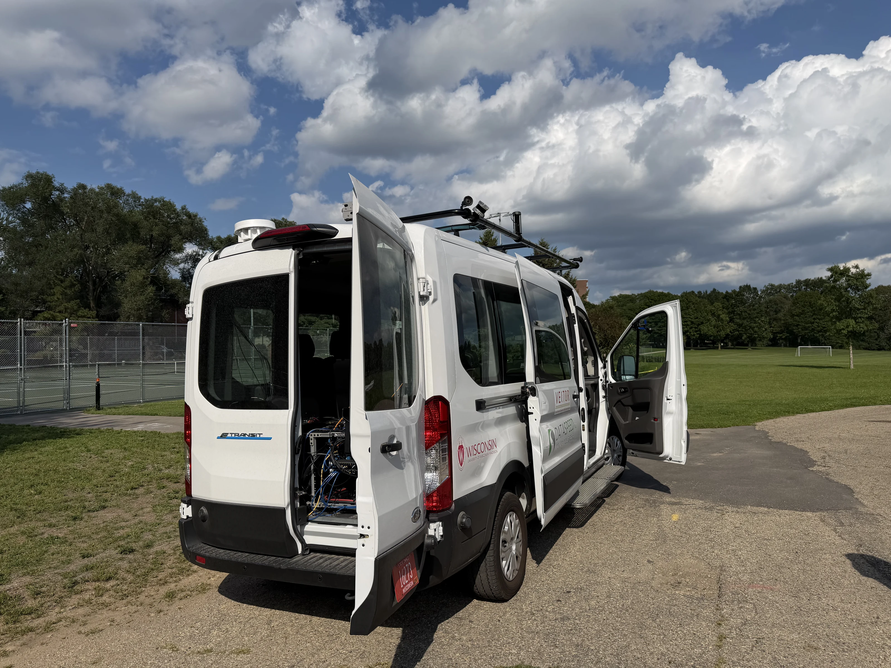
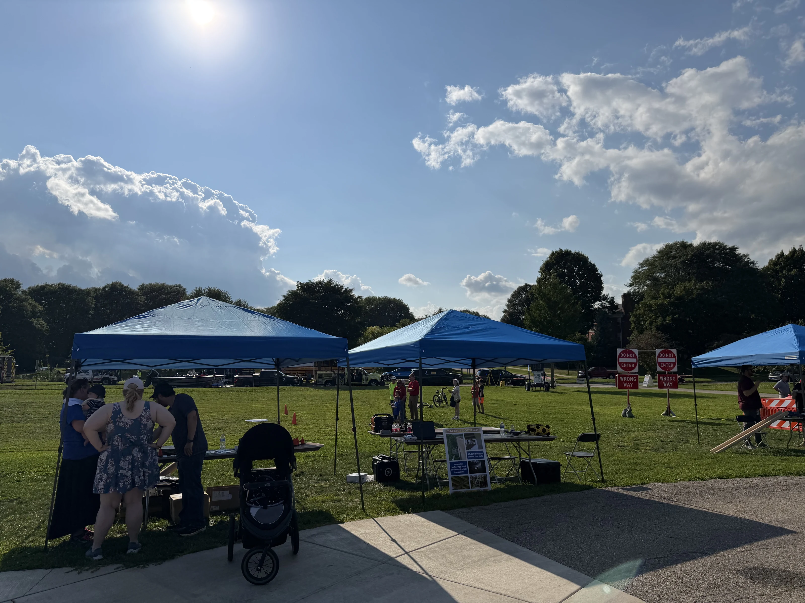

We were excited to join the **WisDOT Safer Together Community Event** at Rennebohm Park on August 26, 2026. From 3:00 to 7:00 p.m., our team at [Sky-Lab](https://sky-lab-uw.github.io/) shared remote-driving and autonomous vehicle research with community members of all ages.

At our remote vehicle operation station, visitors explored how a driver can interact with a research vehicle through a steering-wheel control setup and live computer interface. We also displayed our autonomous research vehicle and discussed how connected, automated, and remotely operated technologies can support safer and more accessible transportation.

More details about the event and its transportation safety partners are available in [WisDOT's official report](https://wisconsindot.gov/Pages/about-wisdot/newsroom/news-rel/082626-safer-together-event.aspx). 🚐

  

    
    

      Our remote-driving station at Rennebohm Park.
    

  

  

    
    

      Introducing visitors to the remote-driving controls.
    

  

  

    
    

      Discussing remote-driving research with Brad Basten, WisDOT Strategic Initiatives Policy Advisor for connected and automated vehicles.
    

  

  

    
    

      Sharing our remote-driving demonstration with WisDOT Deputy Secretary Scott Lawry.
    

  

  

    
    

      Presenting our remote-driving research to event attendees.
    

  

  

    
    

      Sharing the demonstration with visitors of all ages.
    

  

  

    
    

      A hands-on look at the remote-driving interface.
    

  

  

    
    

      Transportation safety exhibits inside the park pavilion.
    

  

  

    
    

      Our autonomous research vehicle on display.
    

  

  

    
    

      The Safer Together Community Event at Rennebohm Park.
    

  

