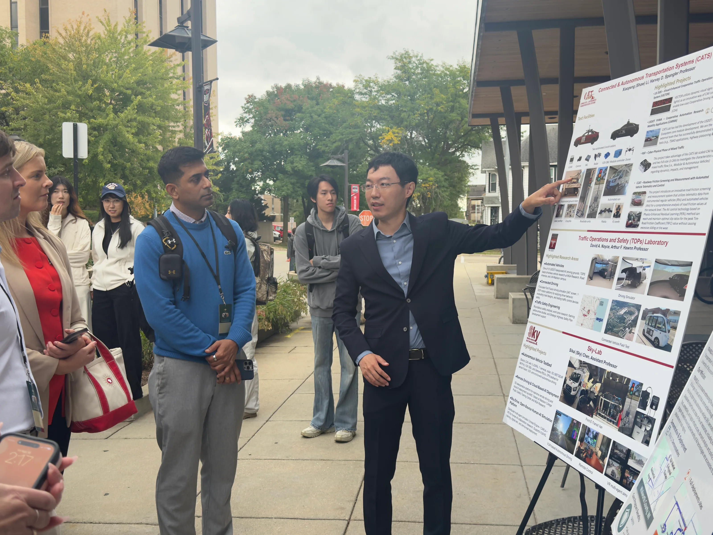
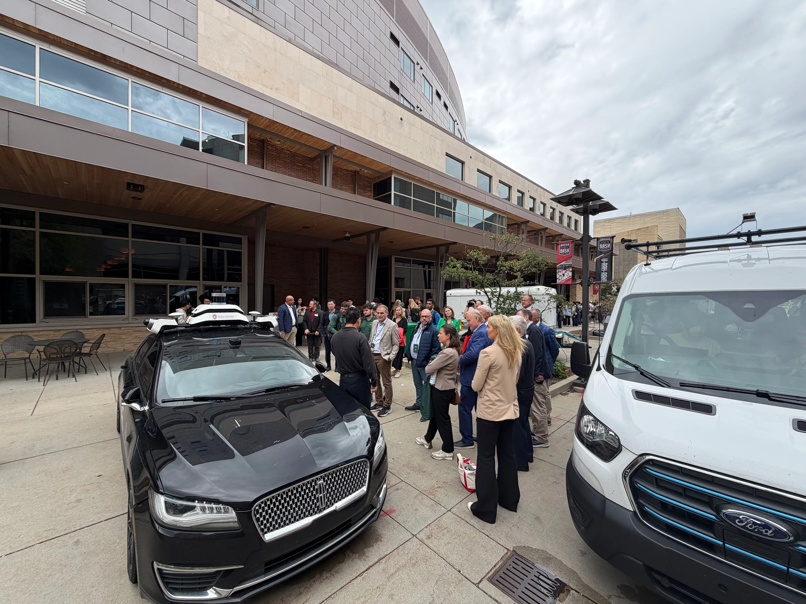
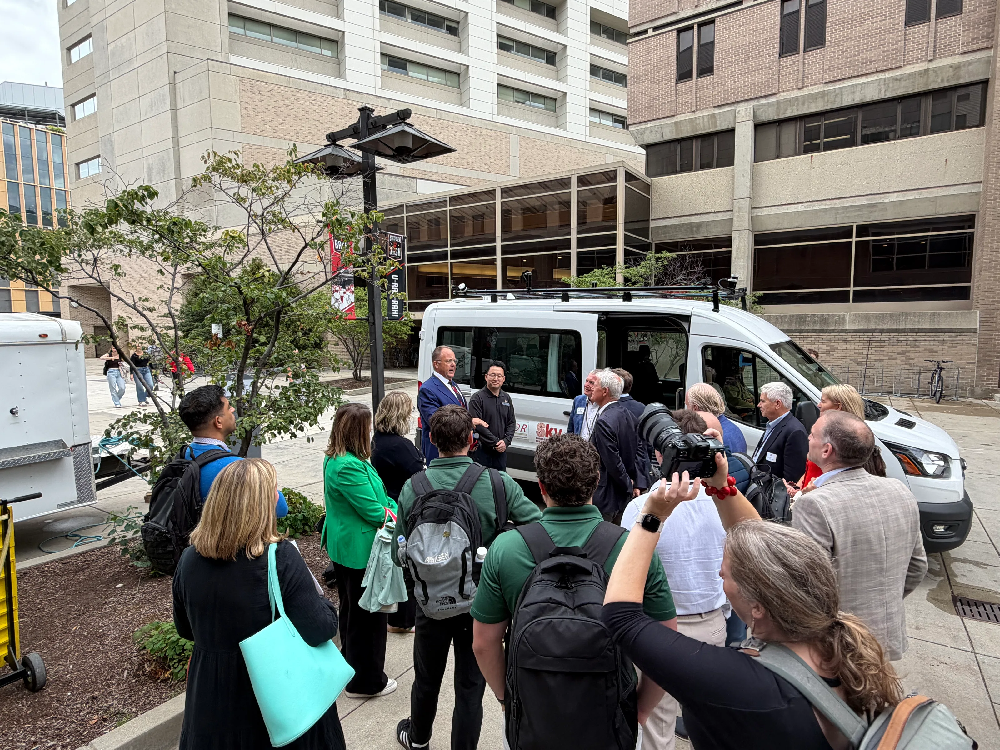
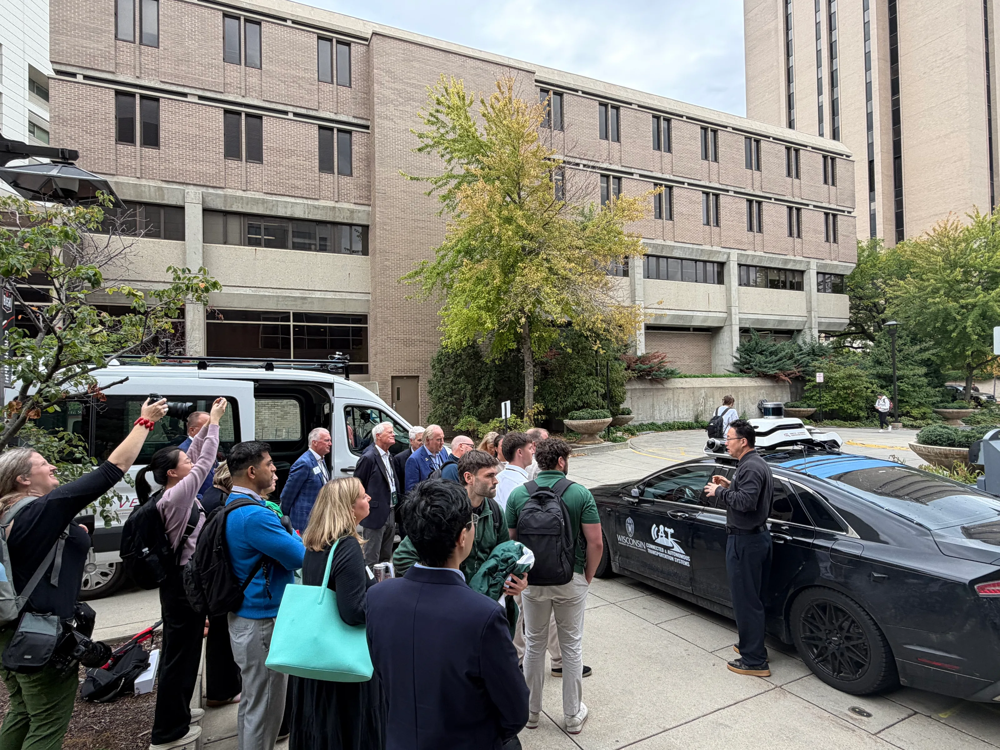
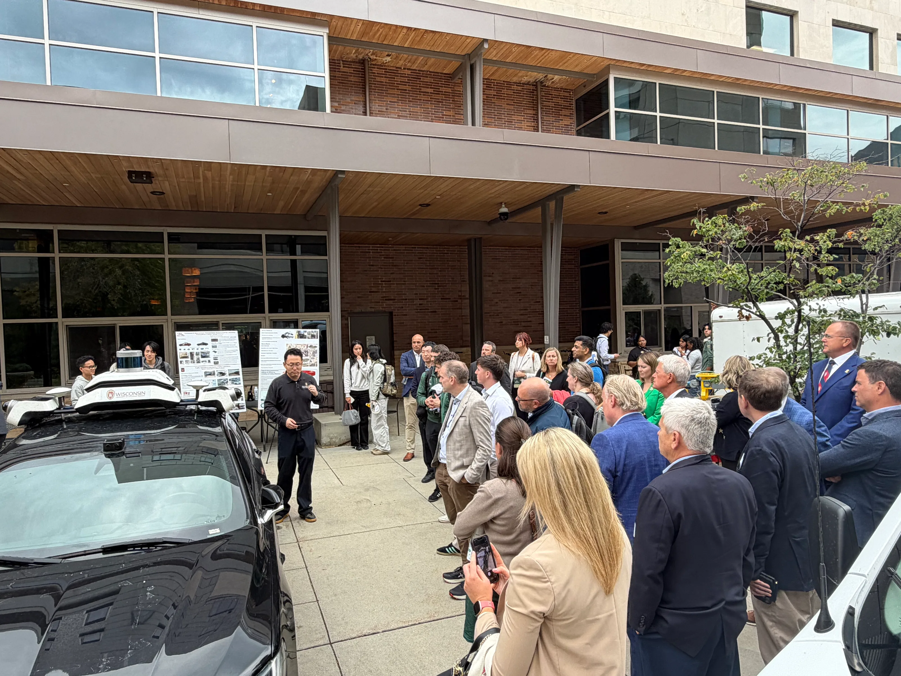
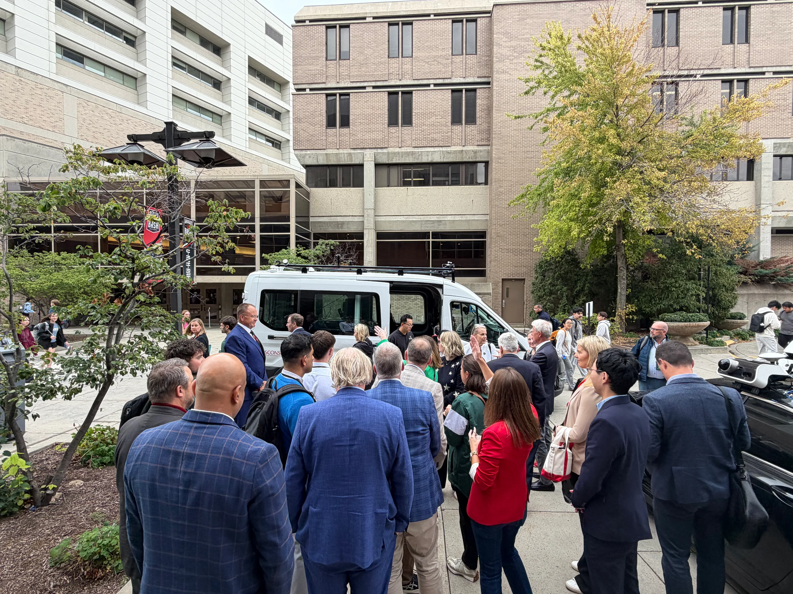

We were pleased to welcome an Irish delegation of government officials, industry leaders, and organizers of the **Aer Lingus College Football Classic** to UW–Madison on September 18, 2026. During their visit to Union South, our team at [Sky-Lab](https://sky-lab-uw.github.io/), together with colleagues from the [CATS Lab](https://catslab.engr.wisc.edu/), showcased our connected and autonomous vehicle research.

Our teams introduced the delegation to UW–Madison's autonomous vehicle platforms, the sensing and computing systems that support them, and ongoing research aimed at making transportation safer, smarter, and more accessible.

More details about the delegation's visit are available in [UW–Madison's official report](https://news.wisc.edu/ireland-meet-uw-madison/). 🚐

  

    
    

      Prof. Sikai Chen presenting CATS Lab and Sky-Lab research to members of the Irish delegation.
    

  

  

    
    

      Introducing the College of Engineering's connected and autonomous vehicle fleet.
    

  

  

    
    

      Prof. David A. Noyce introducing our autonomous vehicle research to the Irish delegation.
    

  

  

    
    

      Prof. Xiaopeng Li sharing the sensing and computing technologies behind the research vehicles.
    

  

  

    
    

      Presenting our connected and autonomous transportation projects.
    

  

  

    
    

      The autonomous vehicle demonstration outside Union South.
    

  

