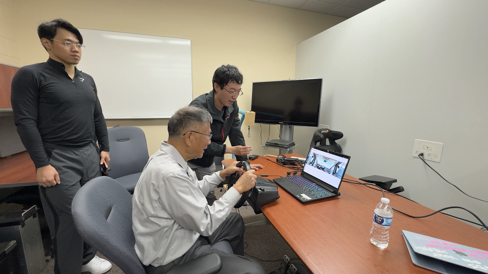
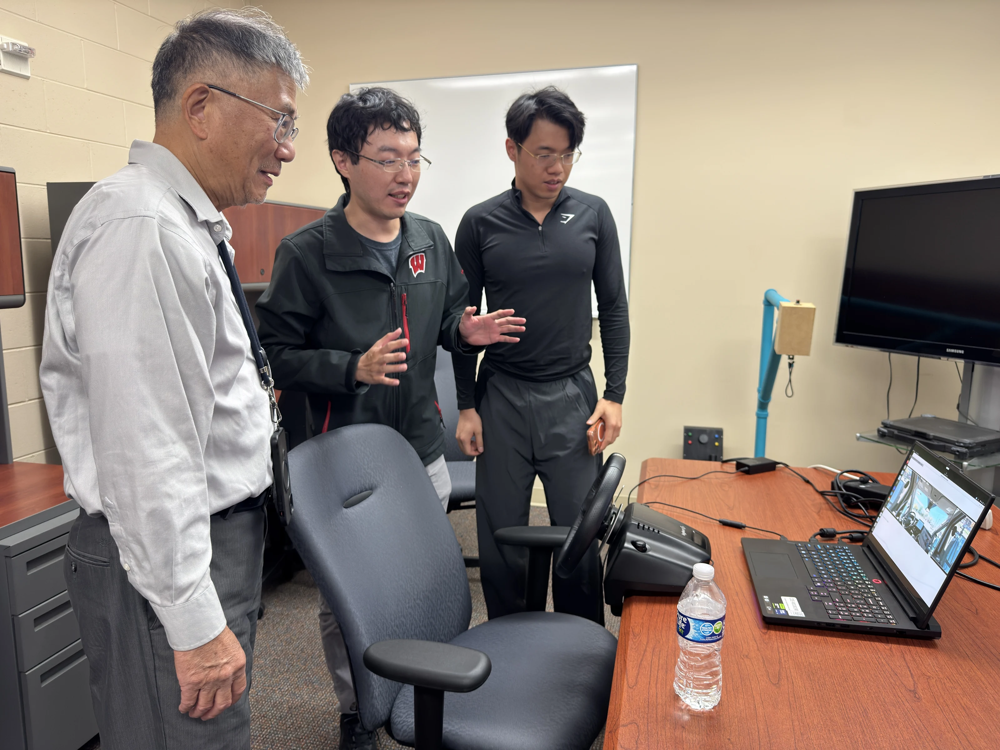
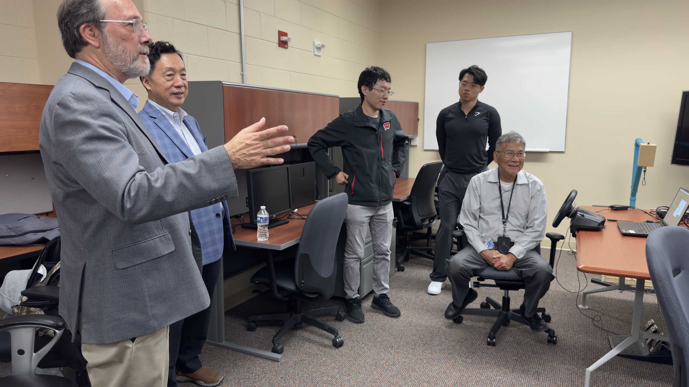
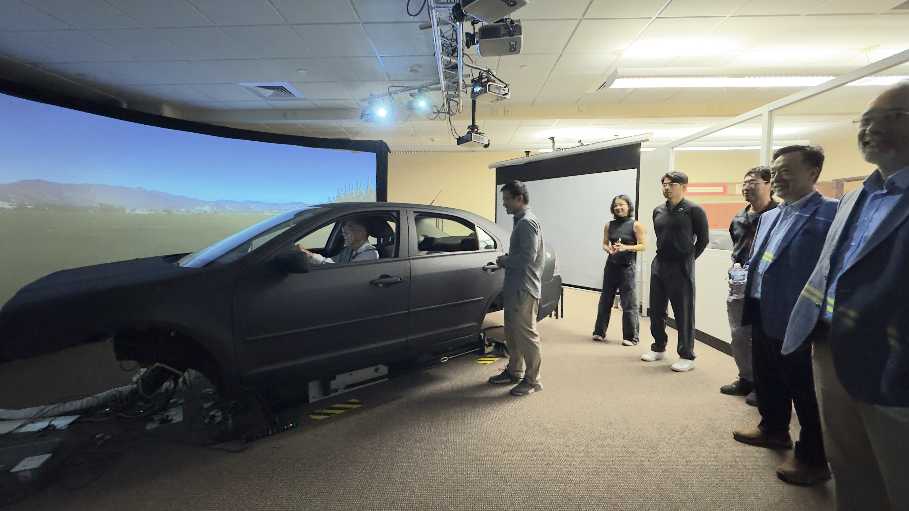

On October 8, 2026, our team at [Sky-Lab](https://sky-lab-uw.github.io/) demonstrated our remote-driving research to Prof. [**Jong-Shi Pang**](https://ise.usc.edu/directory/faculty/profile/?fname=Jong-shi&lname=Pang) during his visit to UW–Madison. Prof. Pang is a member of the National Academy of Engineering and the Epstein Family Chair and Distinguished Professor of Industrial and Systems Engineering at the University of Southern California.

Prof. Pang used the steering-wheel control station and live video interface to remotely operate our research vehicle. We also introduced the system setup and discussed how remote operation can support research in connected and autonomous transportation.

  

    
    

      Prof. Jong-Shi Pang operating the remote-driving control station.
    

  

  

    
    

      Introducing the remote-driving control station to Prof. Pang.
    

  

  

    
    

      Discussing the remote-driving system with Dr. Steven T. Parker, Prof. Sikai Chen, Prof. Bin Ran, and Prof. Jong-Shi Pang.
    

  

  

    
    

      Visiting the autonomous-driving simulator.
    

  

