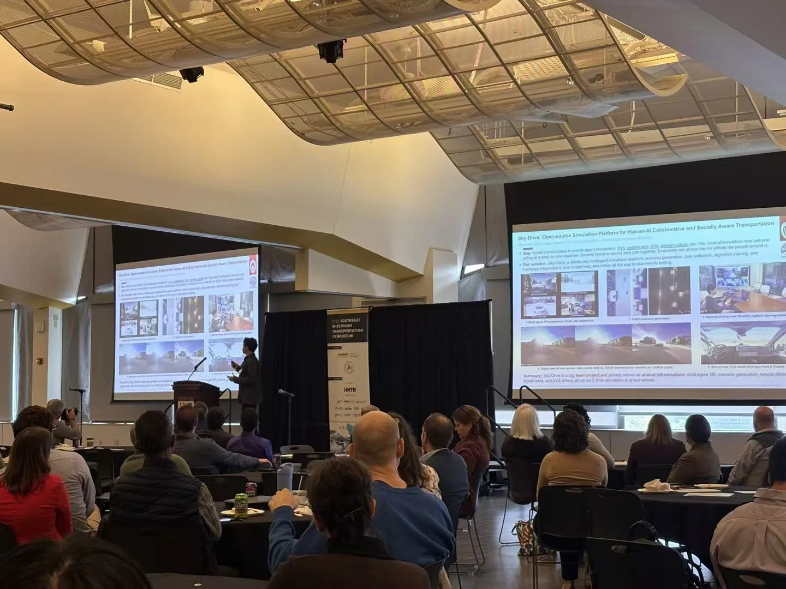
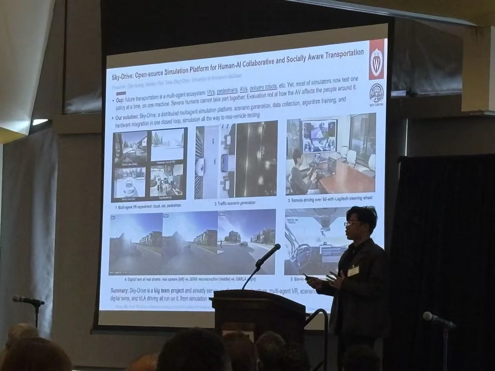
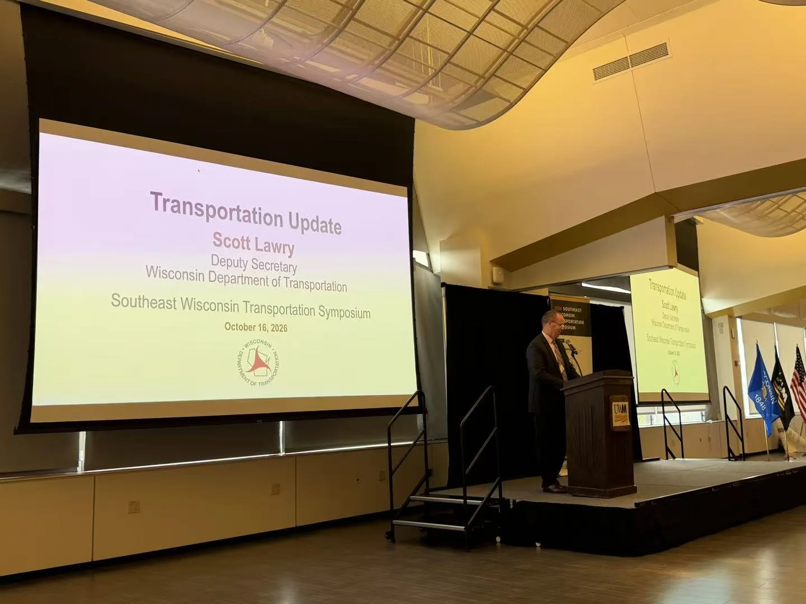
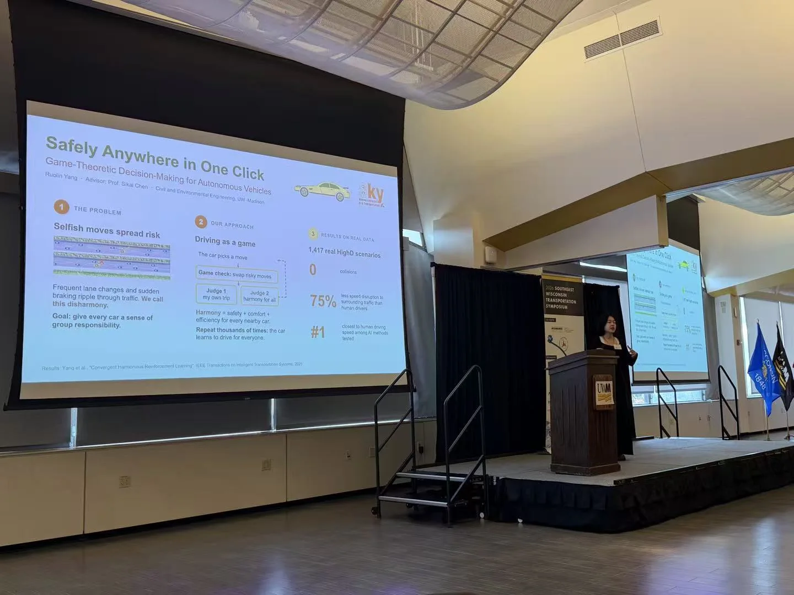
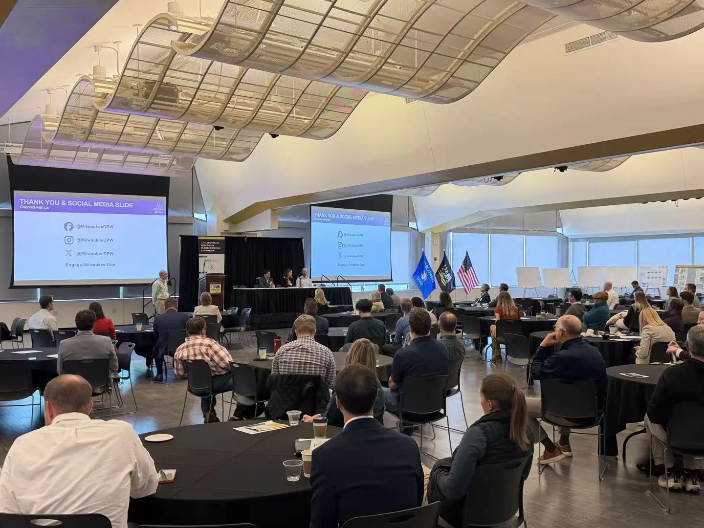
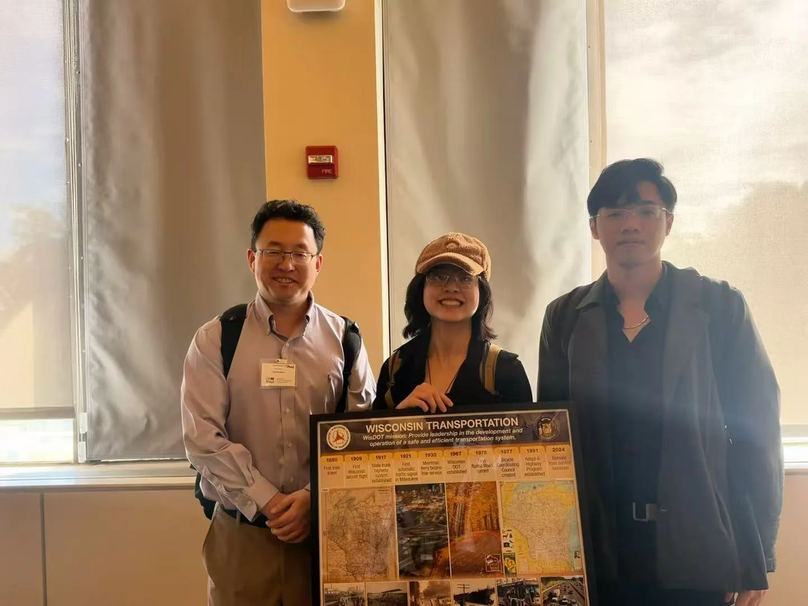

On October 16, 2026, I attended the [2026 Southeast Wisconsin Transportation Symposium](https://uwm.edu/ipit/events/2026-southeast-wisconsin-transportation-symposium/) at the University of Wisconsin–Milwaukee. The symposium was organized by UWM's Institute for Physical Infrastructure and Transportation in collaboration with the Wisconsin Department of Transportation.

During the symposium, I gave a brief presentation titled **“Sky-Drive: Open-Source Simulation Platform for Human–AI Collaborative and Socially Aware Transportation.”** I shared our ongoing work on the distributed multi-agent simulation platform and its use in studying interactions among autonomous vehicles, human-driven vehicles, pedestrians, and other transportation agents.

I appreciated the opportunity to share our work and learn from transportation researchers and practitioners from across Wisconsin.

  

    
    

      Presenting Sky-Drive at the 2026 Southeast Wisconsin Transportation Symposium.
    

  

  

    
    

      Sharing our ongoing work on Sky-Drive.
    

  

  

    
    

      WisDOT Deputy Secretary Scott Lawry providing a transportation update during the symposium.
    

  

  

    
    

      An additional research presentation at the symposium.
    

  

  

    
    

      A panel discussion with transportation researchers and practitioners.
    

  

  

    
    

      With Prof. Xiaopeng Li and fellow Sky-Lab members.
    

  

