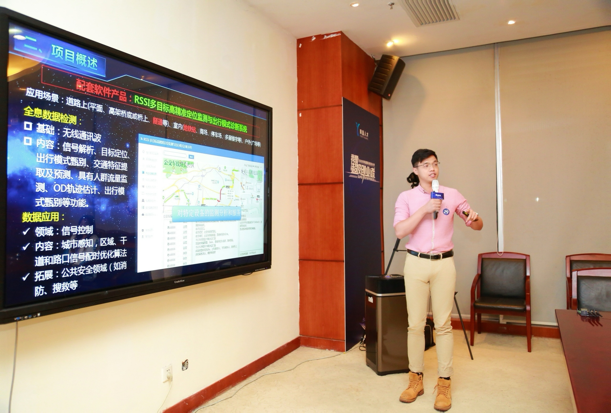
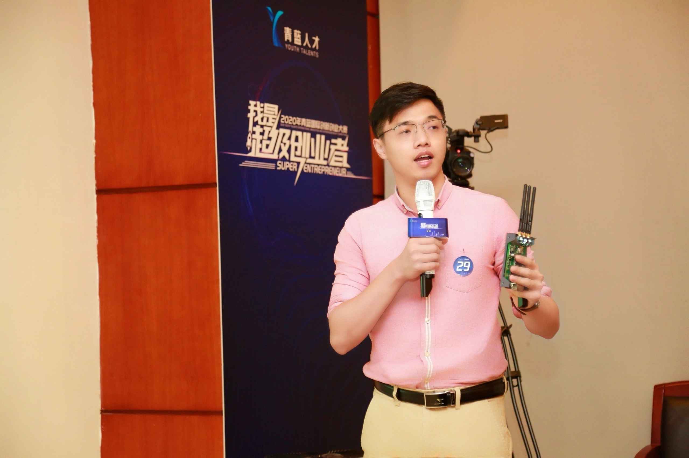
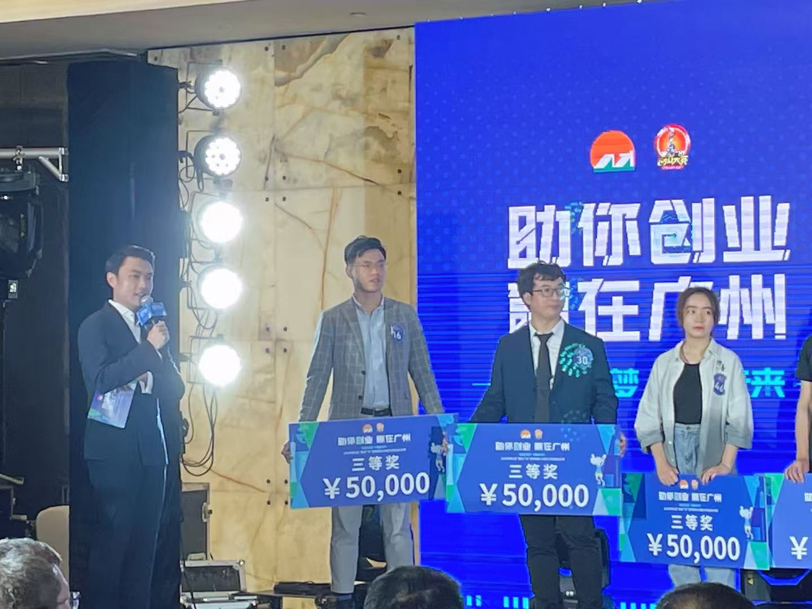
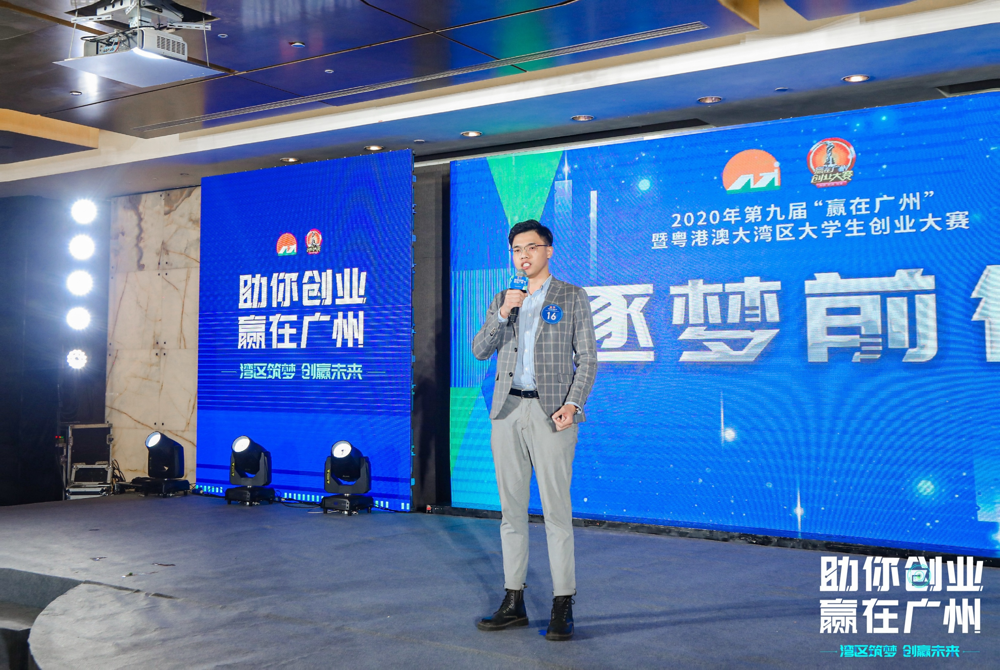
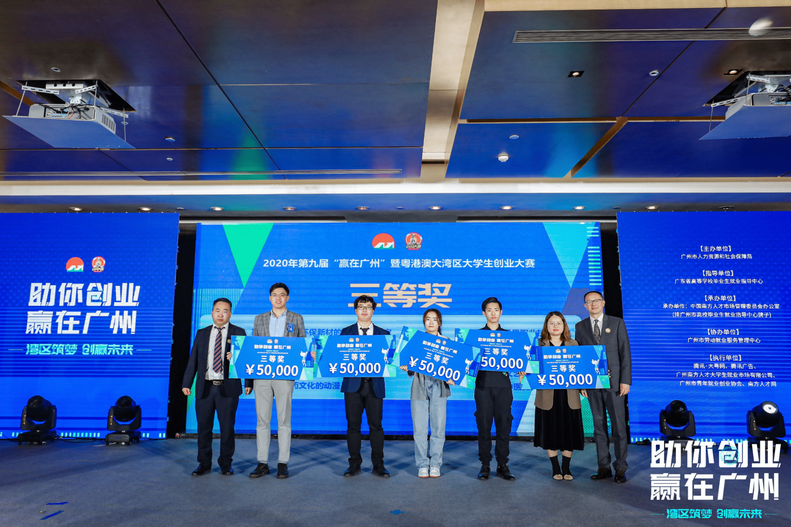
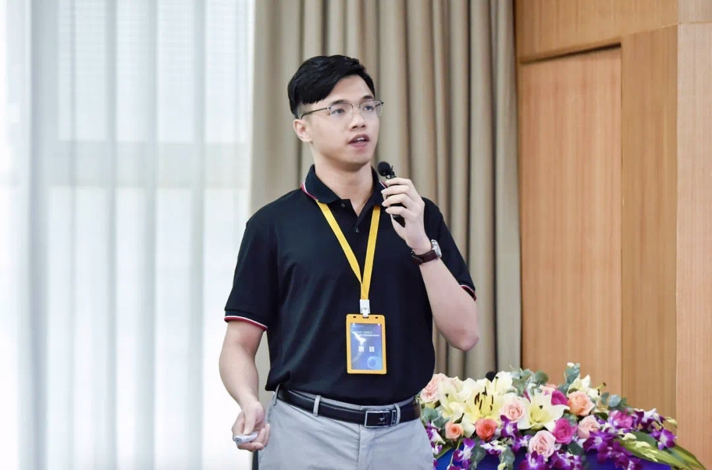
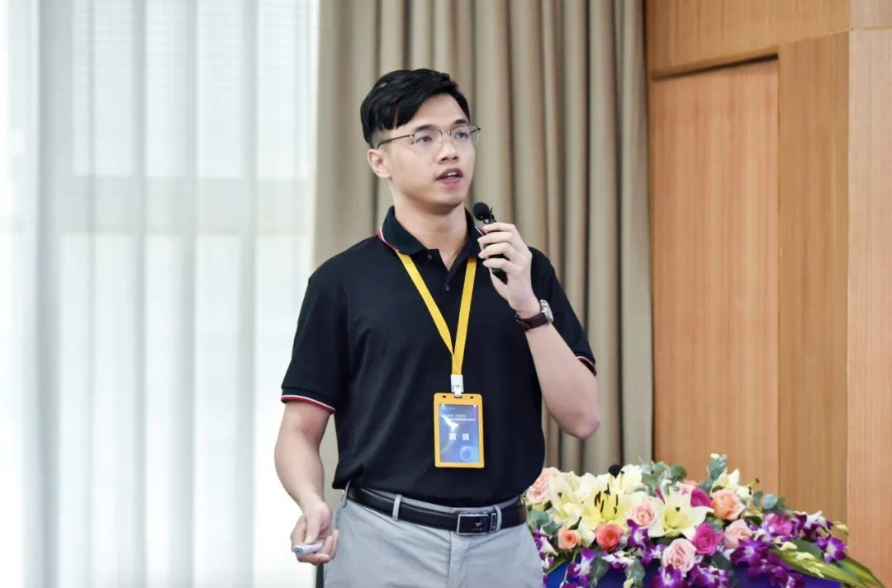

<h4>Technology Transfer</h4>

<!-- 

  Growing up in Shenzhen, China, I witnessed the city's remarkable transformation from a small fishing village into a global technology hub - what many call the "Shenzhen speed." This environment planted the seeds of entrepreneurial spirit in me from an early age. During high school, I ventured into selling phone cards, coordinating food delivery services for school, setting up market stalls, selling courses, and organizing the campus laundry market. These experiences laid the foundation for my understanding of business models. 

 -->
  

  
I am deeply passionate about bridging the gap between scientific discovery and real-world impact. Before beginning my Ph.D. journey, <b>I founded two technology companies</b> in China, aiming to transform my research findings into practical solutions. Through this experience, I had the opportunity to collaborate with industry professionals and gain valuable insights into the innovation ecosystem. Encouragingly, the companies attracted <b>over 3 million RMB</b> in potential investment from leading institutions such as <b>Yueke Securities</b> and <b>CITIC Securities</b>. These experiences reinforced my belief that when scientific discoveries move beyond the lab and into society, they can generate meaningful and lasting value.

<!-- Entrepreneurship images -->

  

    
    

      Qinglan Project (2021)
    

  

  

    
    

      Qinglan Project (2021)
    

  

  

    
    

      Winning Guangdong Competition (2020)
    

  

  

    
    

      Winning Guangdong Competition (2020)
    

  

  

    
    

      Winning Guangdong Competition (2020)
    

  

  

    
    

      Chuangke Guangdong Competition (2020)
    

  

  

    
    

      Chuangke Guangdong Competition (2020)
    

  

<h4>Patents Property</h4>

<h5>Grant of Patent</h5>
<ol class="artistic-list">
<li>发明专利A RSSI-based method for positioning low-speed moving vehicles. <a href="../assets/patents/patent_CN109375168A.pdf" target="_blank">PDF</a> 
Yongjie Lin, <strong>Zilin Huang</strong>, and Lunhui Xu. <em>Invention Patent, CN109375168A</em>.</li>

<li>发明专利A RSSI-based method for positioning low-speed moving vehicles. <a href="../assets/patents/patent_CN201811368103.8.pdf" target="_blank">PDF</a> 
Yongjie Lin, <strong>Zilin Huang</strong>, Sheng Zhao, Lunhui Xu, and Shanyu Tang. <em>Invention Patent, CN201811368103.8</em>.</li>

<li>发明专利Urban traffic operation evaluation method based on ecological index. <a href="../assets/patents/patent_CN201911419439.7.pdf" target="_blank">PDF</a> 
Yongjie Lin, Weijia Zeng, Yanqing Yang, Yuming Cheng, Yuheng Liu, Haixia Guan, and <strong>Zilin Huang</strong>. <em>Invention Patent, CN201911419439.7</em>.</li>

<li>实用新型A device for counting the number of passengers getting on and off in a portable bus. <a href="../assets/patents/patent_CN201920581476.7.pdf" target="_blank">PDF</a> 
<strong>Zilin Huang</strong>, Yongjie Lin, and Lunhui Xu. <em>Utility Model Patent, CN201920581476.7</em>.</li>

<li>实用新型RSSI-based road traffic jam detection and dispersion device. <a href="../assets/patents/patent_CN202021751310.4.pdf" target="_blank">PDF</a> 
<strong>Zilin Huang</strong>, Yuzhuang Pian, Yongjie Lin, Pan Wu, and Yuqing Zhan. <em>Utility Model Patent, CN202021751310.4</em>.</li>

<li>实用新型Vehicle-mounted positioning device based on RSSI and inertial navigation. <a href="../assets/patents/patent_CN201920574767.3.pdf" target="_blank">PDF</a> 
Yongjie Lin, <strong>Zilin Huang</strong>. <em>Utility Model Patent, CN201920574767.3</em>.</li>

<li>实用新型Micro device for positioning moving target based on RSSI. <a href="../assets/patents/patent_CN201920574719.4.pdf" target="_blank">PDF</a> 
Yongjie Lin, <strong>Zilin Huang</strong>. <em>Utility Model Patent, CN201920574719.4</em>.</li>

<li>实用新型An obstacle avoidance system for unmanned vehicles based on machine vision and infrared sensors. <a href="../assets/patents/patent_CN202020235979.1.pdf" target="_blank">PDF</a> 
Yongjie Lin, <strong>Zilin Huang</strong>, and Lunhui Xu. <em>Utility Model Patent, CN202020235979.1</em>.</li>

<li>实用新型Visual navigation system for assisting unmanned vehicles. <a href="../assets/patents/patent_CN202020235977.2.pdf" target="_blank">PDF</a> 
Yongjie Lin, <strong>Zilin Huang</strong>, and Lunhui Xu. <em>Utility Model Patent, CN202020235977.2</em>.</li>

<li>实用新型A target intrusion detection device based on wireless communication signal. <a href="../assets/patents/patent_CN202020965272.6.pdf" target="_blank">PDF</a> 
Yongjie Lin, <strong>Zilin Huang</strong>, and Lunhui Xu. <em>Utility Model Patent, CN202020965272.6</em>.</li>

<li>实用新型A RSSI-based positioning and early warning device for two-passenger and one-dangerous vehicles. <a href="../assets/patents/patent_CN202021751321.2.pdf" target="_blank">PDF</a> 
Yuzhuang Pian, <strong>Zilin Huang</strong>, Yongjie Lin, Yuqing Zhan, and Pan Wu. <em>Utility Model Patent, CN202021751321.2</em>.</li>

<li>实用新型A kind of elevator apparatus of wheel. <a href="../assets/patents/patent_CN201620682753.X.pdf" target="_blank">PDF</a> 
Chao He, Zhanqin Yu, Zequan Hong, Chengzhao Zhang, Ziping Chen, and <strong>Zilin Huang</strong>. <em>Utility Model Patent, CN201620682753.X</em>.</li>

<li>实用新型Tunnel vehicle accident detection and early warning device based on RSSI. <a href="../assets/patents/patent_CN202120982224.2.pdf" target="_blank">PDF</a> 
Binrao, Zhihong Ye, Yongjie Lin, Haochuan Zhong, Yuqing Zhan, Jiajun Wu, Yuzhuang Pian, and <strong>Zilin Huang</strong>. <em>Invention Patent, CN202120982224.2</em>.</li>
</ol>

<h5>Substantive Examination</h5>
<ol class="artistic-list">
<li>发明专利Subway transfer bus behavior identification method, system, computer equipment and storage medium. <a href="../assets/patents/patent_CN201910051795.1.pdf" target="_blank">PDF</a> 
<strong>Zilin Huang</strong>, and Lunhui Xu. <em>Invention Patent, CN201910051795.1</em>.</li>

<li>发明专利The recognition methods of Metro Passenger time getting off, system, computer equipment and storage medium. <a href="../assets/patents/patent_CN201910051785.8.pdf" target="_blank">PDF</a> 
<strong>Zilin Huang</strong>, and Lunhui Xu. <em>Invention Patent, CN201910051785.8</em>.</li>

<li>发明专利A kind of hot spot junction of park and shift recognition methods based on IC card data. <a href="../assets/patents/patent_CN201910339482.6.pdf" target="_blank">PDF</a> 
<strong>Zilin Huang</strong>, and Lunhui Xu. <em>Invention Patent, CN201910339482.6</em>.</li>

<li>发明专利A kind of subway station passenger flow monitoring method and system. <a href="../assets/patents/patent_CN201910338991.7.pdf" target="_blank">PDF</a> 
<strong>Zilin Huang</strong>, Yongjie Lin, and Lunhui Xu. <em>Invention Patent, CN201910338991.7</em>.</li>

<li>发明专利A kind of traffic trip mode identification method based on wireless signal. <a href="../assets/patents/patent_CN201910581470.4.pdf" target="_blank">PDF</a> 
Yongjie Lin, <strong>Zilin Huang</strong>. <em>Invention Patent, CN201910581470.4</em>.</li>
</ol>

<h5>Computer Software Copyright</h5>
<ol class="artistic-list">
<li>软件著作权The Simulation System of Rapid Customization Design Platform for Hollow Glass Automatic Production Line V1.0 
Kuanyuan Li, <strong>Zilin Huang</strong>, Luofang, and Chuang Zhou. <em>Computer Software Copyright, 2017SR099863; Legal Status: Authorization</em>.</li>

<li>软件著作权Intelligent Workshop Rapid Customization Design Platform System V1.0 
Xiaoping Li, Luo Fang, <strong>Zilin Huang</strong>, and Chuang Zhou. <em>Computer Software Copyright, 2017SR302066; Legal Status: Authorization</em>.</li>

<li>软件著作权Student Organization Activity Approval System V1.0 
Junxing Zhang, Ruixuan Cai, Huanzeng Yang, <strong>Zilin Huang</strong>, Poyu Zhuang, Guangzheng Zhong, and Jiahao Jiang. <em>Computer Software Copyright, 2017SR099823; Legal Status: Authorization</em>.</li>

<li>软件著作权Club Activities Background Management System V1.0 
Junxing Zhang, Huanzeng Yang, Poyu Zhuang, <strong>Zilin Huang</strong>, Guangzheng Zhong, and Jiahao Jiang. <em>Computer Software Copyright, 2017SR302060; Legal Status: Authorization</em>.</li>
</ol>

