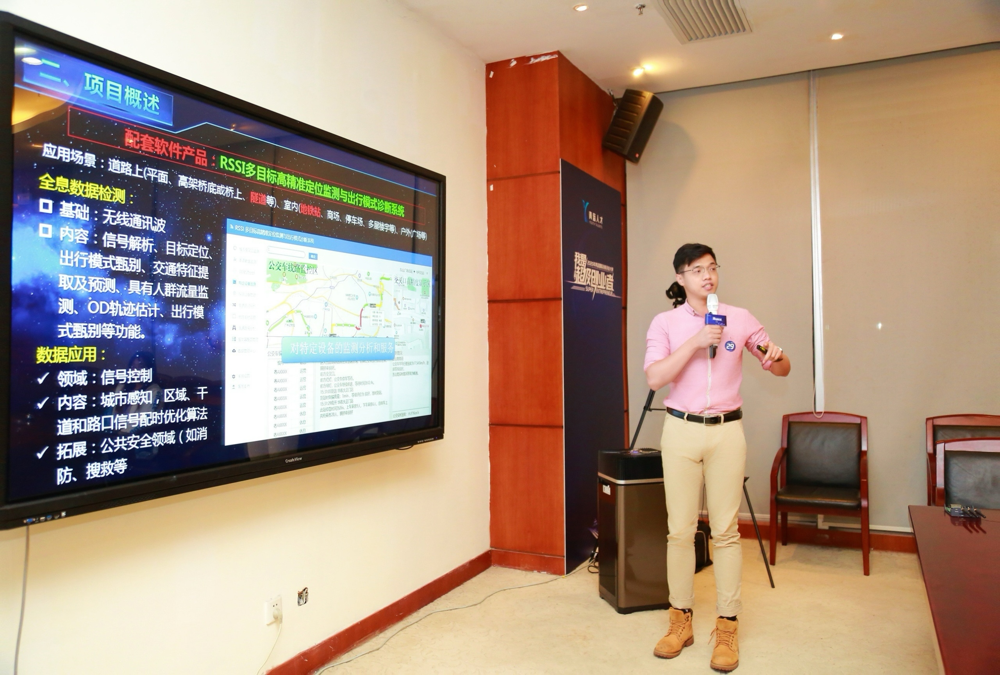
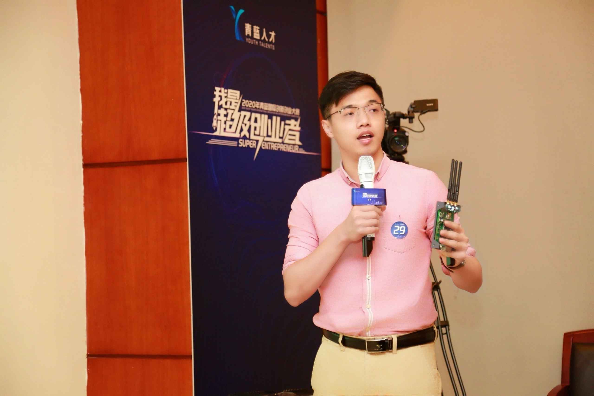
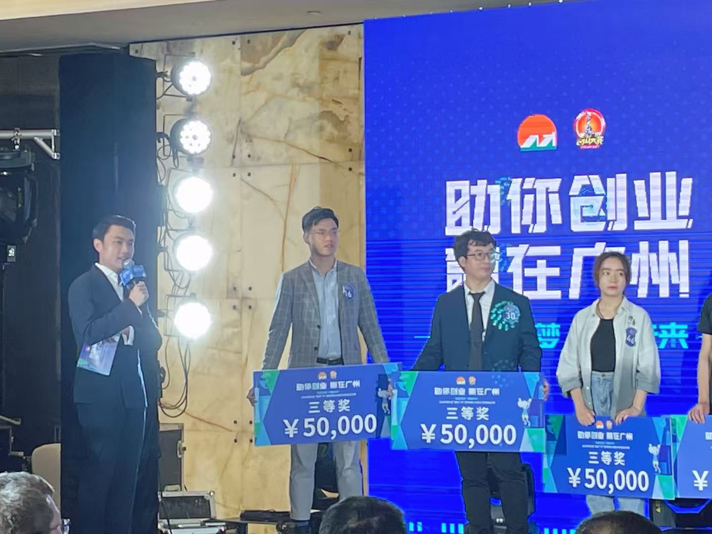
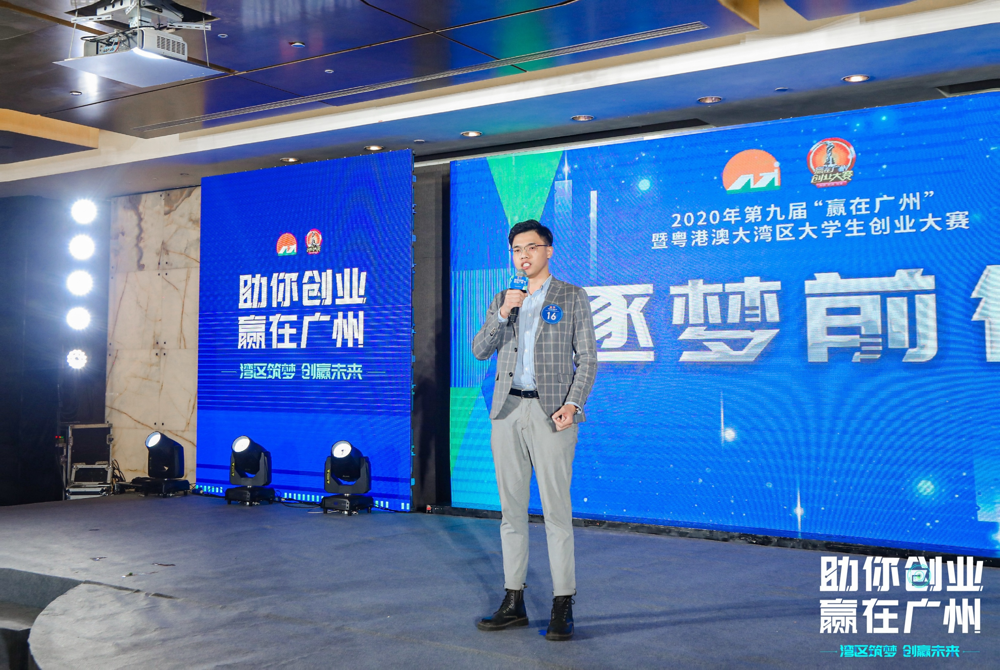
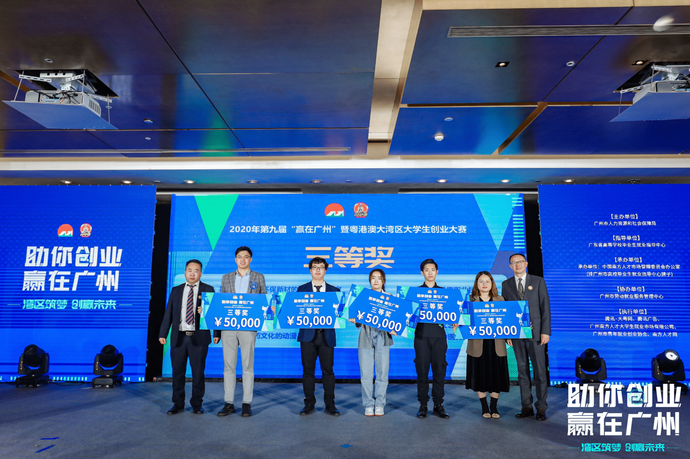
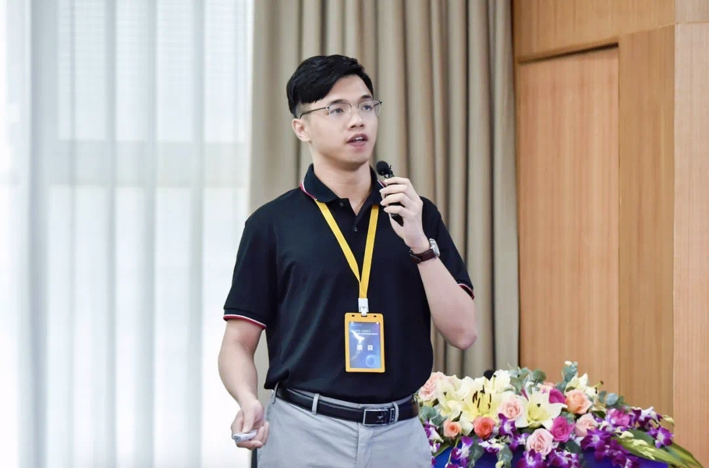
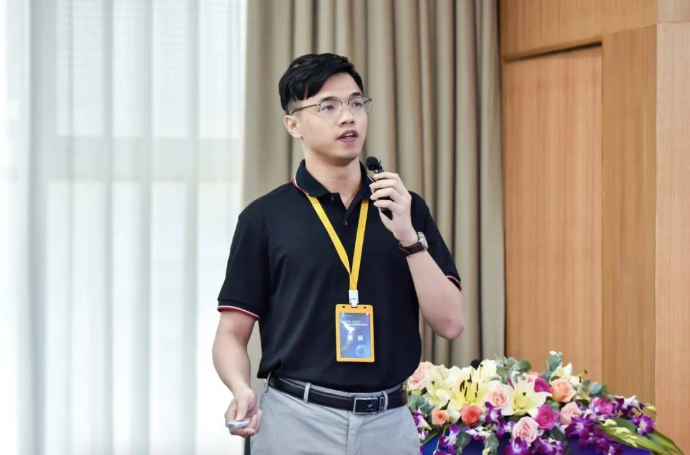

<h4>Funded Research Projects</h4>

<h5 class="funding-subheading">Currently Participated Projects</h5>
<ul class="funding-list">
  <li>Domain-Specific Foundation Models for Safe and Intelligent TransportationFunding source: Wisconsin Alumni Research Foundation (WARF) · Award total: $56,315 · Period: 07/01/2026–06/30/2027 · Role: Research Contributor</li>
  <li>Safe and Trustworthy Human-Centered Mobility: Leveraging Foundation Models and Digital Twins for Vulnerable Road User–Vehicle InteractionsFunding source: USDOT through CCAT with OVCR match funding · Award total: $170,000 · Period: 01/01/2026–12/31/2026 · Role: Research Contributor</li>
  <li>Towards Safe and Efficient Autonomous Driving: A Synergistic Approach with Human Expertise and Multimodal Large Language ModelsFunding source: USDOT through CCAT with OVCR match funding · Award total: $170,000 · Period: 01/01/2026–12/31/2026 · Role: Research Contributor</li>
  <li>Using Connected Intelligent Transportation to Enhance Vulnerable Road User Safety: Phase II Real-World Testing and DeploymentFunding source: USDOT through CCAT with OVCR match funding · Award total: $250,000 · Period: 01/01/2025–12/31/2026 · Role: Research Contributor</li>
  <li>Tribal &amp; Rural Autonomous Vehicles for Efficiency, Livability and Safety (TRAVELS)Funding source: U.S. Department of Transportation (USDOT) · Award total: $30,000,000 · Period: 03/01/2026–02/28/2032 · Role: Research Contributor</li>
</ul>

<h5 class="funding-subheading">Previously Participated Projects</h5>
<ul class="funding-list">
  <li>SafetyGPT: Domain-Specific Multi-Modal LLM for Transport Safety and ManagementFunding source: NVIDIA · Award total: $40,000 in computing resources and unrestricted gift support · Period: 04/01/2025–09/30/2026 · Role: Research Contributor</li>
  <li>EdgeTwin: An Edge AI-Enabled Digital Twin Framework for Intelligent Traffic Infrastructure Management and SafetyFunding source: NVIDIA · Award total: $19,998 in hardware and unrestricted gift support · Period: 07/01/2025–06/30/2026 · Role: Research Contributor</li>
  <li>Promoting CAV Deployment by Enhancing the Perception Phase of Autonomous Driving Using Explainable AIFunding source: U.S. Department of Transportation through CCAT · Award total: $120,000 · Period: 04/01/2022–03/31/2023 · Role: Research Contributor</li>
  <li>Leveraging Control Theory to Facilitate UAV Application for CAV DeploymentFunding source: U.S. Department of Transportation through CCAT · Award total: $100,000 · Period: 04/01/2022–03/31/2023 · Role: Research Contributor</li>
</ul>

<h4>Entrepreneurship &amp; Technology Transfer</h4>

<!-- 

  Growing up in Shenzhen, China, I witnessed the city's remarkable transformation from a small fishing village into a global technology hub - what many call the "Shenzhen speed." This environment planted the seeds of entrepreneurial spirit in me from an early age. During high school, I ventured into selling phone cards, coordinating food delivery services for school, setting up market stalls, selling courses, and organizing the campus laundry market. These experiences laid the foundation for my understanding of business models. 

 -->
  

  
Prior to my Ph.D. studies, I co-founded two technology companies in China. Through this experience, I worked with industry professionals on practical applications of research and gained experience in technology development and commercialization. The companies also engaged in discussions concerning more than <b>3 million RMB</b> in potential investment with institutions including <b>Yueke Securities</b> and <b>CITIC Securities</b>.

<!-- Entrepreneurship images -->

  

    
    

      Qinglan Project (2021)
    

  

  

    
    

      Qinglan Project (2021)
    

  

  

    
    

      Winning Guangdong Competition (2020)
    

  

  

    
    

      Winning Guangdong Competition (2020)
    

  

  

    
    

      Winning Guangdong Competition (2020)
    

  

  

    
    

      Chuangke Guangdong Competition (2020)
    

  

  

    
    

      Chuangke Guangdong Competition (2020)
    

  

<h4>Patents &amp; Intellectual Property</h4>

<h5>Granted Patents</h5>
<ul class="artistic-list">
<li>A RSSI-based method for positioning low-speed moving vehicles. <a href="../assets/patents/patent_CN109375168A.pdf" target="_blank">PDF</a> 
Yongjie Lin, <strong>Zilin Huang</strong>, and Lunhui Xu. <em>Invention Patent, CN109375168A</em>.</li>

<li>A RSSI-based method for positioning low-speed moving vehicles. <a href="../assets/patents/patent_CN201811368103.8.pdf" target="_blank">PDF</a> 
Yongjie Lin, <strong>Zilin Huang</strong>, Sheng Zhao, Lunhui Xu, and Shanyu Tang. <em>Invention Patent, CN201811368103.8</em>.</li>

<li>Urban traffic operation evaluation method based on ecological index. <a href="../assets/patents/patent_CN201911419439.7.pdf" target="_blank">PDF</a> 
Yongjie Lin, Weijia Zeng, Yanqing Yang, Yuming Cheng, Yuheng Liu, Haixia Guan, and <strong>Zilin Huang</strong>. <em>Invention Patent, CN201911419439.7</em>.</li>

<li>A device for counting the number of passengers getting on and off in a portable bus. <a href="../assets/patents/patent_CN201920581476.7.pdf" target="_blank">PDF</a> 
<strong>Zilin Huang</strong>, Yongjie Lin, and Lunhui Xu. <em>Utility Model Patent, CN201920581476.7</em>.</li>

<li>RSSI-based road traffic jam detection and dispersion device. <a href="../assets/patents/patent_CN202021751310.4.pdf" target="_blank">PDF</a> 
<strong>Zilin Huang</strong>, Yuzhuang Pian, Yongjie Lin, Pan Wu, and Yuqing Zhan. <em>Utility Model Patent, CN202021751310.4</em>.</li>

<li>Vehicle-mounted positioning device based on RSSI and inertial navigation. <a href="../assets/patents/patent_CN201920574767.3.pdf" target="_blank">PDF</a> 
Yongjie Lin, <strong>Zilin Huang</strong>. <em>Utility Model Patent, CN201920574767.3</em>.</li>

<li>Micro device for positioning moving target based on RSSI. <a href="../assets/patents/patent_CN201920574719.4.pdf" target="_blank">PDF</a> 
Yongjie Lin, <strong>Zilin Huang</strong>. <em>Utility Model Patent, CN201920574719.4</em>.</li>

<li>An obstacle avoidance system for unmanned vehicles based on machine vision and infrared sensors. <a href="../assets/patents/patent_CN202020235979.1.pdf" target="_blank">PDF</a> 
Yongjie Lin, <strong>Zilin Huang</strong>, and Lunhui Xu. <em>Utility Model Patent, CN202020235979.1</em>.</li>

<li>Visual navigation system for assisting unmanned vehicles. <a href="../assets/patents/patent_CN202020235977.2.pdf" target="_blank">PDF</a> 
Yongjie Lin, <strong>Zilin Huang</strong>, and Lunhui Xu. <em>Utility Model Patent, CN202020235977.2</em>.</li>

<li>A target intrusion detection device based on wireless communication signal. <a href="../assets/patents/patent_CN202020965272.6.pdf" target="_blank">PDF</a> 
Yongjie Lin, <strong>Zilin Huang</strong>, and Lunhui Xu. <em>Utility Model Patent, CN202020965272.6</em>.</li>

<li>A RSSI-based positioning and early warning device for two-passenger and one-dangerous vehicles. <a href="../assets/patents/patent_CN202021751321.2.pdf" target="_blank">PDF</a> 
Yuzhuang Pian, <strong>Zilin Huang</strong>, Yongjie Lin, Yuqing Zhan, and Pan Wu. <em>Utility Model Patent, CN202021751321.2</em>.</li>

<li>A kind of elevator apparatus of wheel. <a href="../assets/patents/patent_CN201620682753.X.pdf" target="_blank">PDF</a> 
Chao He, Zhanqin Yu, Zequan Hong, Chengzhao Zhang, Ziping Chen, and <strong>Zilin Huang</strong>. <em>Utility Model Patent, CN201620682753.X</em>.</li>

<li>Tunnel vehicle accident detection and early warning device based on RSSI. <a href="../assets/patents/patent_CN202120982224.2.pdf" target="_blank">PDF</a> 
Binrao, Zhihong Ye, Yongjie Lin, Haochuan Zhong, Yuqing Zhan, Jiajun Wu, Yuzhuang Pian, and <strong>Zilin Huang</strong>. <em>Invention Patent, CN202120982224.2</em>.</li>
</ul>

<h5>Patent Applications Under Examination</h5>
<ul class="artistic-list">
<li>Subway transfer bus behavior identification method, system, computer equipment and storage medium. <a href="../assets/patents/patent_CN201910051795.1.pdf" target="_blank">PDF</a> 
<strong>Zilin Huang</strong>, and Lunhui Xu. <em>Invention Patent, CN201910051795.1</em>.</li>

<li>The recognition methods of Metro Passenger time getting off, system, computer equipment and storage medium. <a href="../assets/patents/patent_CN201910051785.8.pdf" target="_blank">PDF</a> 
<strong>Zilin Huang</strong>, and Lunhui Xu. <em>Invention Patent, CN201910051785.8</em>.</li>

<li>A kind of hot spot junction of park and shift recognition methods based on IC card data. <a href="../assets/patents/patent_CN201910339482.6.pdf" target="_blank">PDF</a> 
<strong>Zilin Huang</strong>, and Lunhui Xu. <em>Invention Patent, CN201910339482.6</em>.</li>

<li>A kind of subway station passenger flow monitoring method and system. <a href="../assets/patents/patent_CN201910338991.7.pdf" target="_blank">PDF</a> 
<strong>Zilin Huang</strong>, Yongjie Lin, and Lunhui Xu. <em>Invention Patent, CN201910338991.7</em>.</li>

<li>A kind of traffic trip mode identification method based on wireless signal. <a href="../assets/patents/patent_CN201910581470.4.pdf" target="_blank">PDF</a> 
Yongjie Lin, <strong>Zilin Huang</strong>. <em>Invention Patent, CN201910581470.4</em>.</li>
</ul>

<h5>Software Copyrights</h5>
<ul class="artistic-list">
<li>The Simulation System of Rapid Customization Design Platform for Hollow Glass Automatic Production Line V1.0 
Kuanyuan Li, <strong>Zilin Huang</strong>, Luofang, and Chuang Zhou. <em>Computer Software Copyright, 2017SR099863; Legal Status: Authorization</em>.</li>

<li>Intelligent Workshop Rapid Customization Design Platform System V1.0 
Xiaoping Li, Luo Fang, <strong>Zilin Huang</strong>, and Chuang Zhou. <em>Computer Software Copyright, 2017SR302066; Legal Status: Authorization</em>.</li>

<li>Student Organization Activity Approval System V1.0 
Junxing Zhang, Ruixuan Cai, Huanzeng Yang, <strong>Zilin Huang</strong>, Poyu Zhuang, Guangzheng Zhong, and Jiahao Jiang. <em>Computer Software Copyright, 2017SR099823; Legal Status: Authorization</em>.</li>

<li>Club Activities Background Management System V1.0 
Junxing Zhang, Huanzeng Yang, Poyu Zhuang, <strong>Zilin Huang</strong>, Guangzheng Zhong, and Jiahao Jiang. <em>Computer Software Copyright, 2017SR302060; Legal Status: Authorization</em>.</li>
</ul>

