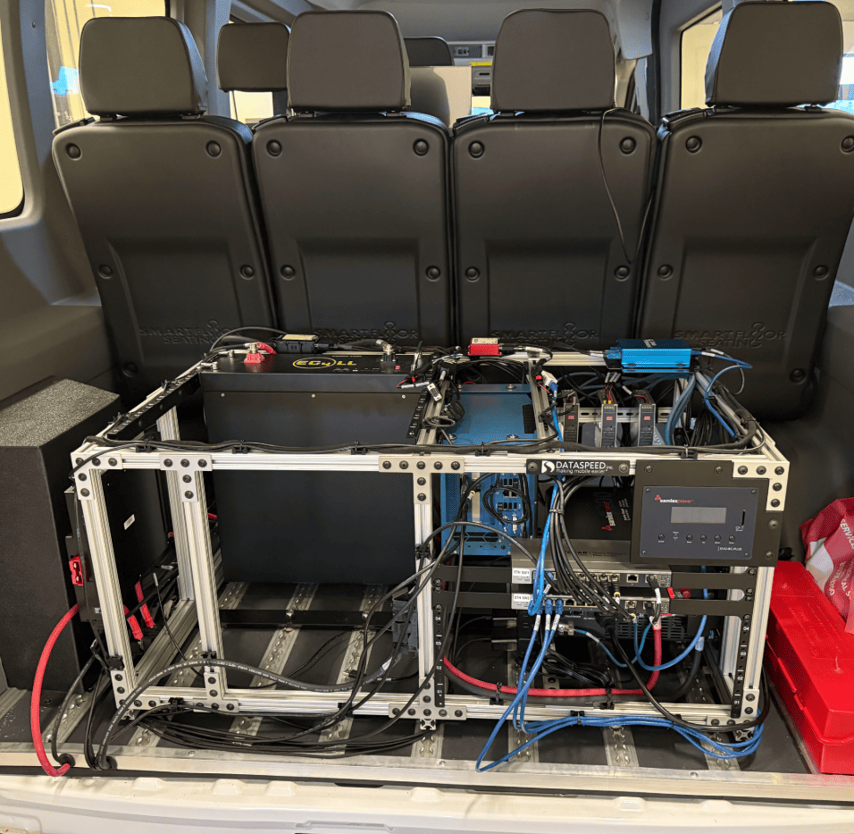
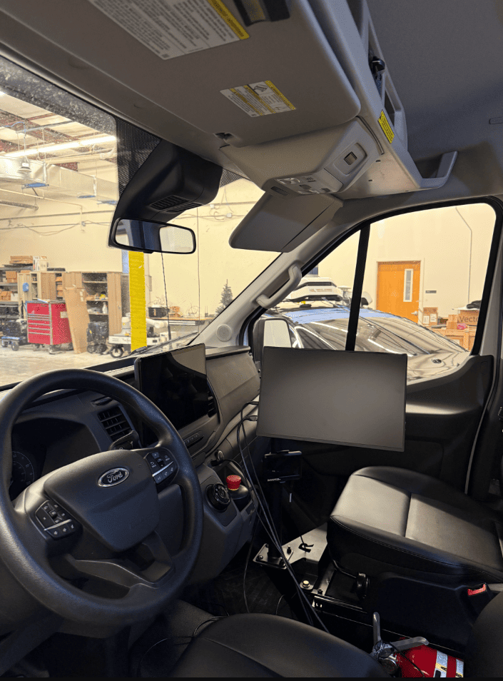
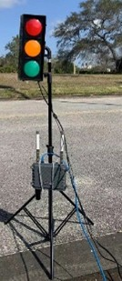
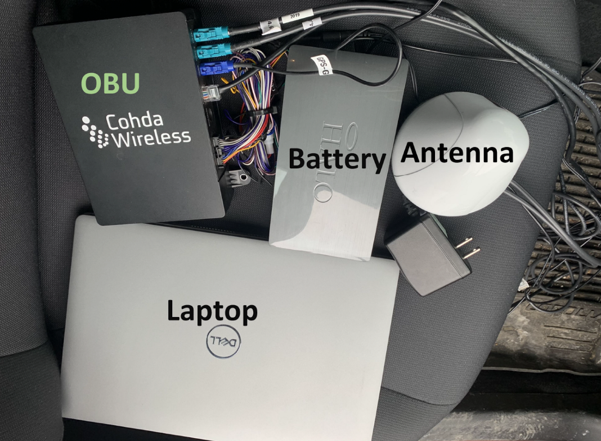
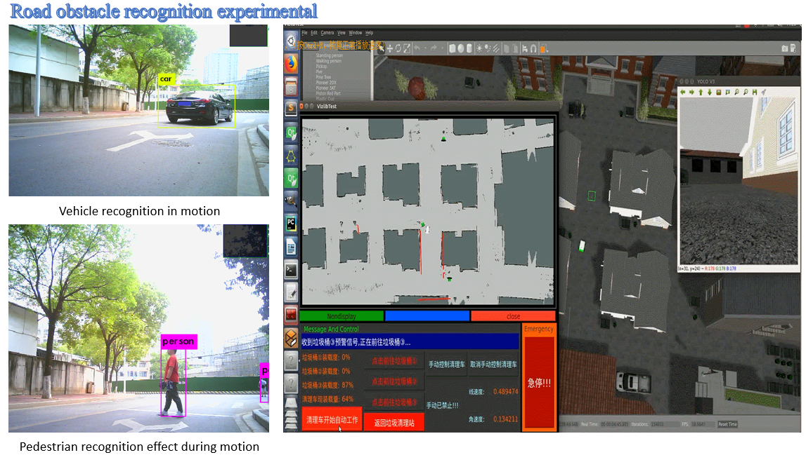
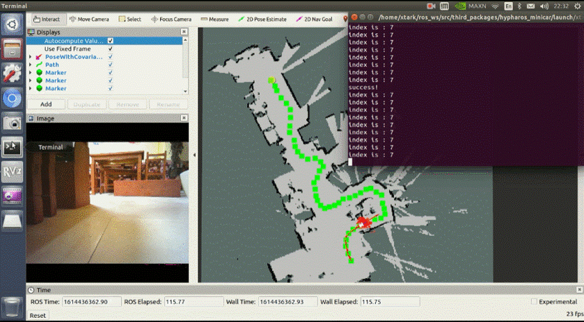

  
<u>H</u>uman-c<u>e</u>ntered <u>a</u>nd Trustwo<u>r</u>thy Au<u>t</u>onomous Systems (HEART)

<h4>Research Vision</h4>

  

  My research interests lie at the intersection of <strong>Physical AI</strong> and <strong>human-centered transportation systems</strong>. I envision future mobility as a <strong>human–robot–society ecosystem</strong>, where humans coexist, interact, and collaborate with diverse autonomous agents, including self-driving vehicles, delivery robots, drones, and other embodied systems. To thrive in such environments, these agents must understand complex physical and social contexts, reason about their actions, adapt to human preferences and social norms, and operate safely and reliably under open-world uncertainty.

  My long-term goal is to develop <strong>Human-centered and Trustworthy Autonomous Systems (HEART)</strong> that can safely learn, interact, and collaborate with people in the physical world.

<h4>Research Themes</h4>

  <h5>1. Human-Aware Intelligence and Decision-Making</h5>
  
How can autonomous agents understand complex physical and social environments and make safe, reliable, and human-aware decisions?

  
I integrate human-guided reinforcement learning, physics-informed feedback, and foundation-model-based semantic reasoning to improve safe decision-making.

  

    Featured Work
    

      <a href="https://zilin-huang.github.io/HAIM-DRL-website/" target="_blank">HAIM-DRL</a>
      <a href="https://www.huang-zilin.com/PE-RLHF-website/" target="_blank">PE-RLHF</a>
      <a href="https://www.huang-zilin.com/VLM-RL-website/" target="_blank">VLM-RL</a>
      <a href="https://arxiv.org/abs/2603.18315" target="_blank">DriveVLM-RL</a>
      <a href="https://arxiv.org/abs/2602.10458" target="_blank">Found-RL</a>
    

  

  <h5>2. Generalization, Adaptation, and Real-World Deployment</h5>
  
How can capabilities learned in simulation or encoded in foundation models generalize, adapt, and transfer to real physical systems?

  
I investigate deployment gaps, model selection, data-efficient adaptation, and evaluation across environments, embodiments, sensing configurations, and physical platforms.

  

    Featured Work
    

      <a href="https://arxiv.org/abs/2604.03497" target="_blank">Sim2Real-AD</a>
      TRIAGE
      DOSE
      ExecGap
      MadisonTwin
    

  

  <h5>3. Safe Continuous Improvement and Evaluation</h5>
  
How can autonomous agents safely and continuously improve through physical interaction, failure discovery, and real-world feedback?

  
I explore closed-loop testing, independent evaluation designed to resist reward hacking, and verifiable policy improvement under limited real-world testing budgets.

  

    Featured Work
    <h6 class="featured-work-title">Sky-Drive Simulation Platform</h6>
  

  

    Existing simulators often optimize traffic flow or validate a single vehicle, but lack distributed, multi-agent support. To address this gap, my colleagues and I at Sky-Lab developed Sky-Drive—a long-term effort with many contributors; I have been involved since Summer 2023. Sky-Drive integrates Unreal Engine/CARLA, ROS, WebSocket, and custom scenario pipelines to run synchronized simulations across multiple terminals. Unlike single-vehicle or flow-only tools, Sky-Drive emphasizes synchronized interactions among pedestrians, human-driven vehicles (HVs), and autonomous vehicles (AVs), and supports multi-participant intervention and co-study for human-AI collaborative driving research.
  

  

    

      <video width="100%" controls>
        <source src="../assets/research/mutli-agent interaction/sky-drive-2.mp4" type="video/mp4">
        Your browser does not support the video tag.
      </video>
      

        Sky-Drive overview.
      

    

    

      <video width="100%" controls>
        <source src="../assets/research/mutli-agent interaction/sky-drive-1.mp4" type="video/mp4">
        Your browser does not support the video tag.
      </video>
      

        My colleagues and I at Sky-Lab are conducting the multi-agent VR experiment.
      

    

  

  

    

      <video width="100%" controls>
        <source src="../assets/research/mutli-agent interaction/Right_Turn_Conflict -480p.mp4" type="video/mp4">
        Your browser does not support the video tag.
      </video>
      
Safety-Critical Scenario: Right Turn Conflict.

    

    

      <video width="100%" controls>
        <source src="../assets/research/mutli-agent interaction/Nearside_Conflict_Straight_road-480p.mp4" type="video/mp4">
        Your browser does not support the video tag.
      </video>
      
Safety-Critical Scenario: Nearside Conflict.

    

    

      <video width="100%" controls>
        <source src="../assets/research/mutli-agent interaction/Left_Turn_Conflict - 480p.mp4" type="video/mp4">
        Your browser does not support the video tag.
      </video>
      
Safety-Critical Scenario: Left Turn Conflict.

    

    

      <video width="100%" controls>
        <source src="../assets/research/mutli-agent interaction/Farside_Conflict_Straight_road - 480p.mp4" type="video/mp4">
        Your browser does not support the video tag.
      </video>
      
Safety-Critical Scenario: Farside Conflict.

    

  

<h4>Research Platforms</h4>

  <h5>Autonomous Vehicle Testbed</h5>
  

    While simulation is safe and scalable, the sim-to-real gap remains a core challenge. At Sky-Lab, we maintain a real-world testbed that I actively use with my colleagues to validate human-centered AI algorithms. Our primary platform is a retrofit electric Ford E-Transit with a full autonomy stack: drive-by-wire, a multi-modal sensor suite (3 LiDARs, 7 cameras, radar), 5G connectivity (NETGEAR Nighthawk M6 Pro), and on-board GPU computing (RTX A6000). We also deploy portable RSUs/OBUs (e.g., Siemens RSUs, Cohda MK6C) and configurable traffic signals to create intersection and corridor scenarios. Combined with Sky-Lab’s Lambda servers (RTX Pro 6000, A6000, 4090, 4080), this cyber-physical setup lets me run end-to-end evaluations, collect edge cases, and iterate quickly on model design and safety checks in real traffic conditions.
  

  

    

      
      

        Autonomous Van with Sensor Suite
      

    

    

      
      

        Driver Cockpit and Control Interface
      

    

    

      
      

        Computing Hardware
      

    

    

      
      

        Portable Traffic Light
      

    

    

      
      

        Testbed
      

    

    

      
      

        Sensor Configuration
      

    

    

      
      

        V2X Experiment Equipment
      

    

    

      
      

        5G mmWave Mobile Hotspot
      

    

  

  

    <h5>End-to-End Autonomous Driving</h5>
    

      To evaluate designed end-to-end (E2E) driving policies in the real world, my colleagues and I at Sky-Lab deploy them on our lab-developed autonomous van for systematic testing and iterative refinement. Real-time streams from the multimodal perception suite (LiDAR, cameras, radar) feed the E2E policy, which outputs steering, throttle, and brake commands at ~20 Hz for closed-loop control. Through testing on public roads and our campus testbed, we continuously log performance and edge cases to inform model improvements.
    

    

      

        <video width="100%" controls>
          <source src="../assets/research/E2E/end-to-end-2.mp4" type="video/mp4">
          Your browser does not support the video tag.
        </video>
        

          End-to-end autonomous driving in urban and rural environments (McKee Road, Madison).
        

      

      

        <video width="100%" controls>
          <source src="../assets/research/E2E/end-to-end-1.mp4" type="video/mp4">
          Your browser does not support the video tag.
        </video>
        

          Live demo at the 2025 AAA Safe Mobility Conference, Madison, WI.
        

      

    

  

  <h5>Remote Operation and Cloud Deployment</h5>
  

    Deploying large VLMs and complex AI stacks directly on vehicle hardware is often compute-limited. To overcome this, my colleagues and I at Sky-Lab built a remote operations (teleoperation) and remote-inference platform for our autonomous van. Using 5G connectivity, we can remotely operate the vehicle for driving and data collection from locations such as a conference room or off-site lab. The platform also supports remote AI deployment: real-time sensor streams are sent from the van to a local workstation or cloud (e.g., AWS), where models process the data and return control commands to the vehicle for execution.
  

  

    

      <video width="100%" controls>
        <source src="../assets/research/remote control/remote control - 4speed - 480p.mp4" type="video/mp4">
        Your browser does not support the video tag.
      </video>
      

        My colleagues and I testing remote driving function with Logitech G920 Racing Wheel and Pedals. Full video on <a href="https://www.youtube.com/embed/Lj6kqDByaEI?si=c1Jzdf6PukLNb1c4" target="_blank">YouTube</a>.
      

    

    

      <video width="100%" controls>
        <source src="../assets/research/remote control/sky-remote-driving-1min.mp4" type="video/mp4">
        Your browser does not support the video tag.
      </video>
      

        Prof. Chen remote driving from the office. 
      

    

  

<h4>Earlier Research Foundations</h4>

  My earlier research established foundations in wireless sensing, transportation data mining, vehicle localization and control, and digital-twin optimization. These projects continue to inform my current work on human-centered and trustworthy autonomous systems.

  

    <h5>Autonomous Driving, Localization, and Mobility Recognition</h5>
    
2018–2021

    <ul>
      <li><strong>Autonomous Vehicle Path Tracking and Visual Localization</strong>: I evaluated model predictive control and conventional pure-pursuit tracking through practical vehicle experiments. I also explored DBow3-based visual place recognition to support camera-assisted localization.</li>
      <li><strong>RSSI-Based Location Awareness and Travel-Mode Recognition</strong>: My Master’s thesis developed fingerprint- and ranging-based methods for accurate, fast, and robust localization across different spatial scales. It also introduced a travel-mode classification method using single-point wireless sensing data.</li>
      <li><strong>Robust Outdoor Pedestrian Positioning with WiFi RSSI</strong>: I developed a multi-stage outdoor positioning framework that combines probabilistic RSSI modeling, filtering, and location estimation. The framework was designed to remain robust under substantial real-time RSSI fluctuations.</li>
      <li><strong>GPS-Denied Vehicle Localization in Tunnels</strong>: I combined semi-supervised extreme learning with locally linear embedding to learn from both labeled and unlabeled RSSI samples. The resulting method estimates vehicle positions in GPS-denied tunnel and parking environments.</li>
    </ul>
    

      <figure class="earlier-media-card">
        

          
        

        <figcaption>Early autonomous-driving road-obstacle recognition experiment.</figcaption>
      </figure>
      <figure class="earlier-media-card">
        

          
        

        <figcaption>Path tracking and trajectory control demonstration.</figcaption>
      </figure>
      <figure class="earlier-media-card">
        

          <iframe src="https://www.youtube-nocookie.com/embed/srNsl74nGyU" title="Intelligent vehicle-infrastructure cooperative system demonstration" loading="lazy" allow="accelerometer; autoplay; clipboard-write; encrypted-media; gyroscope; picture-in-picture; web-share" allowfullscreen></iframe>
        

        <figcaption>Location awareness and travel-mode classification demonstration.</figcaption>
      </figure>
      <figure class="earlier-media-card">
        

          <iframe src="https://www.youtube-nocookie.com/embed/4dkykpWYjqo?start=58" title="RSSI vehicle positioning in tunnels and parking facilities demonstration" loading="lazy" allow="accelerometer; autoplay; clipboard-write; encrypted-media; gyroscope; picture-in-picture; web-share" allowfullscreen></iframe>
        

        <figcaption>RSSI vehicle positioning in tunnels and parking facilities.</figcaption>
      </figure>
    

    

      
Related Publications:

      <ul class="related-publications-list">
        <li><a href="../publications/#huang2019wifi">A Novel WiFi-Oriented RSSI Signal Processing Method for Tracking Low-Speed Pedestrians</a> (ICTIS, 2019)</li>
        <li><a href="../publications/#huang2020wifi">Multi-Stage Pedestrian Positioning Using Filtered WiFi Scanner Data in an Urban Road Environment</a> (Sensors, 2020)</li>
        <li><a href="../publications/#lin2021rssi">RSSI Positioning Method of Vehicles in Tunnels Based on Semi-Supervised Extreme Learning Machine</a> (Journal of Traffic and Transportation Engineering, 2021)</li>
      </ul>
    

  

  

    <h5>Transportation Data Mining and Prediction</h5>
    
2019–2021

    <ul>
      <li><strong>Citywide Metro-to-Bus Transfer Analytics</strong>: I fused smart-card and GPS data to infer missing bus boarding stops and identify actual metro-to-bus interchange trips. Station-specific transfer-time thresholds were then used to evaluate connectivity and locate poorly connected transfer hubs.</li>
      <li><strong>Short-Term Traffic Speed Prediction with Attention-Based LSTM</strong>: I developed an integrated framework that combines missing-data preprocessing with attention-based traffic-speed prediction. Bayesian inference and dynamic time warping improve the raw data before the LSTM model captures temporal traffic patterns.</li>
      <li><strong>WiCL: Portable WiFi-Based Traffic Monitoring and Travel-Mode Recognition</strong>: I helped develop a low-cost, portable system that uses only WiFi scanner data for traffic monitoring and non-motorized travel-mode recognition. Signal filtering, feature extraction, and an LSTM classifier were combined to distinguish pedestrians from cyclists.</li>
    </ul>
    

      <figure class="earlier-media-card">
        

          <iframe src="https://www.youtube-nocookie.com/embed/gcR_oDDVYe4" title="Traffic data mining software demonstration" loading="lazy" allow="accelerometer; autoplay; clipboard-write; encrypted-media; gyroscope; picture-in-picture; web-share" allowfullscreen></iframe>
        

        <figcaption>DataFind traffic data-mining software demonstration.</figcaption>
      </figure>
    

    

      
Related Publications:

      <ul class="related-publications-list">
        <li><a href="../publications/#huang2019metrobus">Citywide Metro-to-Bus Transfer Behavior Identification Based on Combined Data from Smart Cards and GPS</a> (Applied Sciences, 2019)</li>
        <li><a href="../publications/#wu2022metrobus">Recognizing Real-Time Transfer Patterns Between Metro and Bus Systems Based on Spatial–Temporal Constraints</a> (ASCE-JTE, 2022)</li>
        <li><a href="../publications/#wu2020lstm">A Combined Deep Learning Method with Attention-Based LSTM Model for Short-Term Traffic Speed Forecasting</a> (Journal of Advanced Transportation, 2020)</li>
        <li><a href="../publications/#xu2023wicl">Wi-CL: Low-Cost WiFi-Based Detection System for Nonmotorized Traffic Travel Mode Classification</a> (Journal of Advanced Transportation, 2023)</li>
      </ul>
    

  

  

    <h5>Digital Twin and Multi-Objective Optimization</h5>
    
2016–2017

    <ul>
      <li><strong>Digital-Twin Production-Line Design and Optimization</strong>: I combined physics-based system modeling with distributed real-time production data to support production-line design before deployment. An analytical decoupling framework provided engineering-analysis and multi-objective decision-support capabilities.</li>
    </ul>
    

      <figure class="earlier-media-card">
        

          <iframe src="https://www.youtube-nocookie.com/embed/UTap5pSXgrg" title="Digital twin-based hollow glass production line demonstration" loading="lazy" allow="accelerometer; autoplay; clipboard-write; encrypted-media; gyroscope; picture-in-picture; web-share" allowfullscreen></iframe>
        

        <figcaption>Digital twin-based hollow glass production-line demonstration.</figcaption>
      </figure>
    

  

<h4>Future Directions</h4>

  Looking ahead, I plan to develop embodied foundation models that can generalize across environments, embodiments, sensing configurations, and hardware while remaining grounded in physical constraints and human expectations. This direction will connect foundation-model reasoning with data-efficient adaptation and rigorous evaluation on real physical platforms.

  I also aim to build autonomous systems that can learn from physical interaction, failure discovery, and real-world feedback without weakening safety. By combining closed-loop simulation, real-world testing, and independent verification, I hope to make continuous improvement both practical and trustworthy.

