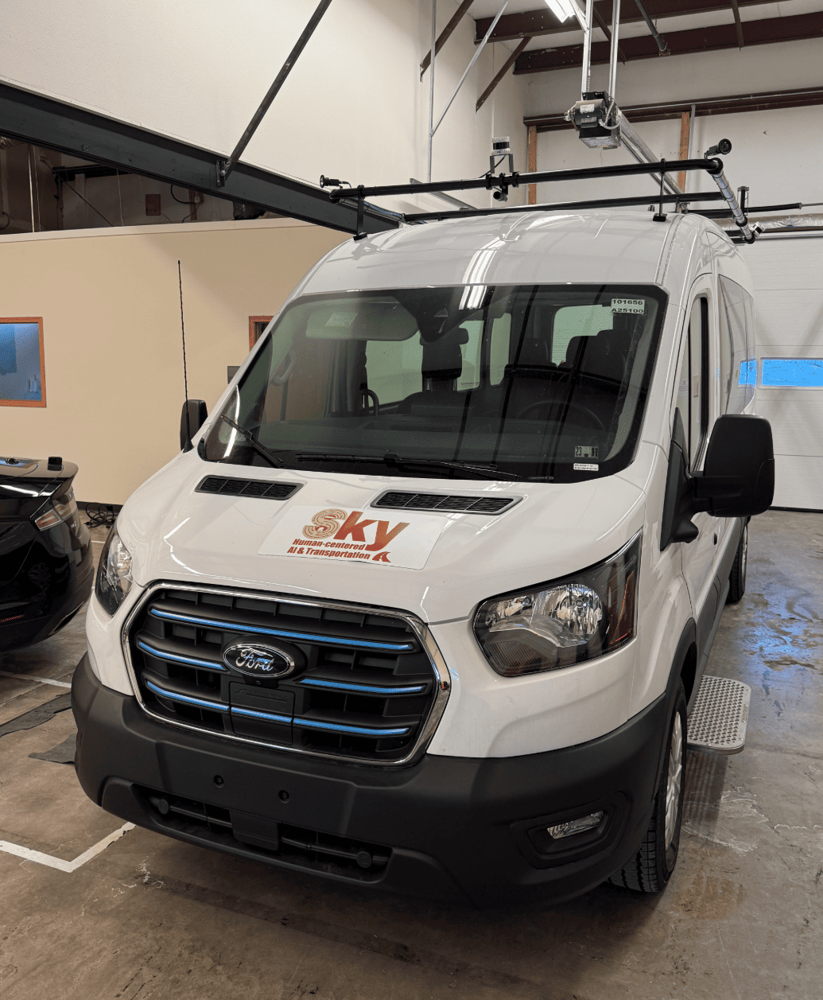
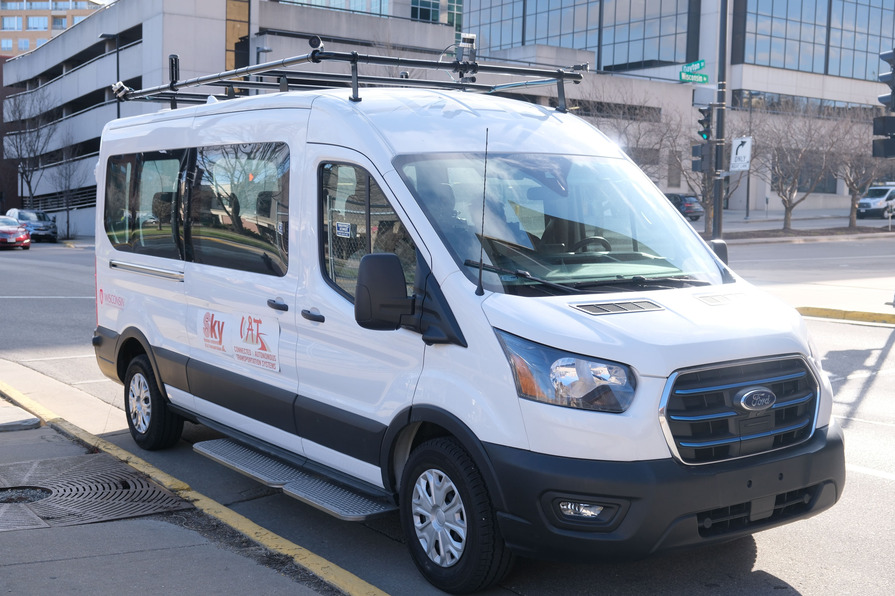
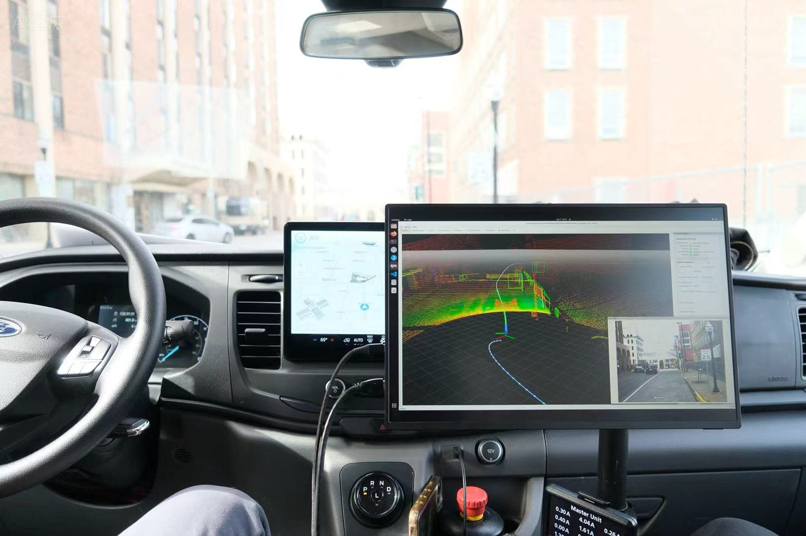
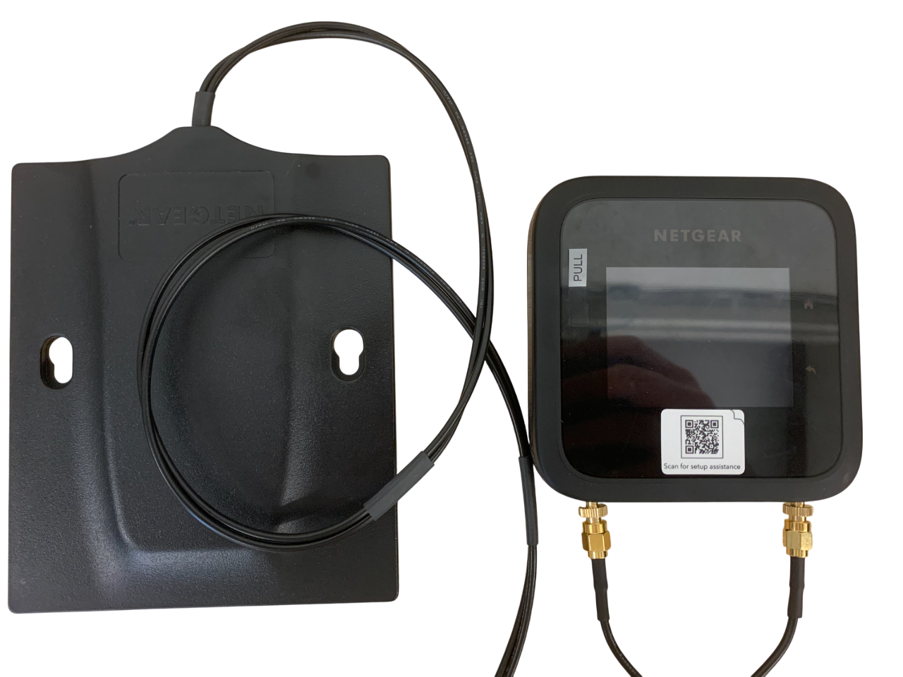

  
<u>H</u>uman-c<u>e</u>ntered <u>a</u>nd Trustwo<u>r</u>thy Au<u>t</u>onomous Systems (HEART)

<h4>Research Vision</h4>

  My research interests lie at the intersection of <strong>Physical AI</strong> and <strong>human-centered transportation systems</strong>. I envision future mobility as a <strong>human–robot–society ecosystem</strong>, where humans coexist, interact, and collaborate with diverse autonomous agents, including self-driving vehicles, delivery robots, drones, and other embodied systems. To thrive in such environments, these agents must understand complex physical and social contexts, reason about their actions, adapt to human preferences and social norms, and operate safely and reliably under open-world uncertainty.

  My long-term goal is to develop <strong>Human-centered and Trustworthy Autonomous Systems (HEART)</strong> that can safely learn, interact, and collaborate with people in the physical world.

  

<h4>Research Theme 1: Human-Aware Intelligence and Decision-Making</h4>

  
How can autonomous agents understand complex physical and social environments and make safe, reliable, and human-aware decisions?

  
I integrate human-guided reinforcement learning, physics-informed feedback, and foundation-model-based semantic reasoning to provide meaningful supervision for safer and more intelligent autonomous behavior.

  

    <a href="https://zilin-huang.github.io/HAIM-DRL-website/" target="_blank">HAIM-DRL</a>
    <a href="https://www.huang-zilin.com/PE-RLHF-website/" target="_blank">PE-RLHF</a>
    <a href="https://www.huang-zilin.com/VLM-RL-website/" target="_blank">VLM-RL</a>
    <a href="https://arxiv.org/abs/2602.10458" target="_blank">Found-RL</a>
  

<h4>Research Theme 2: Generalization, Adaptation, and Real-World Deployment</h4>

  
How can capabilities learned in simulation or encoded in foundation models generalize, adapt, and transfer to real physical systems?

  
I investigate deployment gaps, model selection, data-efficient adaptation, and evaluation across environments, embodiments, sensing configurations, and physical platforms.

  

    <a href="https://arxiv.org/abs/2604.03497" target="_blank">Sim2Real-AD</a>
    <a href="https://arxiv.org/abs/2603.18315" target="_blank">DriveVLM-RL</a>
    TRIAGE
    DOSE
    ExecGap
  

<h4>Research Theme 3: Safe Continuous Improvement and Evaluation</h4>

  
How can autonomous agents safely and continuously improve through physical interaction, failure discovery, and real-world feedback?

  
I explore closed-loop testing, independent evaluation designed to resist reward hacking, and verifiable policy improvement under limited real-world testing budgets.

  

    <a href="https://arxiv.org/abs/2504.18010" target="_blank">Sky-Drive</a>
    Sealed-Loop
    RoadCert
  

<h4>Research Platforms</h4>

  <h5>Sky-Drive Simulation Platform</h5>
  

    Existing simulators often optimize traffic flow or validate a single vehicle, but lack distributed, multi-agent support. To address this gap, my colleagues and I at Sky-Lab developed Sky-Drive—a long-term effort with many contributors; I have been involved since Summer 2023. Sky-Drive integrates Unreal Engine/CARLA, ROS, WebSocket, and custom scenario pipelines to run synchronized simulations across multiple terminals. Unlike single-vehicle or flow-only tools, Sky-Drive emphasizes synchronized interactions among pedestrians, human-driven vehicles (HVs), and autonomous vehicles (AVs), and supports multi-participant intervention and co-study for human-AI collaborative driving research.
  

  

    

      <video width="100%" controls>
        <source src="../assets/research/mutli-agent interaction/sky-drive-2.mp4" type="video/mp4">
        Your browser does not support the video tag.
      </video>
      

        Sky-Drive overview.
      

    

    

      <video width="100%" controls>
        <source src="../assets/research/mutli-agent interaction/sky-drive-1.mp4" type="video/mp4">
        Your browser does not support the video tag.
      </video>
      

        My colleagues and I at Sky-Lab are conducting the multi-agent VR experiment.
      

    

  

  

    

      <video width="100%" controls>
        <source src="../assets/research/mutli-agent interaction/Right_Turn_Conflict -480p.mp4" type="video/mp4">
        Your browser does not support the video tag.
      </video>
      

        Safety-Critical Scenario: Right Turn Conflict.
      

    

    

      <video width="100%" controls>
        <source src="../assets/research/mutli-agent interaction/Nearside_Conflict_Straight_road-480p.mp4" type="video/mp4">
        Your browser does not support the video tag.
      </video>
      

        Safety-Critical Scenario: Nearside Conflict.
      

    

    

      <video width="100%" controls>
        <source src="../assets/research/mutli-agent interaction/Left_Turn_Conflict - 480p.mp4" type="video/mp4">
        Your browser does not support the video tag.
      </video>
      

        Safety-Critical Scenario: Left Turn Conflict.
      

    

    

      <video width="100%" controls>
        <source src="../assets/research/mutli-agent interaction/Farside_Conflict_Straight_road - 480p.mp4" type="video/mp4">
        Your browser does not support the video tag.
      </video>
      

        Safety-Critical Scenario: Farside Conflict.
      

    

  

  <h5>Autonomous Vehicle Testbed</h5>
  

     While simulation is safe and scalable, the sim-to-real gap remains a core challenge. At Sky-Lab, we maintain a real-world testbed that I actively use with my colleagues to validate human-centered AI algorithms. Our primary platform is a retrofit electric Ford E-Transit with a full autonomy stack: drive-by-wire, a multi-modal sensor suite (3 LiDARs, 7 cameras, radar), 5G connectivity (NETGEAR Nighthawk M6 Pro), and on-board GPU computing (RTX A6000). We also deploy portable RSUs/OBUs (e.g., Siemens RSUs, Cohda MK6C) and configurable traffic signals to create intersection and corridor scenarios. Combined with Sky-Lab’s Lambda servers (RTX Pro 6000, A6000, 4090, 4080), this cyber-physical setup lets me run end-to-end evaluations, collect edge cases, and iterate quickly on model design and safety checks in real traffic conditions.
  

  

    

      
      

        Autonomous Van with Sensor Suite
      

    

    

      
      

        Driver Cockpit and Control Interface
      

    

    

      
      

        Computing Hardware
      

    

    

      
      

        Portable Traffic Light
      

    

    

      
      

        Testbed
      

    

    

      
      

        Sensor Configuration
      

    

    

      
      

        V2X Experiment Equipment
      

    

    

      
      

        5G mmWave Mobile Hotspot
      

    

  

  

  <h6>End-to-End Autonomous Driving</h6>
  

    To evaluate designed end-to-end (E2E) driving policies in the real world, my colleagues and I at Sky-Lab deploy them on our lab-developed autonomous van for systematic testing and iterative refinement. Real-time streams from the multimodal perception suite (LiDAR, cameras, radar) feed the E2E policy, which outputs steering, throttle, and brake commands at ~20 Hz for closed-loop control. Through testing on public roads and our campus testbed, we continuously log performance and edge cases to inform model improvements.
  

  

    

      <video width="100%" controls>
        <source src="../assets/research/E2E/end-to-end-2.mp4" type="video/mp4">
        Your browser does not support the video tag.
      </video>
      

        End-to-end autonomous driving in urban and rural environments (McKee Road, Madison).
      

    

    

      <video width="100%" controls>
        <source src="../assets/research/E2E/end-to-end-1.mp4" type="video/mp4">
        Your browser does not support the video tag.
      </video>
      

        Live demo at 2025 AAA Safe Mobility Conference, Madison, WI.
      

    

  

  

  <h5>Remote Operation and Cloud Deployment</h5>
  

    Deploying large VLMs and complex AI stacks directly on vehicle hardware is often compute-limited. To overcome this, my colleagues and I at Sky-Lab built a remote operations (teleoperation) and remote-inference platform for our autonomous van. Using 5G connectivity, we can remotely operate the vehicle for driving and data collection from locations such as a conference room or off-site lab. The platform also supports remote AI deployment: real-time sensor streams are sent from the van to a local workstation or cloud (e.g., AWS), where models process the data and return control commands to the vehicle for execution.
  

  

    

      <video width="100%" controls>
        <source src="../assets/research/remote control/remote control - 4speed - 480p.mp4" type="video/mp4">
        Your browser does not support the video tag.
      </video>
      

        My colleagues and I testing remote driving function with Logitech G920 Racing Wheel and Pedals. Full video on <a href="https://www.youtube.com/embed/Lj6kqDByaEI?si=c1Jzdf6PukLNb1c4" target="_blank">YouTube</a>.
      

    

    

      <video width="100%" controls>
        <source src="../assets/research/remote control/sky-remote-driving-1min.mp4" type="video/mp4">
        Your browser does not support the video tag.
      </video>
      

        Prof. Chen remote driving from the office. 
      

    

  

<h4>Future Directions</h4>

  Looking ahead, I plan to develop embodied foundation models that can generalize across environments, embodiments, sensing configurations, and hardware while remaining grounded in physical constraints and human expectations. This direction will connect foundation-model reasoning with data-efficient adaptation and rigorous evaluation on real physical platforms.

  I also aim to build autonomous systems that can learn from physical interaction, failure discovery, and real-world feedback without weakening safety. By combining closed-loop simulation, real-world testing, and independent verification, I hope to make continuous improvement both practical and trustworthy.

