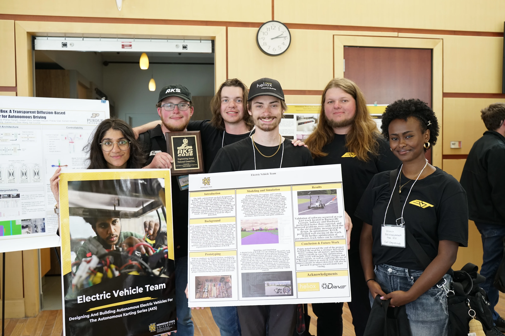
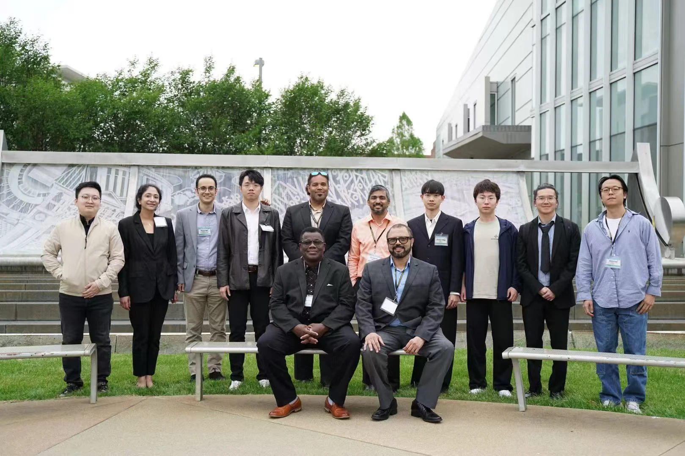
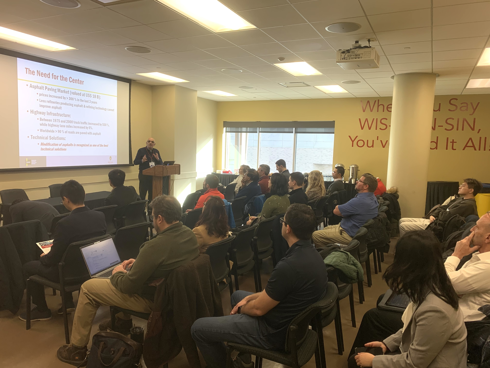
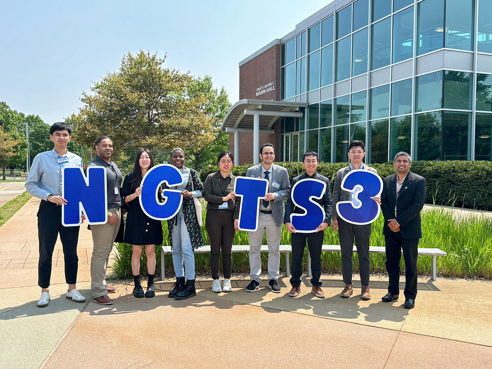
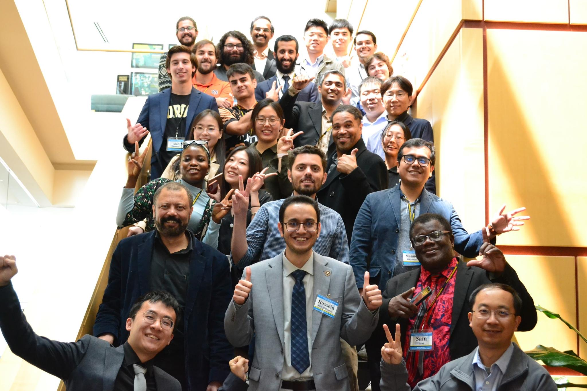

<h4 style="text-align: left;">Editorial &amp; Peer-Review Service</h4>

  <h5 style="text-align: left;">Journal Review</h5>
  <ul class="services-list academic-services reviewer-list">
    <li>Nature Communications</li>
    <li>IEEE Transactions on Intelligent Transportation Systems (TITS)</li>
    <li>IEEE Transactions on Vehicular Technology (TVT)</li>
    <li>Accident Analysis and Prevention (AAP)</li>
    <li>IEEE Transactions on Circuits and Systems for Video Technology (TCSVT)</li>
    <li>IEEE Transactions on Cognitive and Developmental Systems (TCDS)</li>
    <li>IEEE Transactions on Intelligent Vehicles (TIV)</li>
    <li>Transportation Research Part C: Emerging Technologies (Part C)</li>
    <li>Computer-Aided Civil and Infrastructure Engineering (CACAIE)</li>
    <li>IEEE Transactions on Image Processing (TIP)</li>
    <li>IEEE Robotics and Automation Letters (RA-L)</li>
    <li>Expert Systems With Applications</li>
    <li>Applied Soft Computing Journal (ASOC)</li>
    <li>IEEE Intelligent Transportation Systems Magazine (ITSM)</li>
    <li>Journal of Advanced Transportation (JAT) <a href="{{ '/assets/services/2024_ATR_Reviewer_Certificate.pdf' | relative_url }}" target="_blank">[Certificate]</a></li>
    <li>Neural Computing and Applications (NCAA)</li>
    <li>Sensors</li>
    <li>IEEE Access</li>
    <li>Applied Intelligence</li>
    <li>Scientific Reports</li>
  </ul>

  <h5 style="text-align: left;">Conference Review</h5>
  <ul class="services-list academic-services">
    <li>Transportation Research Board Annual Meeting (TRB)</li>
    <li>IEEE Intelligent Vehicles Symposium (IV)</li>
    <li>IEEE Intelligent Transportation Systems Conference (ITSC)</li>
  </ul>

<h4 style="text-align: left;">Conference Service</h4>

  <h5 style="text-align: left;">Organization &amp; Session Leadership</h5>
  <ul class="services-list community-services" style="margin-bottom: 5px;">
    <li class="conference-item">Workshop Organizer, 3rd Workshop on Multi-Agent Embodied Intelligent Systems Meet Generative-AI Era: Opportunities, Challenges and Futures (MEIS @ CVPR 2026), Denver, CO, US, Jun 4 2026 <a href="https://coop-intelligence.github.io/" target="_blank" rel="noopener noreferrer">[Website]</a></li>
    <li class="conference-item">Committee Chair, 5th Annual Conference on Next-Generation Transport Systems (NGTS 2026), West Lafayette, IN, US, May 22 2026 <a href="https://nextranspurdue.wixsite.com/ngts5/copy-of-organizing-committee" target="_blank" rel="noopener noreferrer">[Website]</a></li>
  </ul>
  

    

      
      

        Student team at NGTS 2026
      

    

    

      
      

        NGTS 2026 organizing committee
      

    

  

  <ul class="services-list community-services" style="margin-bottom: 5px;">
    <li class="conference-item">Workshop Organizer, Modified Asphalt Research Center (MARC) Future Research Focus Workshop, Madison, WI, US, Feb 21 2024 <a href="{{ '/assets/services/MARC/2024_MARC_1.jpg' | relative_url }}" target="_blank">[Flyer]</a></li>
  </ul>
  

    

      
      

        MARC Workshop
      

    

    

      
      

        MARC Workshop
      

    

  

  <ul class="services-list community-services" style="margin-top: 0; margin-bottom: 5px;">
    <li class="conference-item">Session Chair, 3rd Annual Conference on Next-Generation Transport Systems (NGTS-3), West Lafayette, IN, US, May 16-18 2023 <a href="{{ '/assets/services/NGTS/2023_NGTS_Flyer.pdf' | relative_url }}" target="_blank">[Flyer]</a></li>
  </ul>
  

    

      
      

        NGTS-3 Conference
      

    

    

      
      

        NGTS-3 Conference
      

    

  

<h4 style="text-align: left;">Professional Memberships</h4>

  <ul class="services-list academic-services">
    <li>IEEE Student Member</li>
    <li>ASCE Student Member</li>
    <li>COTA Student Member</li>
  </ul>

<h4 style="text-align: left;">Leadership &amp; Outreach</h4>

  <h5 style="text-align: left;">Student Leadership</h5>
  <ul class="services-list community-services">
    <li>Member, Graduate Student Union (Oct 2018–Oct 2019)</li>
    <li>Member, Student Leader Advocacy Team of Guangdong Province (Oct 2017–Oct 2018)</li>
    <li>Deputy Secretary, Student Government (Dec 2016–May 2018) Assisted with community-service activities and academic competitions.</li>
    <li>Member, Student Union of Guangdong Province (Apr 2016–May 2018)</li>
    <li>Tutor Assistant, School of Mechanical and Electrical Engineering (Sep 2015–Sep 2016)</li>
    <li>Freshman Class Assistant, School of Mechanical and Electrical Engineering (Sep 2015–Sep 2016)</li>
    <li>Class Leader, School of Mechanical and Electrical Engineering (Sep 2014–Sep 2015)</li>
  </ul>

  <h5 style="text-align: left;">Outreach &amp; Volunteering</h5>
  <ul class="services-list community-services">
    <li>Invited Guest Speaker, Youth Science Camp for Chinese Universities (Jul 2018)</li>
    <li>Founder, Transformation Program (Apr 2018)</li>
    <li>Outstanding Community Worker, Summer Rural Social Practice Program, Guangdong Province (Sep 2017)</li>
    <li>Volunteer, Guangzhou Export Commodities Fair (Nov 2016)</li>
    <li>Outstanding Community Worker, Summer Rural Social Practice Program, China (Sep 2016)</li>
  </ul>

