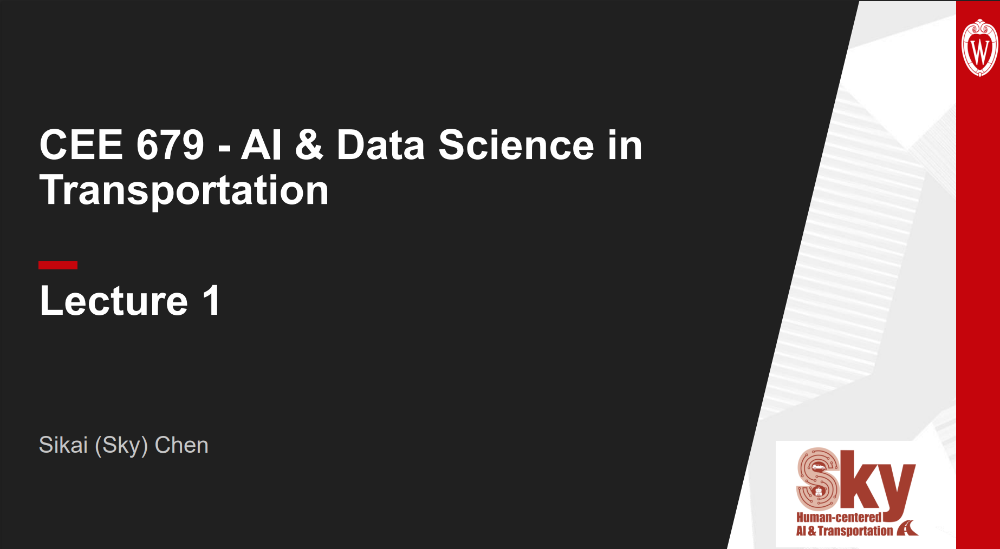
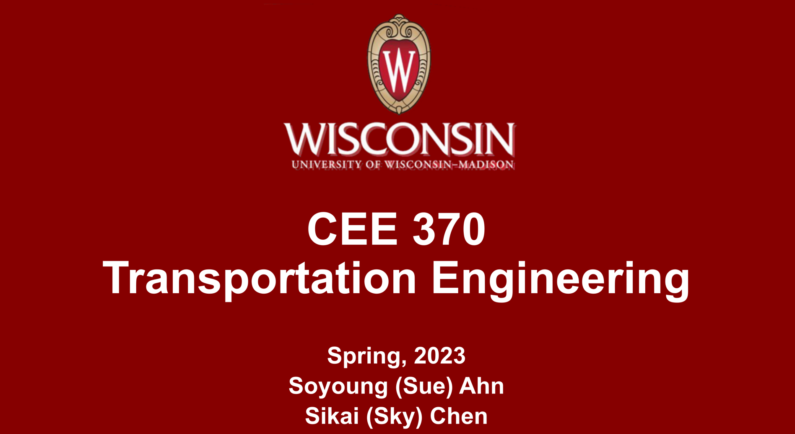
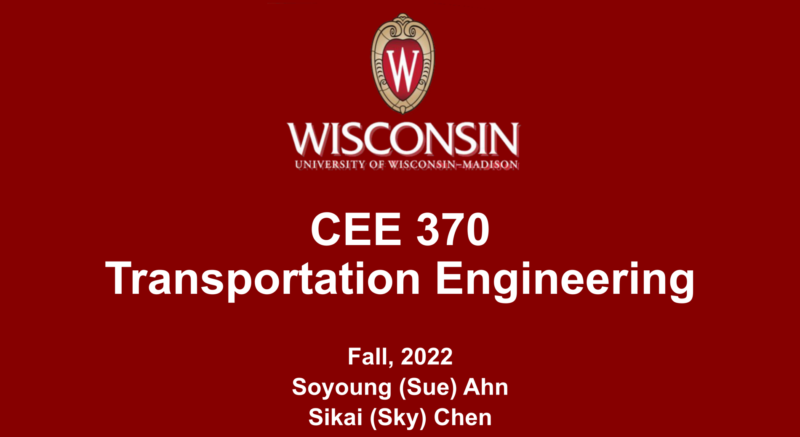

<h4 style="text-align: left;">Teaching</h4>

  
  
  

    

      CEE 679 AI & Data Science in Transportation
      
Fall 2024(Teaching Assistant)

      Instructor: Sikai (Sky) Chen
      Department of Civil and Environmental Engineering
      University of Wisconsin-Madison
    

  

  
  
  

    

      CEE 679 AI & Data Science in Transportation
      
Fall 2023(Teaching Assistant)

      Instructor: Sikai (Sky) Chen
      Department of Civil and Environmental Engineering
      University of Wisconsin-Madison
    

  

  
  
  

    

      CEE 370 Transportation Engineering
      
Spring 2023(Grader)

      Instructor: Soyoung (Sue) Ahn, Sikai (Sky) Chen
      Department of Civil and Environmental Engineering
      University of Wisconsin-Madison
    

  

  
  
  

    

      CEE 370 Transportation Engineering
      
Fall 2022(Grader)

      Instructor: Soyoung (Sue) Ahn, Sikai (Sky) Chen
      Department of Civil and Environmental Engineering
      University of Wisconsin-Madison
    

  

<h4 style="text-align: left;">Mentoring</h4>
